# 第一卷 配置、流程与工具
## 第一章 基础配置
## 第二章 算子组沟通地图
### 2.1 蓝区电脑配置
#### 2.1.1 如何申请蓝区服务器
#### 2.1.2 如何使用Xshell/VScode连接npu服务器
#### 2.1.3 如何建立容器及工作注意事项
### 2.2 API申请与使用

### 2.3 权限申请清单
### 2.4 新员工培养目标
## 第三章 工作流程

### 3.1 问题单处理流程
### 3.2 开发上线流程
## 第四章 常用算子测试与调优工具


# 第二卷 算子基础知识
## 第一章 大模型基础

### 1.1 神经网络


> **学习目标**
> - 说出单个神经元的组成部件及各自职责
> - 手写前向计算公式，并解释激活函数的作用
> - 用链式法则推导单个神经元的梯度，完成一次梯度下降更新
> - 通过交互实验直观感受"学习率"与"误差信号"的作用

#### 1.1.1 引言：神经网络的最小积木

神经网络听起来高深，但它的最小积木——**单个神经元**——本质上就是一个"带旋钮的打分器"：把几个输入按重要程度加权求和，再经过一个"压缩函数"输出一个结果。训练的过程就是不断拧旋钮（调参数），让输出更接近目标。

本节按"结构 → 前向数学 → 反向数学 → 数值实例 → 交互实验"的顺序，把这一个最小积木彻底讲透。后续章节的全连接网络、乃至 Transformer，都是在此基础上堆叠与扩展出来的。

#### 1.1.2 神经元的结构与组成部件

单个神经元内部的数据从左往右流动，经过三道工序：**① 加权 → ② 求和加偏置 → ③ 激活**。

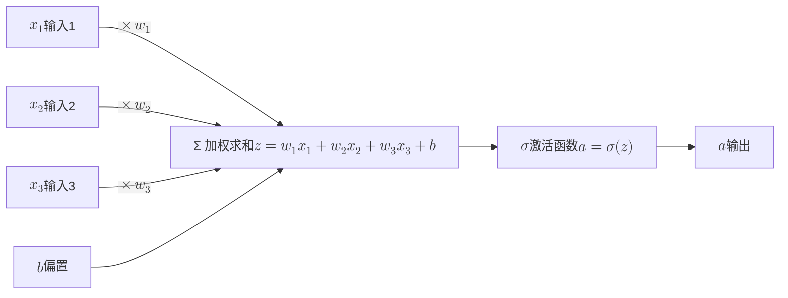

*图1.1.2-1 单个神经元的结构（Mermaid 静态图）*

各部件的职责如下：

| 部件 | 符号 | 是什么 | 类比 |
|---|---|---|---|
| 输入 | $x_1, x_2, \dots$ | 外部喂进来的数据（特征） | 评委看到的各项指标 |
| 权重 | $w_1, w_2, \dots$ | 每个输入的"重要程度"，**可学习** | 每项指标的打分权重 |
| 偏置 | $b$ | 一个整体平移量，**可学习** | 评委的"基础印象分" |
| 加权求和 | $z$ | 把所有输入按权重混合成一个数 | 算出总分 |
| 激活函数 | $\sigma$ | 对 $z$ 做非线性变换 | 把总分压成"录取概率" |
| 输出 | $a$ | 神经元最终对外的信号 | 最终判定 |

*表1.1.2-1 神经元的组成部件*

**关键点：神经元里真正"学出来"的东西只有 $w$ 和 $b$**，其余都是固定的计算规则。所谓"训练一个神经网络"，本质上就是在海量数据上反复调整这些 $w$ 和 $b$。

#### 1.1.3 前向计算（Forward）的数学机理

前向就是"给定输入和参数，算出输出"，共两步。

**(1) 线性加权求和**

$$
z = \sum_{i=1}^{n} w_i x_i + b
$$

这是一个线性运算：每个输入乘以自己的权重，全部加起来，再加偏置。 $b$ 的作用是：即使所有输入都是 0，神经元也能有一个非零的"基准输出"，相当于直线的截距。

**(2) 激活函数（以 sigmoid 为例）**

$$
a = \sigma(z) = \frac{1}{1 + e^{-z}}
$$

**为什么需要这一步？** 如果只有线性求和，那么无论叠多少层神经元，整体仍然等价于一个线性函数，无法表达"曲线关系"。激活函数引入**非线性**，是神经网络能拟合复杂规律的根本原因。

sigmoid 把任意实数压缩到 $(0, 1)$ 区间，常被解释为"概率/激活强度"：

- $z$ 很大（正）→ $a$ 接近 1（强烈激活）
- $z$ 很小（负）→ $a$ 接近 0（几乎沉默）
- $z = 0$ → $a$ 恰好 0.5

完整的 S 形曲线见附件（自包含 HTML，双击即可离线打开）：

[图1.1.3-1 Sigmoid 激活函数曲线](resources/chapter1/chapter1.1.3-sigmoid_activation_curve.html)

注意曲线两端几乎水平——这叫**饱和区**： $z$ 太大或太小时，输出对输入变化几乎不敏感，梯度接近 0，学习会变得极慢。这是 sigmoid 的著名缺点，1.1.4 节会看到它的数学体现。

sigmoid 还有一个对反向传播极其友好的性质——**它的导数可以用输出自身表示**：

$$
\sigma'(z) = \sigma(z)\bigl(1 - \sigma(z)\bigr) = a(1 - a)
$$

前向时已经算出了 $a$，反向时直接复用，无需重新计算指数，这是它当年被广泛采用的重要原因。

#### 1.1.4 反向计算（Backward / 反向传播）的数学机理

前向是"用参数算输出"，反向是"根据输出的错误，算出每个参数该怎么改"。分四小步。

**(1) 定义损失函数——量化"错得有多离谱"**

设真实目标为 $y$，用平方误差（乘 $\frac{1}{2}$ 只是为了求导后系数干净）：

$$
L = \frac{1}{2}(a - y)^2
$$

$L$ 越大错得越多。训练的唯一目标：**调整 $w$ 和 $b$，让 $L$ 变小**。

**(2) 链式法则——把"错误的责任"层层摊派**

我们想知道 $\frac{\partial L}{\partial w_1}$（ $w_1$ 动一点点， $L$ 会动多少）。但 $L$ 不直接依赖 $w_1$，依赖链条是 $w_1 \to z \to a \to L$，所以用链式法则把三段导数乘起来：

$$
\frac{\partial L}{\partial w_1} = \frac{\partial L}{\partial a} \cdot \frac{\partial a}{\partial z} \cdot \frac{\partial z}{\partial w_1}
$$

三段导数各自都非常简单：

$$
\begin{aligned}
\frac{\partial L}{\partial a} &= a - y && \text{（损失对输出的敏感度）} \cr
\frac{\partial a}{\partial z} &= a(1 - a) && \text{（sigmoid 的导数，恰好能用输出 } a \text{ 表示）} \cr
\frac{\partial z}{\partial w_1} &= x_1 && \text{（} z \text{ 对 } w_1 \text{ 的导数就是对应输入）}
\end{aligned}
$$

把前两段合并，记作 **$\delta$（误差信号）**，它是反向传播的核心中间量：

$$
\delta = \frac{\partial L}{\partial z} = (a - y)\, a(1 - a)
$$

于是每个参数的梯度一步到位：

$$
\frac{\partial L}{\partial w_i} = \delta \, x_i, \qquad \frac{\partial L}{\partial b} = \delta
$$

**直觉解读**：梯度 = 误差信号 × 当初的输入。哪个输入当初贡献大（ $x_i$ 大），它对应的权重就要为错误承担更多责任。而 $a(1-a)$ 这一项解释了饱和区问题： $a$ 接近 0 或 1 时它趋近 0， $\delta$ 被"掐灭"，参数几乎不更新。

**(3) 梯度下降——沿"下坡方向"拧旋钮**

梯度指向 $L$ 上升最快的方向，所以我们朝反方向走一小步：

$$
w_i \leftarrow w_i - \eta \, \frac{\partial L}{\partial w_i}, \qquad b \leftarrow b - \eta \, \frac{\partial L}{\partial b}
$$

$\eta$ 是**学习率**，控制步长：太大会震荡甚至发散，太小则进步缓慢。

**(4) 重复，形成训练闭环**

更新后再前向、再反向……成千上万次迭代后， $L$ 逐渐降到很低，参数就"学会"了任务。

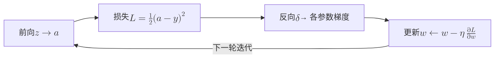

*图1.1.4-1 单神经元的训练闭环（Mermaid 静态图）*

#### 1.1.5 完整数值实例（手算一遍）

取一个 2 输入神经元，初始参数和目标如下：

$$
\begin{aligned}
&\text{输入：} x_1 = 1,\ x_2 = 2 \qquad \text{目标：} y = 1 \cr
&\text{参数：} w_1 = 0.5,\ w_2 = -0.3,\ b = 0.1 \qquad \text{学习率：} \eta = 0.5
\end{aligned}
$$

**（1）前向：**

$$
z = 0.5 \times 1 + (-0.3) \times 2 + 0.1 = 0.5 - 0.6 + 0.1 = 0
$$

$$
a = \sigma(0) = \frac{1}{1 + e^{0}} = 0.5
$$

**（2）损失：**

$$
L = \frac{1}{2}(0.5 - 1)^2 = \frac{1}{2} \times 0.25 = 0.125
$$

目标是 1，输出只有 0.5，错得不少。开始反向摊派责任。

**（3）反向：**

$$
\begin{aligned}
\frac{\partial L}{\partial a} &= a - y = 0.5 - 1 = -0.5 \cr
\frac{\partial a}{\partial z} &= a(1 - a) = 0.5 \times 0.5 = 0.25 \cr
\delta &= (-0.5) \times 0.25 = -0.125
\end{aligned}
$$

$$
\begin{aligned}
\frac{\partial L}{\partial w_1} &= \delta \, x_1 = -0.125 \times 1 = -0.125 \cr
\frac{\partial L}{\partial w_2} &= \delta \, x_2 = -0.125 \times 2 = -0.25 \cr
\frac{\partial L}{\partial b} &= \delta = -0.125
\end{aligned}
$$

其中 $x_2$ 更大，所以 $w_2$ 担责更多。

**（4）梯度下降更新（ $\eta = 0.5$）：**

$$
\begin{aligned}
w_1 &\leftarrow 0.5 - 0.5 \times (-0.125) = 0.5625 \cr
w_2 &\leftarrow -0.3 - 0.5 \times (-0.25) = -0.175 \cr
b &\leftarrow 0.1 - 0.5 \times (-0.125) = 0.1625
\end{aligned}
$$

**（5）验证：用新参数再前向一次**

$$
z = 0.5625 \times 1 + (-0.175) \times 2 + 0.1625 = 0.375
$$

$$
a = \sigma(0.375) \approx 0.5927
$$

$$
L = \frac{1}{2}(0.5927 - 1)^2 \approx 0.0829
$$

损失从 **0.125 降到 0.0829**——仅一步，输出就从 0.5 向目标 1 靠近了。这就是"学习"发生的最小完整闭环。

#### 1.1.6 交互实验

下面的实验台演示 1.1.3～1.1.5 节的整套流程。改动输入、目标或学习率，所有中间量会实时重算。点击「梯度下降更新一步」可以观察参数和损失的变化。

[单神经元一步训练实验台](resources/chapter1/chapter1.1.6-single_neuron_training_demo.html)

建议动手做三个小实验：

1. **连续更新**：保持默认参数，连点 10 次"更新一步"，观察 $L$ 如何一步步逼近 0，输出 $a$ 如何逼近目标 1。
2. **学习率过大**：把 $\eta$ 调到 2 再连续更新，观察损失是否震荡、不降反升——体会"步长太大越过谷底"。
3. **目标反转**：把目标 $y$ 改成 0，观察梯度符号如何反转、参数朝相反方向更新——体会"误差信号决定方向"。

#### 1.1.7 小结

把整个闭环压缩成一张清单：

1. **结构**：输入 $x$ → 权重 $w$ 加权 → 加偏置 $b$ → 求和得 $z$ → 激活函数 $\sigma$ → 输出 $a$。可学习的只有 $w$ 和 $b$。
2. **前向**： $z = \sum_i w_i x_i + b$， $a = \sigma(z)$——用参数算预测。
3. **损失**： $L = \frac{1}{2}(a-y)^2$——量化预测与目标的差距。
4. **反向**：链式法则求 $\delta = (a-y)\,a(1-a)$，再得 $\frac{\partial L}{\partial w_i} = \delta \, x_i$、 $\frac{\partial L}{\partial b} = \delta$——把错误责任摊派到每个参数。
5. **更新**： $w \leftarrow w - \eta \cdot \text{梯度}$——朝损失下降方向走一小步，循环往复。

多个神经元并排成"层"、层与层再串起来，反向传播的链式法则就继续往更深的层传递——这正是"深度"网络的学习原理，而本节已经掌握了它的最小单元。1.2 节将把多个神经元组织成**全连接神经网络**，看矩阵如何一次性描述整层的计算，以及误差信号如何逐层回传。

### 1.2 从神经元到多层全连接神经网络


#### 1.2.1 组合规则：分层与全连接

单个神经元只能做一件简单的"打分"。把多个神经元**并排成一层**、再把层与层**串起来**，就得到了网络：

- **输入层**：接收原始特征 $x$，本身不做计算，记 $a^{(0)} = x$；
- **隐藏层**：中间的神经元层，可以有多层，每层提取更抽象的组合特征；
- **输出层**：给出最终预测 $a^{(L)}$。

**全连接（Fully Connected / Dense）** 的含义：相邻两层的神经元**两两相连**，每条连线都有一个独立的权重。上一层每个神经元的输出，都会送给下一层每个神经元当输入。

下面是一个 2-2-1 网络（2 输入、2 隐藏神经元、1 输出）：

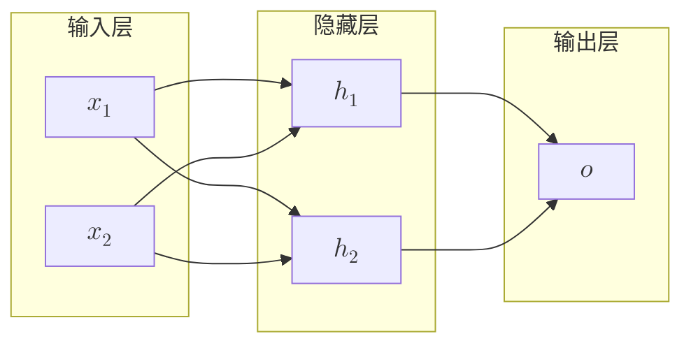

*图1.2.1-1 2-2-1 全连接网络（每条连线对应一个独立权重）*

隐藏层的每个神经元，内部仍然是 1.1.2 节那套"加权求和 + 激活"，只是它的输入换成了上一层的输出。

#### 1.2.2 参数账：网络一共有多少个旋钮

每个神经元有自己的权重向量和偏置。对 2-2-1 网络逐层清点：

| 层 | 权重矩阵形状 | 权重数 | 偏置数 | 小计 |
|---|---|---|---|---|
| 隐藏层（2 神经元） | $W^{(1)}$: $2 \times 2$ | 4 | 2 | 6 |
| 输出层（1 神经元） | $W^{(2)}$: $1 \times 2$ | 2 | 1 | 3 |
| 合计 | — | 6 | 3 | **9** |

*表1.2.5-1 2-2-1 网络的参数清单*

一般地，第 $l$ 层（ $n_l$ 个神经元，接收 $n_{l-1}$ 个输入）的参数量为：

$$
n_l \times n_{l-1} + n_l
$$

"训练网络"就是同时调整所有这些参数。现代大模型有数十亿个这样的旋钮，但每个旋钮的更新规则和本章完全一样。

#### 1.2.3 矩阵形式：一次算完一整层

每个神经元的加权求和是一个点积；把一层所有神经元的点积**打包**，就是一次矩阵乘法：

$$
z^{(l)} = W^{(l)} a^{(l-1)} + b^{(l)}, \qquad a^{(l)} = \sigma\bigl(z^{(l)}\bigr)
$$

其中 $W^{(l)} \in \mathbb{R}^{n_l \times n_{l-1}}$，**第 $i$ 行恰好是第 $i$ 个神经元的权重**； $\sigma$ 对向量逐元素作用。把第一层展开写，就能看清"矩阵 = 一排神经元"：

$$
\begin{bmatrix} z^{(1)}_1 \cr z^{(1)}_2 \end{bmatrix} =
\begin{bmatrix} w^{(1)}_{11} & w^{(1)}_{12} \cr w^{(1)}_{21} & w^{(1)}_{22} \end{bmatrix}
\begin{bmatrix} x_1 \cr x_2 \end{bmatrix} +
\begin{bmatrix} b^{(1)}_1 \cr b^{(1)}_2 \end{bmatrix}
$$

**为什么矩阵形式重要？** 不是数学上更高级，而是工程上更高效：矩阵乘法可以在 GPU/NPU 上大规模并行，一次算完一层成百上千个神经元。这正是深度学习框架把 **MatMul（矩阵乘）算子**作为核心算子的原因——本课程后续的算子开发与调优，很大程度上就是在优化这一步。

#### 1.2.4 多层反向传播：误差信号逐层回传

输出层的 $\delta$ 和单神经元一模一样。关键问题是：**隐藏层没有直接的目标 $y$，它的误差从哪来？** 答案：从后一层**按权重分摊回来**。

对 2-2-1 网络（输出层记为第 2 层）：

$$
\delta^{(2)} = (a^{(2)} - y)\, a^{(2)}(1 - a^{(2)})
$$

$$
\delta^{(1)} = \bigl(W^{(2)\top} \delta^{(2)}\bigr) \odot a^{(1)}(1 - a^{(1)})
$$

$\odot$ 表示逐元素相乘。直觉解读分两步：

1. $W^{(2)\top} \delta^{(2)}$：输出端的误差信号，沿着连线**按权重原路分摊**回每个隐藏神经元——当初谁的输出权重绝对值大，谁分到的责任就多；
2. 再乘本地的 $a^{(1)}(1-a^{(1)})$：和单神经元一样，经过本地激活函数的导数"闸门"。

有了每层的 $\delta$，梯度就是**外积**（列向量 × 行向量 = 矩阵）：

$$
\frac{\partial L}{\partial W^{(l)}} = \delta^{(l)} \bigl(a^{(l-1)}\bigr)^\top, \qquad \frac{\partial L}{\partial b^{(l)}} = \delta^{(l)}
$$

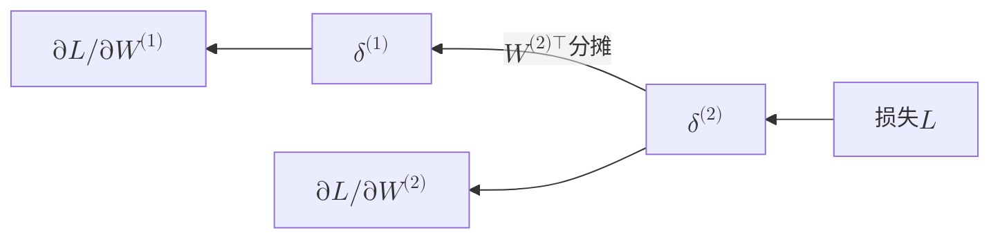

*图1.2.7-1 误差信号的反向流动：先算输出层 δ，再逐层回传*

推广到任意深度，就是反向传播的通用递推式：

$$
\delta^{(l)} = \bigl(W^{(l+1)\top} \delta^{(l+1)}\bigr) \odot a^{(l)}(1 - a^{(l)})
$$

**前向逐层算 $a$，反向逐层传 $\delta$，每层用自己的 $\delta$ 和上一层的 $a$ 算梯度**——这就是"深度"网络学习的完整骨架。

#### 1.2.5 实例：2-2-1 网络的一次完整训练

沿用图1.2.1-1 的网络，给定初始参数（中间量按全精度计算，显示保留四位小数）：

$$
x = \begin{bmatrix} 1 \cr 2 \end{bmatrix}, \qquad y = 1, \qquad \eta = 0.5
$$

$$
W^{(1)} = \begin{bmatrix} 0.5 & -0.3 \cr 0.2 & 0.4 \end{bmatrix}, \quad
b^{(1)} = \begin{bmatrix} 0.1 \cr -0.1 \end{bmatrix}, \quad
W^{(2)} = \begin{bmatrix} 0.6 & -0.5 \end{bmatrix}, \quad
b^{(2)} = 0.2
$$

**（1）前向——隐藏层：**

$$
z^{(1)} = W^{(1)}x + b^{(1)} = \begin{bmatrix} 0.5 - 0.6 + 0.1 \cr 0.2 + 0.8 - 0.1 \end{bmatrix} = \begin{bmatrix} 0 \cr 0.9 \end{bmatrix}
$$

$$
a^{(1)} = \sigma(z^{(1)}) \approx \begin{bmatrix} 0.5 \cr 0.7109 \end{bmatrix}
$$

**（2）前向——输出层：**

$$
z^{(2)} = 0.6 \times 0.5 + (-0.5) \times 0.7109 + 0.2 \approx 0.1446
$$

$$
a^{(2)} = \sigma(0.1446) \approx 0.5361
$$

**（3）损失：**

$$
L = \frac{1}{2}(0.5361 - 1)^2 \approx 0.1076
$$

**（4）反向——输出层：**

$$
\delta^{(2)} = (0.5361 - 1) \times 0.5361 \times 0.4639 \approx -0.1154
$$

$$
\frac{\partial L}{\partial W^{(2)}} = \delta^{(2)} a^{(1)\top} \approx \begin{bmatrix} -0.0577 & -0.0820 \end{bmatrix}, \qquad \frac{\partial L}{\partial b^{(2)}} \approx -0.1154
$$

**（5）反向——隐藏层（误差回传）：**

$$
W^{(2)\top}\delta^{(2)} \approx \begin{bmatrix} -0.0692 \cr 0.0577 \end{bmatrix}, \qquad a^{(1)}(1-a^{(1)}) \approx \begin{bmatrix} 0.25 \cr 0.2055 \end{bmatrix}
$$

$$
\delta^{(1)} = \bigl(W^{(2)\top}\delta^{(2)}\bigr) \odot a^{(1)}(1-a^{(1)}) \approx \begin{bmatrix} -0.0173 \cr 0.0119 \end{bmatrix}
$$

注意 $\delta^{(1)}_2$ 是**正号**：隐藏神经元 2 的输出权重 $w^{(2)}_2 = -0.5$ 为负，"增大它的输出"反而有助于降低损失。梯度的方向完全由链式法则自动决定，不需要人为指定。

$$
\frac{\partial L}{\partial W^{(1)}} = \delta^{(1)} x^\top \approx \begin{bmatrix} -0.0173 & -0.0346 \cr 0.0119 & 0.0237 \end{bmatrix}, \qquad \frac{\partial L}{\partial b^{(1)}} = \delta^{(1)}
$$

**（6）更新全部 9 个参数（ $\eta = 0.5$）：**

$$
W^{(1)} \leftarrow \begin{bmatrix} 0.5087 & -0.2827 \cr 0.1941 & 0.3881 \end{bmatrix}, \qquad b^{(1)} \leftarrow \begin{bmatrix} 0.1087 \cr -0.1059 \end{bmatrix}
$$

$$
W^{(2)} \leftarrow \begin{bmatrix} 0.6288 & -0.4590 \end{bmatrix}, \qquad b^{(2)} \leftarrow 0.2577
$$

**（7）验证：用新参数再前向一次**

$$
a^{(2)}_{\text{new}} \approx 0.5640, \qquad L_{\text{new}} = \frac{1}{2}(0.5640 - 1)^2 \approx 0.0951
$$

损失从 **0.1076 降到 0.0951**——9 个参数各自朝自己的"下坡方向"走了一步，网络整体输出向目标靠近。反复迭代，就是一次完整的训练。

#### 1.2.6 交互实验（全连接网络）

下面的实验台把 1.2.1～1.2.5 节的 2-2-1 网络做成了可交互页面（自包含 HTML，双击即可离线打开）：实时显示两层的前向结果、损失、各层 $\delta$ 与全部梯度；点"梯度下降更新一步"，9 个参数同时更新。

🧪 [交互实验：2-2-1 全连接网络训练实验台](resources/chapter1/chapter1.2.6-fc_network_training_demo.html)

建议动手做四个小实验：

1. **连续更新**：连点 20 次"更新一步"，观察 $L$ 逐步逼近 0、 $a^{(2)}$ 逼近目标 1。
2. **观察误差回传**：注意隐藏层 $\delta^{(1)}_2$ 的符号与输出权重 $w^{(2)}_2$ 的符号关系——体会"按权重分摊责任"。
3. **学习率过大**：把 $\eta$ 调到 2 再连续更新，观察损失震荡——多层网络对步长更敏感。
4. **目标反转**：把 $y$ 改成 0，观察所有梯度符号整体反转。

#### 1.2.7 小结

单神经元的闭环清单已在 1.1.7 节给出，此处小结"组合成网络"的三个要点：

1. **组合**：相邻层全连接，每条连线一个独立权重；第 $l$ 层参数量 $n_l n_{l-1} + n_l$。
2. **整层前向**： $z^{(l)} = W^{(l)}a^{(l-1)} + b^{(l)}$， $a^{(l)} = \sigma(z^{(l)})$——一次矩阵乘法算完一层，这是 MatMul 算子的用武之地。
3. **整层反向**： $\delta^{(l)} = \bigl(W^{(l+1)\top}\delta^{(l+1)}\bigr) \odot a^{(l)}(1-a^{(l)})$，梯度为外积 $\delta^{(l)}(a^{(l-1)})^\top$——误差从输出层逐层回传。

至此，"深度网络如何学习"的完整骨架已经就位。

### 1.3 机器学习框架简介

> **本节定位**：简要认识主流机器学习框架"是什么、怎么分层、和算子/器件是什么关系"。对算子开发者而言，框架不是要精通的对象，而是**你的算子被谁调用、以什么形式调用**的上下文。

#### 1.3.1 PyTorch

**背景**：Meta（Facebook）于 2016 年推出，源自 Torch。目前是**学术界与工业界研究领域的事实标准**，HuggingFace、vLLM 等主流生态均构建其上。

**核心特点：动态图（Define-by-Run）**。代码执行到哪，计算图就建到哪，可以用普通 Python 控制流（if/for）写模型，调试如同调试普通程序。

**四个核心组件**：

| 组件 | 职责 | 与第一章知识的对应 |
|---|---|---|
| `Tensor` | 多维数组，携带 `device`（CPU/GPU/NPU）与 `requires_grad` 标记 | 向量 $x$、矩阵 $W^{(l)}$ 的载体 |
| `autograd` | 前向时录制计算图，`backward()` 自动求梯度 | 自动完成 1.2.4 节的 $\delta$ 逐层回传 |
| `nn.Module` | 封装参数与层结构（`Linear`、`Transformer` 等） | 全连接层 $z = Wa + b$ 的现成实现 |
| `optim` | 参数更新策略（SGD、Adam 等） | 梯度下降 $w \leftarrow w - \eta\,\nabla_w L$ |

*表1.3.1-1 PyTorch 核心组件*

**一个呼应前文的例子**——1.2.5 节的 2-2-1 网络，用 PyTorch 只需几行，反向传播全部自动：

```python
import torch

x  = torch.tensor([1.0, 2.0])
W1 = torch.tensor([[0.5, -0.3], [0.2, 0.4]], requires_grad=True)
b1 = torch.tensor([0.1, -0.1], requires_grad=True)
W2 = torch.tensor([[0.6, -0.5]], requires_grad=True)
b2 = torch.tensor([0.2], requires_grad=True)

a1 = torch.sigmoid(W1 @ x + b1)          # 隐藏层前向
a2 = torch.sigmoid(a1 @ W2.T + b2)       # 输出层前向
L  = 0.5 * ((a2 - 1.0) ** 2).sum()       # 损失
L.backward()                             # 自动完成逐层反向
print(W1.grad)   # ≈ [[-0.0173, -0.0346], [0.0119, 0.0237]]，与手算一致
```

**执行路径（算子视角）**：Python API → **ATen 算子库** → **Dispatcher** 按设备/数据类型分发 → 具体后端 kernel（GPU 走 CUDA/cuDNN，昇腾走 CANN）。2.x 引入 `torch.compile`（TorchInductor），在保留动态图体验的同时捕获子图做编译优化。

**昇腾适配**：通过 `torch_npu` 插件把 NPU 注册为一种设备后端，模型代码基本不改即可运行——这正是 1.3.4 节"框架-器件"关系的实例。

#### 1.3.2 TensorFlow

**背景**：Google 于 2015 年开源，工业界部署的先驱，与 TPU 深度绑定。

**核心特点：从静态图走向动静结合**。1.x 是"先建图、后执行"（Define-then-Run）：Python 只负责描述计算图，`Session.run()` 才真正计算，利于整图优化与跨平台部署，但调试困难。2.x 默认 **Eager 模式**（与 PyTorch 类似的即时执行），用 `tf.function` 把热点函数编译回静态图，兼顾灵活与性能。

**关键组件与生态**：

- **Keras**：高层建模 API（`tf.keras`），搭网络像搭积木；
- **Grappler / XLA**：图优化器与编译器，XLA 把子图编译成针对硬件的高效 kernel；
- **部署链**：TF Serving（服务端）、TFLite（移动端）、TF.js（浏览器）、SavedModel（标准模型格式）。

**现状**：研究领域份额已明显让位于 PyTorch，但在**大规模工业部署、TPU 场景**仍占重要地位。对算子开发者，重点理解其"图优化 + XLA 编译"的思路——这与昇腾的图编译（GE）理念相通。

#### 1.3.3 其他框架

| 框架 | 主导方 | 特点 | 与本课程的关联 |
|---|---|---|---|
| **MindSpore** | 华为 | 昇腾原生框架，动静统一，自动并行；配套 MindIR 图格式 | **昇腾生态第一方**，算子经 CANN/GE 下发到 AI Core |
| **JAX** | Google | 函数式风格，`jit`/`vmap`/`grad` 变换组合，底层 XLA | 前沿研究常用，TPU 主力 |
| **PaddlePaddle** | 百度 | 国产，产业级部署工具链完整（飞桨） | 国产器件适配路线可参考 |
| **MXNet** | Apache | 早期动静结合代表，已停止活跃维护 | 了解历史演进即可 |
| **OneFlow** | 一流科技 | 静态图 + Actor 调度，主打分布式效率 | 图执行机制的另一种设计 |

*表1.3.3-1 其他主流框架速览*

**一句话总结**：框架之争主要在"动态图易用性 vs 静态图可优化性"与生态绑定；底层殊途同归——**都要把模型拆成算子，交给器件执行**。

#### 1.3.4 硬件、算子、学习框架的关系

**算子（Operator）**：框架中可调度的最小计算单元，如 MatMul、Add、Softmax、Conv2d。模型无论多复杂，最终都被分解为算子序列；每个算子有明确的输入/输出张量规格（shape、dtype、layout）。

**器件 kernel**：同一个算子在具体硬件上的实现。例如矩阵乘 $C = AB$：GPU 上是 cuBLAS kernel，昇腾上是 CANN 的 `aclnnMatmul` 或 AscendC 自定义 kernel。

**分层关系**（自上而下）：

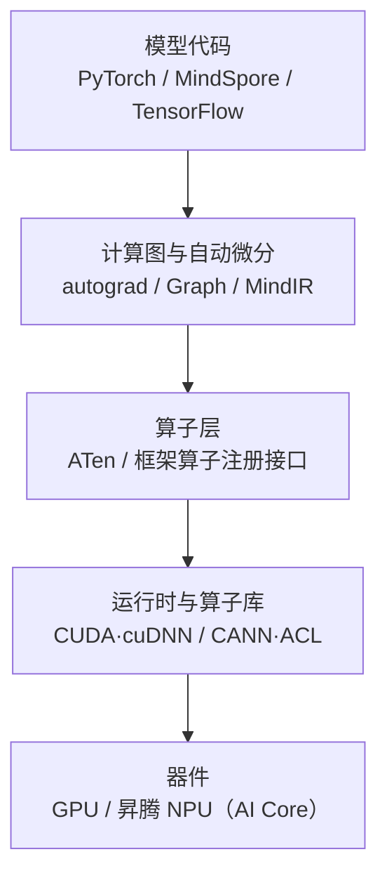

*图1.3.4-1 硬件、算子与学习框架的分层关系*

以 `torch.matmul` 在昇腾上执行为例，完整调用链：

```text
torch.matmul(A, B)
  → ATen matmul 算子（框架统一接口）
  → Dispatcher 按 device=npu 分发（torch_npu 适配层）
  → CANN aclnnMatmul（昇腾算子库）
  → AI Core 上的矩阵乘 kernel（真正干活的硬件代码）
```

**三个关键结论**：

1. **框架是"调用方"，器件是"执行方"，算子是两者之间的契约**。框架不关心 kernel 怎么写，只关心算子的语义与规格；器件不关心模型长什么样，只关心收到什么算子任务。
2. **新器件接入框架 = 实现适配层 + 算子库**。`torch_npu` 之于昇腾、CUDA 后端之于 GPU，都是这个模式。算子覆盖度与性能，直接决定器件能不能跑主流模型、跑得多快。
3. **本课程的位置在最底层**：用 AscendC/Triton 编写或调优的，就是图1.3.4-1 最下方那个 kernel。理解上层框架，是为了知道——你的算子**被谁调用、输入从哪来、shape/dtype 由谁决定、性能瓶颈在哪一层被放大**。

> **学习建议**：不必深入框架 API，但建议动手跑通 1.3.1 的 PyTorch 小例子，并用 `print` 观察中间张量的 shape——建立"模型 → 算子 → 张量规格"的直觉，后续算子开发会反复用到。

**章末桥梁：从全连接到大模型**。全连接网络有一个根本局限：每条连线的权重训练完就固定了，对所有输入一视同仁，难以表达"序列中元素之间的动态关联"——而语言恰恰是强关联的序列（"它"指代谁，取决于上下文）。把"固定权重连接"换成"按内容动态计算关联权重"，就得到了**注意力机制（Attention）**；以注意力为核心堆叠出的网络就是 **Transformer**，即当今大模型的骨架。这正是第二章的主题。而无论模型多大，最终仍被拆成算子落到器件执行——本章建立的"硬件-算子-框架"视角将贯穿全课程。

## 第二章 Transformer基础

> **学习目标**
> - 说清 Transformer 相对全连接网络解决了什么问题，画出解码器块的完整结构
> - 手写 Attention 的五步计算，独立完成一个 4-token 因果注意力的手算
> - 解释 $\sqrt{d_k}$ 缩放的统计意义，说清多头到底从哪个维度切分、 $W_O$ 在融合什么
> - 理解 RoPE 如何用旋转编码相对位置
> - 推导 Online Softmax 递推式，解释 FlashAttention 为什么又快又省内存
> - 说清 KV Cache 为什么只缓存 K/V，会估算缓存体积，了解 PagedAttention 与 KV 量化
> - 用两条规则走完 Attention 的反向传播，手算 softmax 反向
> - 对比 MHA/MQA/GQA/MLA 的压缩思路，用 SVD 解释 MLA 低秩压缩的数学依据

### 2.1 全景：从全连接网络到 Transformer

#### 2.1.1 全连接网络处理序列的三个困难

第一章我们已经把"神经元 → 全连接网络 → 前向/反向/梯度下降"的完整骨架搭好了。但那套骨架面对**语言这类序列数据**时有三个先天困难：

1. **输入宽度固定**。全连接层的权重矩阵形状是 $n_l \times n_{l-1}$，输入必须恰好 $n_{l-1}$ 维。而句子有长有短——"你好"和一篇千字文章无法喂进同一个固定宽度的输入层。
2. **位置之间没有共享与交互**。把一句话拉平成一个长向量后，第 1 个词和第 100 个词之间的关联只能靠中间层层层传递，路径长、效率低；而且每个位置用的是不同的权重，"猫"出现在句首和句尾要被重新学一遍。
3. **顺序信息丢失**。拉平后的向量里，"狗咬人"和"人咬狗"只是数字排列不同，网络必须从零学会"排列顺序代表语义"这件事。

循环神经网络（RNN）曾部分解决这些问题：按时间步逐个读词、用隐状态传递历史。但它引入了新瓶颈——**必须串行计算**（第 $t$ 步依赖第 $t-1$ 步的输出），无法利用 GPU 的大规模并行；且历史被压缩进一个固定宽度的隐状态，长距离信息逐步衰减。

2017 年《Attention Is All You Need》给出的答案是：**扔掉循环，让每个词直接"看到"所有其他词，按内容相关性决定听谁的**。这就是注意力（Attention）机制，也是 Transformer 的核心。

#### 2.1.2 注意力的核心思想：按内容检索的加权平均

用一个图书馆类比建立直觉。你带着一个**问题**走进图书馆：

- 你的问题 = **Query（查询）**："我想了解猫的行为"；
- 每本书书脊上的标签 = **Key（键）**："动物行为学""量子物理""烹饪大全"……
- 书的实际内容 = **Value（值）**。

检索过程分三步：① 拿你的问题和每本书的标签**比对相关性**（点积打分）；② 把相关性分数**归一化成权重**（softmax，加起来等于 1）；③ 按权重把各本书的内容**加权混合**成一份答案。

注意力机制把这个过程搬进网络：**每个 token 同时扮演三个角色**——它带着自己的 Query 去问全序列，也把自己的 Key 和 Value 摆出来供别人检索。"自注意力（self-attention）"的"自"就体现在：Q、K、V 全部来自**同一条输入序列**，只是经过三套不同的投影矩阵。

相比 RNN，这个设计有两个决定性优势：

- **任意两个位置一步直达**：第 1 个词和第 1000 个词的交互路径长度都是 1，长距离依赖不再衰减；
- **完全并行**：所有位置的打分、归一化、加权求和都是矩阵乘法，一次算完——正是第一章 1.2.3 节说的"矩阵 = 一排神经元"的 GPU 友好形式。

代价是计算量随序列长度平方增长（ $N$ 个词两两打分，共 $N^2$ 个分数）。本章后半部分的大量工程优化（FlashAttention、KV Cache、GQA、MLA）都是在与这个 $N^2$ 及其带来的显存/带宽开销搏斗。

#### 2.1.3 Transformer 块：注意力只是其中一半

一个完整的 Transformer 解码器块（decoder block）由两个子层构成，每个子层都配**残差连接**与**归一化**：

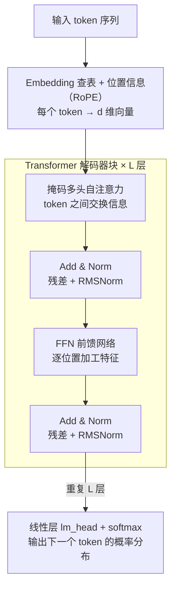

*图2.1.3-1 Transformer 解码器块的整体结构（Mermaid 静态图）*

各部件的职责，以及它们与第一章知识的对应关系：

| 部件 | 职责 | 与已学知识的联系 |
|---|---|---|
| Embedding | 把离散 token 编号查表变成 $d$ 维向量 | 一张 $V \times d$ 的大表（ $V$ 是词表大小），按行取用 |
| 位置编码（RoPE） | 注入"谁在前谁在后"的顺序信息 | 见 2.4 节 |
| 多头自注意力 | **token 之间**的信息交换：每个位置按相关性聚合全序列内容 | 本章主角，2.2～2.3 节 |
| FFN | **每个位置内部**的特征加工：两层全连接 + 激活，中间层通常扩到 $4d$ | 就是第一章的全连接网络，逐位置独立作用 |
| 残差连接 | 子层输出加回输入： $x + \text{Sublayer}(x)$，给梯度一条"高速公路" | 链式法则中多出一条恒等通路，深层网络可训练的关键 |
| RMSNorm | 把每个向量的均方根拉回 1，稳定数值尺度 | $\text{RMSNorm}(x) = \frac{x}{\sqrt{\frac{1}{d}\sum_i x_i^2 + \epsilon}} \odot g$， $g$ 是可学习缩放 |
| 因果掩码 | 禁止位置 $t$ 看到 $t$ 之后的内容 | 保证"预测下一个词"时不作弊，2.2 节手算 |
| lm_head | 把 $d$ 维向量映射回词表大小的 logits | 一个 $d \times V$ 的线性层 + softmax |

*表2.1.3-1 Transformer 各部件的职责*

**一个容易误解的点**：很多人以为 Transformer 的"智能"全在注意力里。实际上从参数量看，FFN 才是大头——注意力投影约 $4d^2$ 个参数，FFN 约 $2 \times d \times 4d = 8d^2$ 个，**FFN 占每层参数的约 2/3**。分工上，注意力负责"把正确的信息搬运到正确的位置"，FFN 负责"对搬运来的信息做深度加工"（大量事实性知识被认为存储在 FFN 权重中）。

现代大模型（GPT、LLaMA、Qwen、DeepSeek 等）都是**decoder-only**架构：把图2.1.3-1 的块堆叠 $L$ 层（几十到上百层），训练时并行地对每个位置做"预测下一个 token"，推理时逐 token 自回归生成。训练与推理的计算形态差异，正是 2.6 节 KV Cache 的出发点。

#### 2.1.4 记号约定（全章统一）

| 符号 | 含义 | 典型取值 |
|---|---|---|
| $N$ | 序列长度（token 数），部分文献记作 $S$ 或 $T$ | 数百～128K |
| $B$ | batch 大小（一次处理几条序列） | 1～数百 |
| $d$ | 模型隐藏维（即 $d_{model}$），每个 token 的向量宽度 | 4096 / 5120 |
| $h$ | 注意力头数 | 32 / 128 |
| $d_k$ | 每个头的 Q/K 维度，标准 MHA 中 $d_k = d/h$ | 64 / 128 |
| $d_v$ | 每个头的 V 维度，标准 MHA 中 $d_v = d/h$ | 64 / 128 |
| $X$ | 输入序列，形状 $N \times d$（带 batch 时 $B \times N \times d$） | — |
| $W_q, W_k, W_v$ | Q/K/V 投影矩阵（可学习参数） | $d \times d$ |
| $W_O$ | 多头输出投影 | $h d_v \times d$ |
| $Q, K, V$ | 投影后的激活张量 | $N \times d_k$ 等 |
| $S$ | 打分矩阵（logits）， $N \times N$ | — |
| $P$ | softmax 后的注意力权重， $N \times N$ | — |
| $O$ | 注意力输出， $N \times d_v$（多头拼合后 $N \times d$） | — |
| $L$ | 层数 | 数十～上百 |
| $\ell$ | Online Softmax 的行指数和（与层数 $L$ 注意区分） | — |

*表2.1.4-1 全章统一记号*

> **两类对象先分清**： $W$ 系列是**权重（参数）**，训练时更新，形状只与 $d$ 有关，不含 $B$、 $N$； $Q/K/V/S/P/O$ 是**激活（中间结果）**，随输入变化，含 $B$、 $N$。后面所有"维度账"都建立在这个区分上。

#### 2.1.5 本章路线图

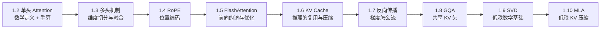

*图2.1.5-1 本章知识路线：先懂原理（2.2～2.4），再看工程优化（2.5～2.6），然后补全训练视角（2.7），最后是结构变体（2.8～2.10）*

### 2.2 Attention 的数学定义（单头）

#### 2.2.1 五步计算

self-attention 的完整公式只有一行：

$$
\text{Attention}(Q, K, V) = \text{softmax}\!\left(\frac{Q K^\top}{\sqrt{d_k}}\right) V
$$

拆成五步，每一步都有明确的语义：

**① 投影**：同一个 $X$ 被三套参数映射到三个语义空间。

$$
Q = X W_q, \qquad K = X W_k, \qquad V = X W_v
$$

| 张量 | 语义 | 图书馆类比 |
|---|---|---|
| $Q$（Query） | 当前 token"想问什么" | 你的问题 |
| $K$（Key） | 每个 token"能被怎样检索" | 书脊标签 |
| $V$（Value） | 每个 token"实际携带的信息" | 书的内容 |

*表2.2.1-1 Q/K/V 的语义分工*

**② 打分**： $S = Q K^\top / \sqrt{d_k}$。 $Q K^\top$ 的第 $(i,j)$ 元是 $q_i \cdot k_j$——第 $i$ 个 token 的问题与第 $j$ 个 token 的标签的点积相似度。除以 $\sqrt{d_k}$ 的原因见 2.2.3。

**③ 掩码**：因果掩码把 $S$ 的**上三角**（ $j > i$，即"未来位置"）置为 $-\infty$。语言模型要预测下一个词，绝不能偷看答案。

**④ 归一化**：按行做 softmax， $P = \text{softmax}_{\text{row}}(S)$。每一行的权重和为 1，构成"第 $i$ 个 token 对全序列的注意力分布"。被掩码的位置因 $e^{-\infty} = 0$ 权重恰好为 0。

**⑤ 加权求和**： $O = P V$。输出的第 $i$ 行 $o_i = \sum_j P_{ij} v_j$——按注意力权重把各位置的 Value 混合成该位置的新表示。

**维度抵消**是理解这五步的钥匙：

$$
(N \times d_k) \cdot (d_k \times N) = N \times N, \qquad (N \times N) \cdot (N \times d_v) = N \times d_v
$$

$d_k$ 在打分时被"消掉"， $N$ 在加权时被"消掉"——**注意力不改变序列长度，也不改变特征宽度，它只是把不同位置的信息重新混合**。行维度管"谁和谁交互"，列维度管"交互什么内容"。

#### 2.2.2 数值实例：4-token 因果注意力（手算）

取 $N = 4$、 $d_k = 4$、 $d_v = 2$。为便于手算，把 $d_k$ 的 4 个维度想象成 4 个"主题" $t_1 \sim t_4$：**Key 的分量指示该 token 覆盖了哪些主题（0/1），Query 的分量表示该 token 对各主题的兴趣强度（可正可负）**。

**第 ① 步：给出投影结果**（为聚焦注意力本身，跳过 $XW$ 直接给 $Q,K,V$）：

$$
Q = \begin{bmatrix} 3.0 & -1.8 & 1.2 & 2.8 \cr -2.0 & 1.1 & -0.3 & 2.5 \cr -3.0 & 2.9 & 1.5 & -1.1 \cr 1.6 & 3.0 & -0.8 & -0.2 \end{bmatrix}, \quad
K = \begin{bmatrix} 0 & 0 & 1 & 1 \cr 0 & 1 & 0 & 1 \cr 0 & 1 & 1 & 0 \cr 1 & 1 & 1 & 0 \end{bmatrix}, \quad
V = \begin{bmatrix} 1.0 & 0.0 \cr 0.0 & 1.0 \cr 1.0 & 1.0 \cr -1.0 & 0.5 \end{bmatrix}
$$

$K$ 的四行依次覆盖主题 $\{t_3,t_4\}$、 $\{t_2,t_4\}$、 $\{t_2,t_3\}$、 $\{t_1,t_2,t_3\}$。

**第 ② 步：原始打分 $M = QK^\top$**。因为 $K$ 只有 0/1，每个点积退化为 $Q$ 对应分量的**部分和**，可完全手算。以 $q_1$ 行为例：

$$
\begin{aligned}
q_1 \cdot k_1 &= q_1[t_3] + q_1[t_4] = 1.2 + 2.8 = 4.0 \cr
q_1 \cdot k_2 &= q_1[t_2] + q_1[t_4] = -1.8 + 2.8 = 1.0 \cr
q_1 \cdot k_3 &= q_1[t_2] + q_1[t_3] = -1.8 + 1.2 = -0.6 \cr
q_1 \cdot k_4 &= q_1[t_1] + q_1[t_2] + q_1[t_3] = 3.0 - 1.8 + 1.2 = 2.4
\end{aligned}
$$

其余三行同理，得到完整打分矩阵：

$$
M = QK^\top = \begin{bmatrix} 4.0 & 1.0 & -0.6 & 2.4 \cr 2.2 & 3.6 & 0.8 & -1.2 \cr 0.4 & 1.8 & 4.4 & 1.4 \cr -1.0 & 2.8 & 2.2 & 3.8 \end{bmatrix}
$$

**第 ③ 步：缩放**。 $d_k = 4$， $1/\sqrt{d_k} = 0.5$，所有打分减半： $S = M/2$。

**第 ④ 步：因果掩码**（上三角置 $-\infty$）：

$$
S_{\text{masked}} = \begin{bmatrix} 2.0 & -\infty & -\infty & -\infty \cr 1.1 & 1.8 & -\infty & -\infty \cr 0.2 & 0.9 & 2.2 & -\infty \cr -0.5 & 1.4 & 1.1 & 1.9 \end{bmatrix}
$$

**第 ⑤ 步：按行 softmax**。以第 2 行为例： $e^{1.1} \approx 3.00$， $e^{1.8} \approx 6.05$，归一化得 $[0.33, 0.67]$。四行结果（保留两位小数）：

$$
P = \begin{bmatrix} 1.00 & 0 & 0 & 0 \cr 0.33 & 0.67 & 0 & 0 \cr 0.10 & 0.19 & 0.71 & 0 \cr 0.04 & 0.28 & 0.21 & 0.47 \end{bmatrix}
$$

每行之和为 1；被掩码位置权重恰好为 0。

**第 ⑥ 步：输出 $O = PV$**：

$$
\begin{aligned}
o_1 &= 1.00 \cdot v_1 = [1.00,\ 0.00] \cr
o_2 &= 0.33 v_1 + 0.67 v_2 = [0.33,\ 0.67] \cr
o_3 &= 0.10 v_1 + 0.19 v_2 + 0.71 v_3 = [0.81,\ 0.90] \cr
o_4 &= 0.04 v_1 + 0.28 v_2 + 0.21 v_3 + 0.47 v_4 = [-0.22,\ 0.725]
\end{aligned}
$$

**语义解读**： $o_1$ 只能看到 $v_1$，所以直接等于 $v_1$； $o_4$ 看到了全部四个位置，权重最大的 $v_4$（0.47）主导了结果。每一行输出都是"该 token 按自己的兴趣，从全序列要回来的信息加权平均"。

🧪 [交互实验：单头注意力计算器](resources/chapter2/chapter2.2-attention_calculator.html)——可编辑 Q/K/V、开关因果掩码，逐步查看 $M \to S \to P \to O$ 的每个中间矩阵（自包含 HTML，双击离线打开）。建议把某个 $q_i$ 的分量改大，观察对应注意力如何变"尖锐"。

#### 2.2.3 为什么除以 $\sqrt{d_k}$：方差归一化器与温度调节器

一句话：**$\sqrt{d_k}$ 把点积的数值尺度拉回与维度无关的标准区间，防止 softmax 饱和、梯度消失。**

**① 统计推导**。设 $q, k$ 各维近似独立、均值 0、方差 1，则点积是 $d_k$ 个独立乘积项之和：

$$
q \cdot k = \sum_{t=1}^{d_k} q_t k_t, \qquad \mathrm{Var}(q \cdot k) = d_k
$$

每个乘积项 $q_t k_t$ 均值 0、方差 1，独立求和后方差线性叠加。即**点积的标准差随维度以 $\sqrt{d_k}$ 增长**——这不是 query 和 key"更相关"，纯粹是维度带来的统计噪声堆积。除以 $\sqrt{d_k}$ 后方差恰好归一到 1。

**② 数值实验证据**（ $q,k$ 各维 iid $\mathcal{N}(0,1)$，1000 个 key）：

| 观察量 | 不缩放 | 除以 $\sqrt{d_k}$ |
|---|---|---|
| 点积方差（ $d_k=64$） | 63.41 ≈ $d_k$ | ≈ 1 |
| logits 范围（ $d_k=64$） | $[-28, 25]$ | $[-3.5, 3.1]$ |
| 最大注意力权重 | 0.901（近 one-hot） | 0.014（有选择性但不武断） |
| 分布的熵（均匀熵 = 6.91） | 0.49 | 6.46 |
| softmax 梯度尺度 $\sum_j P_j(1-P_j)$ | 0.46 | 0.998 |

*表2.2.3-1 缩放前后的数值对比：不缩放时 softmax 退化为近 argmax，梯度通量掉一半以上*

**③ 温度视角**。softmax 本质是玻尔兹曼分布， $1/\sqrt{d_k}$ 就是温度的倒数：

$$
P_j = \frac{e^{\ell_j / T}}{\sum_i e^{\ell_i / T}}, \qquad T = \sqrt{d_k}
$$

logits 差距大（低温）→ 分布趋近 one-hot，模型"武断地"只看一个位置；差距小（高温）→ 趋近均匀，失去选择性。不缩放时 $d_k=64$ 的 logits 落在 $[-28,25]$，最大最小权重比达 $e^{53} \approx 10^{23}$ 倍，softmax 直接饱和成 argmax。

**④ 梯度视角：饱和为什么杀死训练**。softmax 的雅可比为 $\partial P_j / \partial \ell_i = P_j(\delta_{ij} - P_i)$，其迹 $\sum_j P_j(1-P_j)$ 衡量梯度通量：分布均匀时 ≈ 1， $P \to$ one-hot 时 → 0。当某个 $P_j \to 1$，loss 对 logits 的扰动不再敏感，误差信号传不回 $W_q, W_k$。缩放保证训练初期（logits 还是纯噪声时）梯度就能正常流动。

**⑤ 为什么恰好是 $\sqrt{d_k}$ 而不是别的**：

| 归一化方式 | 效果 |
|---|---|
| 不除 | 尺度 $\propto \sqrt{d_k}$，维度越大越饱和 |
| 除以 $d_k$ | 过度压制，logits → 0，softmax 趋于均匀，失去区分能力 |
| **除以 $\sqrt{d_k}$** | **方差恰好归一到 1，尺度与维度无关** |

*表2.2.3-2 三种归一化方式对比*

这与"样本均值的标准差除 $\sqrt{n}$"是同一条统计规律： $n$ 个独立样本均值的方差是 $\sigma^2/n$。 $\sqrt{d_k}$ 就是消掉"$d_k$ 项求和"固有尺度的标准统计量。

#### 2.2.4 softmax 的数值稳定性：减 rowmax

直接算 $e^{s_i}$ 会溢出：fp16 最大约 65504， $e^{12}$ 就超了。标准做法是**整行减去最大值**：

$$
\text{softmax}(s)_i = \frac{e^{s_i - m}}{\sum_j e^{s_j - m}}, \qquad m = \max_j s_j
$$

这**不改变结果**（分子分母同乘 $e^{-m}$），但把指数的输入压到 $\le 0$，永不溢出。这个"减 max"的重参数化有两个重要推论，后面会反复用到：

1. **softmax 对整行平移不变** → 2.7 节反向传播中， $m$ 虽然是 $S$ 的函数，却不需要额外的梯度修正项；
2. **max 可以分块增量维护** → 2.5 节 Online Softmax 的全部基础：先按局部 max 算，来了更大的 max 再把旧结果"打折"修正。

#### 2.2.5 参考实现（PyTorch，单头）

```python
import math
import torch

def attention(Q, K, V, causal_mask=None):
    """Q, K: (N, d_k)；V: (N, d_v)；返回 O: (N, d_v)"""
    d_k = Q.shape[-1]
    S = Q @ K.transpose(-1, -2) / math.sqrt(d_k)   # ② 打分 (N, N)
    if causal_mask is not None:                     # ③ 因果掩码：上三角置 -inf
        S = S.masked_fill(causal_mask, float("-inf"))
    P = torch.softmax(S, dim=-1)                    # ④ 逐行 softmax（内部自动减 rowmax）
    return P @ V                                    # ⑤ 加权求和 (N, d_v)
```

### 2.3 维度语义与多头机制

#### 2.3.1 两类维度：行 = 谁，列 = 什么

$Q,K,V$ 都是二维张量，两个维度扮演**完全不同的角色**：

- **行维度 $N$ = 序列位置**：第几行就是第几个 token。 $N$ 随输入变化，所以自注意力天生支持变长输入；
- **列维度 $d_k$ / $d_v$ = 特征子空间**：每行是一个向量，内部坐标是模型学到的特征。

其中 $d_k$ 决定"匹配空间的容量"（Q 和 K 的列数**必须相同**，否则点积无法定义）； $d_v$ 决定"被聚合信息的通道数"（理论上可不等于 $d_k$，标准实现取相等以便拼接）。

#### 2.3.2 多头 = 切分特征维，不是切分 token

**一句话核心结论：多头注意力是从每个 token 的特征维 $d$ 上切分的**——按 $d = h \times d_{head}$ 把每个 token 的 $d$ 维向量切成 $h$ 段 $d_{head}$ 维子向量。**不是从 batch 维 $B$、不是从序列维 $N$、更不是从词表 $V$ 切分**。所有头共享同一条序列，每个头都能看到全部 $N$ 个 token，只是在各自的低维子空间里独立计算注意力。

最小数值用例： $B=1$、 $N=4$、 $d=6$、 $h=3$、 $d_{head}=2$。每个 token 的 6 维 $Q$ 向量切成 3 段：

```text
token1 的 Q: [q1, q2, q3, q4, q5, q6]
              └ head0 ┘ └ head1 ┘ └ head2 ┘
               2 维      2 维      2 维
```

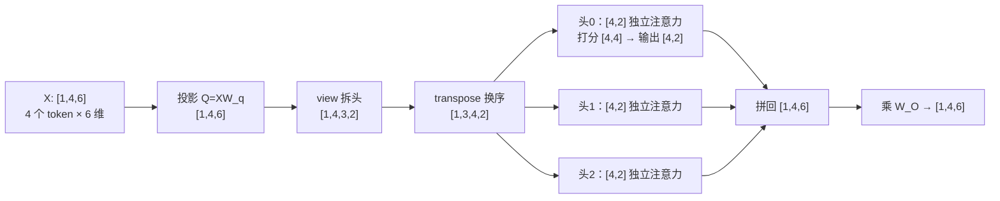

*图2.3.2-1 多头拆分全流程：切的是每行的特征维（列），没有任何 token 被拆开*

| 步骤 | 操作 | 形状 | 说明 |
|---|---|---|---|
| 输入 | $X$ | `[1,4,6]` | — |
| 投影 | $Q = XW_q$ | `[1,4,6]` | 列已按 2 维分段排布 |
| 拆头 | `view` | `[1,4,3,2]` | **分头发生在这一步： $6 \to 3 \times 2$** |
| 换序 | `transpose(1,2)` | `[1,3,4,2]` | 仅视图调整，零拷贝 |
| 各头注意力 | $Q_iK_i^\top/\sqrt{d_{head}} \to \text{softmax} \to \times V_i$ | `[4,4] → [4,2]` | 各头独立、全序列可见 |
| 拼头 | transpose 回 + reshape | `[1,4,6]` | 拆头的逆操作 |
| 输出投影 | $\times W_O$ | `[1,4,6]` | 跨头信息融合 |

*表2.3.2-1 多头拆分的形状流转*

**为什么要多头？** 单头注意力的 softmax 输出一个分布，倾向于聚焦一种"相关性模式"。切成 $h$ 个子空间后，每个头可以学习不同的相似度视角——有的头关注语法搭配、有的头关注指代关系、有的头关注邻近位置。 $h$ 个视角并行计算，最后融合。

#### 2.3.3 权重矩阵视角：分头 = 把 W 按列切成 h 份

标准 MHA 有四个投影权重，全部是 $d \times d$：

$$
W_q, W_k, W_v, W_O \in \mathbb{R}^{d \times d}, \qquad \text{参数量} = 4d^2 \ (\text{忽略 bias})
$$

因为 $d = h \cdot d_{head}$， $W_q$ 可以**按输出维度（列）切成 $h$ 块**：

$$
W_q = \big[\, W_q^{(1)} \mid W_q^{(2)} \mid \cdots \mid W_q^{(h)} \,\big], \qquad W_q^{(i)} \in \mathbb{R}^{d \times d_{head}}
$$

单头的投影就是 $Q_i = X W_q^{(i)}$。**把 $h$ 块拼成大矩阵做一次 GEMM，与"先分头再各自投影"数学上完全等价**——这就是工程实现里"一个大 `nn.Linear` + `view` 拆头"的由来。很多框架进一步把 $W_q, W_k, W_v$ 合并成 fused QKV 矩阵 $[d, 3d]$，一次矩阵乘出全部三路，减少权重加载次数。

> PyTorch 的 `nn.Linear` 内部把 weight 存成 `[out_features, in_features]`（即数学上的 $W^\top$），forward 时做 $y = xW^\top$。这只是存储转置约定，"按列切块"的数学内容不变。

#### 2.3.4 输出拼接与 $W_O$：跨头信息融合

各头输出 $O_i \in \mathbb{R}^{N \times d_v}$ 沿特征维拼接，再乘 $W_O$：

$$
\text{Output} = \big[\,O_1 \mid \cdots \mid O_h\,\big] W_O, \qquad W_O \in \mathbb{R}^{h d_v \times d}
$$

把 $W_O$ 按行横向切成 $h$ 块（每块 $d_v \times d$），与拼接的列块一一对齐：

$$
\text{Output} = \big[\,O_1 \mid \cdots \mid O_h\,\big] \begin{bmatrix} W_O^{(1)} \cr \vdots \cr W_O^{(h)} \end{bmatrix} = \sum_{i=1}^{h} O_i\, W_O^{(i)}
$$

这揭示了 $W_O$ 的两层作用：给**每个头配一个专属的 $d_v \to d$ 映射**，把各头子空间的结果投影回统一的 $d$ 空间；然后**在特征层面把 $h$ 个头的贡献相加**。没有 $W_O$，各头只是简单并列、老死不相往来；有了 $W_O$，第 $i$ 头的某个维度可以和第 $j$ 头的某个维度在输出里线性交互。

极简数值示例： $N=1$、 $h=2$、 $d_v=2$、 $d=4$。输出的第 $k$ 个分量为

$$
\text{out}_k = \sum_{a=1}^{2} o_{1,a}\big(W_O^{(1)}\big)_{a,k} + \sum_{a=1}^{2} o_{2,a}\big(W_O^{(2)}\big)_{a,k}
$$

**每个输出维度都把两个头的贡献加在了一起**——这就是跨头融合。

> 常见误解： $W_O$ 不是"加权求和各头的注意力矩阵"，它作用在**输出特征**上，混合的是各头输出的**通道**。

#### 2.3.5 完整维度账与 Layout

以 BERT-base（ $d=768$、 $h=12$、 $d_k=d_v=64$）、 $N=3$ 为例：

| 张量 | 形状 | 含义 |
|---|---|---|
| $X$ | $3 \times 768$ | 3 个 token，每个 768 维 |
| 单头 $Q, K, V$ | $3 \times 64$ | 64 维匹配空间 / 内容通道 |
| $QK^\top$、softmax 后 | $3 \times 3$ | 两两相似度 → 每行和为 1 的权重 |
| 单头输出 | $3 \times 64$ | 位置混合后的内容 |
| 12 头 concat | $3 \times 768$ | 回到 $d$ |
| 过 $W_O$ | $3 \times 768$ | 该层注意力输出，送入 FFN |

*表2.3.5-1 多头维度账（BERT-base，N=3）*

带 batch 的工程实现中，同一批头有不同的排布（Layout）约定：

| 排布 | 形状 | 说明 |
|---|---|---|
| BSND | `[B, N, h, D]` | 拆头后的自然形状（N=序列，D=头维） |
| BNSD | `[B, h, N, D]` | 头维提前，按头批量并行；`transpose` 零拷贝换视图 |
| TND | `[T, h, D]` | varlen 打包：去掉 B，把各序列长度顺接成 $T=\sum N_i$ |

*表2.3.5-2 三种常见 Layout*

**关键**：改变 $B/N/T$（batching、变长、打包）从不改变头的划分；改变头的划分（调 $h$ 或 $d_{head}$）也永远只动 $d$ 这一个维度。Layout 转置只是"同一批头"的不同遍历视图，数学内容一字节未动。

#### 2.3.6 为什么 h 必须整除 d

分三层看：

1. **数学上其实不要求**。各头不等宽（ $\sum_i d_i = d$）在数学上完全合法。但原论文把定义收紧为等宽： $d_k = d_v = d/h$。等宽一旦成为定义，整除就是直接推论。
2. **`view` 的形状守恒（报错发生地）**。框架用单个大 GEMM 出 $Q \in [B,N,h \cdot d_{head}]$ 再 `view(B,N,h,d_head)`。view 的唯一硬规则是元素总数不变： $d=10$、 $h=3$ 时 $d_{head}=10/3$ 不是整数，你连一个合法的 view 目标形状都写不出来（3×3=9≠10，3×4=12≠10），直接抛 `RuntimeError: shape ... is invalid for input of size ...`。
3. **kernel 预设等宽**。FlashAttention/SDPA 的统一 stride、按头批量并行、张量核分块、 $d_{head}$ 对齐 64/128——全部预设所有头等宽。GQA 还额外要求 $h_q \bmod h_{kv} = 0$。

> 反例预告：MLA（2.10 节）的头维（128+64 RoPE）就不等于 $d/h$——它本就不依赖等宽 MHA 范式，算子把 headDim 当独立入参。

#### 2.3.7 常见误区清单

1. **"头数 = 把 token 分组"** ✗——序列维从不切分，每个头都看到全部 $N$ 个 token，注意力矩阵每头都是完整 $N \times N$。
2. **"$d$ 是词数/序列长度"** ✗——$d$ 是特征宽度， $N$ 才是词数，两者正交。
3. **"词表 $V$ 参与注意力"** ✗——$V$ 只出现在输入端 embedding 查表和输出端 lm_head，从不进入注意力内部。
4. **"reshape 分头是交错/跨步取样"** ✗——是相邻 $d_{head}$ 维的连续段，与 $W$ 的列分块一一对应。
5. **"权重矩阵里含有 B、N"** ✗——权重只有 $d$ 相关维度； $B$、 $N$ 只出现在激活张量里。
6. **"BSND→BNSD 转置改变了分头方式"** ✗——零拷贝视图调整，头的划分不变。

#### 2.3.8 参考实现（PyTorch，多头）

```python
import torch
import torch.nn as nn

class MultiHeadAttention(nn.Module):
    def __init__(self, d_model=768, h=12):
        super().__init__()
        assert d_model % h == 0
        self.h = h
        self.d_k = d_model // h                    # = d_v
        # 一个大投影，等价于 h 个头的 W_q 按列横拼
        self.W_q = nn.Linear(d_model, d_model)
        self.W_k = nn.Linear(d_model, d_model)
        self.W_v = nn.Linear(d_model, d_model)
        self.W_o = nn.Linear(d_model, d_model)

    def forward(self, x):                          # x: (B, N, d_model)
        B, N, _ = x.shape
        Q, K, V = self.W_q(x), self.W_k(x), self.W_v(x)
        # 拆头: (B,N,d) -> (B,N,h,d_k) -> (B,h,N,d_k)
        Q = Q.view(B, N, self.h, self.d_k).transpose(1, 2)
        K = K.view(B, N, self.h, self.d_k).transpose(1, 2)
        V = V.view(B, N, self.h, self.d_k).transpose(1, 2)
        # 每个头独立注意力
        scores = Q @ K.transpose(-2, -1) / (self.d_k ** 0.5)   # (B,h,N,N)
        out = scores.softmax(dim=-1) @ V                       # (B,h,N,d_k)
        # 拼合 + 乘 W_O
        out = out.transpose(1, 2).contiguous().view(B, N, self.h * self.d_k)
        return self.W_o(out)                                   # (B,N,d_model)
```

关键三行的形状变化：`transpose(1,2)` 把 `(B,h,N,d_k)` 变回 `(B,N,h,d_k)`；`view(B,N,h*d_k)` 就是**拼合**；`W_o(out)` 就是**与 $W_O$ 相乘**。

🧪 [交互实验：多头拆分演示](resources/chapter2/chapter2.3-multihead_split_demo.html)——用 $N=4$、 $d=6$、 $h=3$ 的最小用例，可视化"按列切 3 段 → 各头独立算 $4\times4$ 注意力 → 拼回 → $W_O$ 融合"的全过程，可切换单头/多头对比输出差异。

### 2.4 位置编码：RoPE

#### 2.4.1 注意力天生"不知道顺序"

回看 2.2 节的公式：打分只依赖 $q_i \cdot k_j$ 的**内容**，与 $i, j$ 是第几个位置毫无关系。把输入序列打乱，输出只会跟着打乱，内容不变——这叫**置换等变性**。对语言这是致命的："狗咬人"和"人咬狗"的 token 集合相同，注意力算出的相关性完全一样。

所以必须显式注入位置信息。方案演进：

- **绝对正弦编码**（原论文）：给每个位置生成一个固定的 $d$ 维向量，**加**到 embedding 上。简单，但编码的是绝对位置，外推性差；
- **可学习绝对位置嵌入**（GPT-2/BERT）：位置向量当参数训练，但最大长度被训练时的表长锁死；
- **旋转位置编码 RoPE**（LLaMA、Qwen、DeepSeek 等主流模型采用）：不"加"位置向量，而是按位置**旋转** Q 和 K，让点积天然只依赖**相对位置**。

#### 2.4.2 RoPE 的数学：二维配对旋转

把每个头的 $d_k$ 维向量两两配对，分成 $d_k/2$ 个二维平面。第 $i$ 对配一个基准角速度：

$$
\theta_i = \text{base}^{-2i/d_k}, \qquad \text{base} = 10000
$$

位置 $t$ 的 token，其第 $i$ 对分量旋转角度 $t \cdot \theta_i$：

$$
\begin{bmatrix} q'_{2i} \cr q'_{2i+1} \end{bmatrix} = \underbrace{\begin{bmatrix} \cos t\theta_i & -\sin t\theta_i \cr \sin t\theta_i & \cos t\theta_i \end{bmatrix}}_{R(t\theta_i)} \begin{bmatrix} q_{2i} \cr q_{2i+1} \end{bmatrix}
$$

K 同样处理。不同对的旋转速度不同：低维对转得快（刻画近距离关系），高维对转得慢（刻画长距离关系）——像一组指针粗细不同的时钟。

**核心性质：绝对旋转在点积中消去，只留相对位置。** 利用旋转矩阵的正交性 $R(\alpha)^\top R(\beta) = R(\beta - \alpha)$：

$$
\big(R(t\theta_i)\, q\big)^\top \big(R(j\theta_i)\, k\big) = q^\top R\big((j-t)\theta_i\big)\, k
$$

打分只依赖 $j - t$（相对距离），与绝对位置 $t, j$ 无关。这同时解释了为什么 RoPE 作用在 **Q 和 K** 上而**不作用在 V** 上：位置只应影响"谁关注谁"（打分），不应扭曲"被搬运的内容"（Value）。

#### 2.4.3 最小手算示例

取一对二维分量， $q = k = [1, 0]$， $\theta = \pi/2$（旋转矩阵元素全为 $0/\pm1$，手算友好）。查询在位置 $t=1$，键在位置 $j=3$：

$$
R(\pi/2)\, q = \begin{bmatrix} 0 \cr 1 \end{bmatrix}, \qquad R(3\pi/2)\, k = \begin{bmatrix} 0 \cr -1 \end{bmatrix}, \qquad \text{点积} = -1
$$

用相对形式验证： $q^\top R(\pi)\, k = [1, 0] \cdot [-1, 0] = -1$ ✓。若不加 RoPE，点积恒为 $1$，与距离无关；加了之后，同样内容的两个 token 因距离不同得到不同分数——**位置信息进入了打分**。

#### 2.4.4 一个伏笔：旋转依赖位置，无法折进固定权重

RoPE 的旋转矩阵 $R(j\theta)$ **随位置 $j$ 变化**。这意味着任何"把 K 侧的固定权重提前合并进 Q 侧"的代数技巧（2.10 节 MLA 的矩阵吸收）遇到 RoPE 都会失效——你无法把 $N$ 个不同的旋转矩阵合并成一个固定权重。DeepSeek 的 MLA 为此专门设计了"解耦 RoPE"：内容走可压缩通道，位置走独立旁路。这是 2.10.3 节的主题。

### 2.5 前向实现演进：FlashAttention

#### 2.5.1 朴素实现的瓶颈：不是算不动，是搬不动

最直接的做法是把中间矩阵完整算出来、存下去：

```text
Step 1: 读 Q, K → 算 S = QKᵀ/√d_k → 把 S 写回显存   (N×N)
Step 2: 读 S    → 算 P = softmax(S) → 把 P 写回显存  (N×N)
Step 3: 读 P, V → 算 O = PV → 把 O 写回显存          (N×d)
```

问题在 $S$ 和 $P$ 都是 $N \times N$。 $N = 4096$、fp16 时单个矩阵就是 $4096^2 \times 2\text{B} \approx 32\text{MB}$，两个合计 64MB——远超 GPU 片上缓存，必须在显存（HBM）里反复读写。总访存量 $\Theta(Nd + N^2)$，当 $N \gg d$ 时 $N^2$ 项主导。

**注意力从"计算瓶颈"变成了"访存瓶颈"**：GPU 的算力大部分时间在等数据搬运。FlashAttention（Dao et al., 2022）的洞察是：**用分块 + Online Softmax，完全不物化 $N \times N$ 矩阵**，内存从 $O(N^2)$ 降到 $O(N)$，同时大幅减少 HBM 访问。

#### 2.5.2 GPU 内存层次：SRAM vs HBM

| 存储层级 | 类型 | A100 容量 | 带宽 | 特点 |
|---|---|---|---|---|
| SRAM（片上） | 寄存器 + 共享内存 | 每 SM 192 KB，全片约 20 MB | ~19 TB/s | 极快，极小 |
| HBM（显存） | 高带宽内存 | 40–80 GB | ~1.5–2.0 TB/s | 大，但带宽差一个量级 |

*表2.5.2-1 GPU 两级存储：SRAM 带宽约为 HBM 的 10 倍，容量只有约 1/2000*

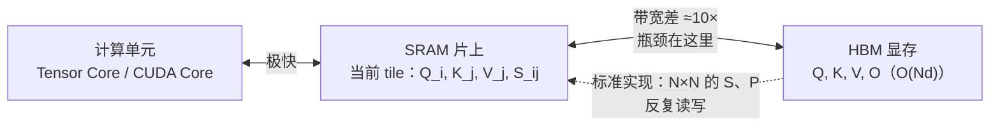

*图2.5.2-1 GPU 内存层次与注意力的访存模式*

标准实现需要 **6 次 HBM 传输**（读 QK → 写 S → 读 S → 写 P → 读 PV → 写 O）；FlashAttention 把中间步骤全部关在 SRAM 里完成，只需 **2 次**（分块读 QKV → 写最终 O）。

#### 2.5.3 分块（Tiling）：把 N×N 切成用完即丢的小块

把 Q 按行切成 $T_r$ 块（每块 $B_r$ 行），K/V 按行切成 $T_c$ 块（每块 $B_c$ 行）。块大小的约束是"SRAM 同时装得下 Q 块、K 块、V 块和局部分数块"：

$$
\underbrace{B_r d}_{Q_i} + \underbrace{B_c d}_{K_j} + \underbrace{B_c d}_{V_j} + \underbrace{B_r B_c}_{S_{ij}} \le M \;\;\overset{B_r = B_c = B}{\Longrightarrow}\;\; B \approx \frac{M}{4d}
$$

论文取 $B_c = \lceil M/4d \rceil$， $B_r = \min(\lceil M/4d \rceil, d)$。数值感受（ $M = 100\text{KB}$、 $d = 64$、 $N = 512$）：

| 量 | 公式 | 取值 |
|---|---|---|
| $B_c$ | $\lceil 100 \times 1024 / (4 \times 64) \rceil$ | 400 |
| $B_r$ | $\min(400, 64)$ | 64 |
| Q 块数 $T_r$ | $\lceil 512/64 \rceil$ | 8 |
| K/V 块数 $T_c$ | $\lceil 512/400 \rceil$ | 2 |
| 块计算总数 | $T_r \times T_c$ | 16 |

*表2.5.3-1 分块大小计算例：SRAM 越大 → 块越大 → 循环次数越少 → HBM 访问越少*

$S$ 的块矩阵布局只是**逻辑视图**：SRAM 中同时只存在一个 $B_r \times B_c$ 的 $S_{ij}$，算完立刻丢弃，完整 $N \times N$ 从未落地。

v1 的循环结构（外层 K/V、内层 Q）：

```text
外层 j = 1 … T_c:          遍历 K/V 块
  加载 K_j, V_j 到 SRAM
  内层 i = 1 … T_r:        遍历 Q 块
    加载 Q_i 及累积量 O_i, ℓ_i, m_i
    SRAM 内算 S_ij → 局部 softmax → 更新 O_i, ℓ_i, m_i
    写回 HBM
```

但这里有个拦路虎：**softmax 需要看到整行才能归一化**，而分块后每次只看到一部分列。怎么办？

#### 2.5.4 Online Softmax：边读块边修正，数学上精确

**回顾安全 softmax**（2.2.4 节）：对一行 $x$，维护三个量——最大值 $m$、指数向量 $f = e^{x - m}$、指数和 $\ell = \sum f$，则 $\text{softmax}(x) = f/\ell$。

**两块合并恒等式**。设 $x = [x^{(1)}, x^{(2)}]$，各自的局部统计量为 $(m_1, \ell_1)$、 $(m_2, \ell_2)$，则全局：

$$
m = \max(m_1, m_2), \qquad \ell = e^{m_1 - m}\, \ell_1 + e^{m_2 - m}\, \ell_2
$$

原理只有一条指数恒等式： $e^{x_i - m_{\text{old}}} \cdot e^{m_{\text{old}} - m_{\text{new}}} = e^{x_i - m_{\text{new}}}$。**如果新块出现了更大的 max，之前所有已累加的指数都要乘一个折扣因子 $r = e^{m_{\text{old}} - m_{\text{new}}} \le 1$ 来修正**——这个动作叫 **rescale**，是整个机制的精髓。

**递推到注意力输出**。把 $\ell$ 的递推推广到分子 $O$（注意累积的是**未归一化**的分子，最后才除 $\ell$）：

$$
m^{\text{new}} = \max(m^{\text{old}}, \tilde{m}), \qquad r = e^{m^{\text{old}} - m^{\text{new}}}
$$

$$
\ell^{\text{new}} = r \cdot \ell^{\text{old}} + e^{\tilde{m} - m^{\text{new}}} \tilde{\ell}, \qquad O^{\text{new}} = r \cdot O^{\text{old}} + e^{\tilde{m} - m^{\text{new}}}\, \tilde{P} V_{\text{blk}}
$$

其中 $\tilde{m}, \tilde{P}, \tilde{\ell}$ 是当前块的局部统计量。所有块处理完后， $\text{out} = O / \ell$。

| 步骤 | 全局 max $m$ | 全局和 $\ell$ | 分子累积 $O$ |
|---|---|---|---|
| 块 1 | $m_1 = \text{rowmax}(S_1)$ | $\sum e^{S_1 - m_1}$ | $e^{S_1 - m_1} V_1$ |
| 块 2 | $\max(m_1, \tilde{m}_2)$ | $r \ell_1 + e^{\tilde{m}_2 - m_2}\tilde{\ell}_2$ | $r O_1 + e^{\tilde{m}_2 - m_2}\tilde{P}_2 V_2$ |
| 块 3 | $\max(m_2, \tilde{m}_3)$ | $r \ell_2 + \cdots$ | $r O_2 + \cdots$ |
| 结束 | — | — | $\text{out} = O_3 / \ell_3$ |

*表2.5.4-1 Online Softmax 的三状态递推：只维护 m、ℓ、O 三个与 N 线性相关的量*

**这不是近似，是精确等价**——无论分几块、按什么顺序处理，结果与一次性 softmax 完全相同（浮点舍入除外）。

**三块数值演示**。设某行分数被切成 $[2.1, 3.2]$、 $[4.1, 1.5]$、 $[2.8, 3.0]$：

- 块 1： $m_1 = 3.2$， $\ell_1 = e^{-1.1} + e^0 = 0.3329 + 1 = 1.3329$；
- 块 2： $\tilde{m}_2 = 4.1 > m_1$， $m_2 = 4.1$， $r = e^{3.2-4.1} = 0.40657$； $\ell_2 = 0.40657 \times 1.3329 + (1 + e^{-2.6}) = 0.54193 + 1.07427 = 1.61618$；
- 块 3： $\tilde{m}_3 = 3.0 < 4.1$， $r = 1$； $\ell_3 = 1.61618 + (e^{-1.3} + e^{-1.1}) = 1.61618 + 0.60540 = 2.22158$。

校验：六个分数一次性做安全 softmax， $m = 4.1$， $\ell = \sum e^{x_i - 4.1} = 2.22158$ ✓，逐位一致。

🧪 [交互实验：Online Softmax 分块演示](resources/chapter2/chapter2.5-online_softmax_demo.html)——逐块点击推进，实时显示 $m, \ell, O$ 的更新与 rescale 折扣因子，并与一次性 softmax 的结果对照（自包含 HTML，双击离线打开）。

#### 2.5.5 完整实例：N=4、d=3、块大小 2

取 $Q$ 的第一块（ $t_1, t_2$）依次与两个 K/V 块交互（完整数据见交互附件，此处列关键中间量）：

$$
Q_1 = \begin{bmatrix} 0.05 & 0.11 & 0.42 \cr 0.03 & 0.89 & 0.59 \end{bmatrix}, \quad V_1 = \begin{bmatrix} -0.07 & 0.10 & 0.13 \cr 0.89 & -0.59 & 0.14 \end{bmatrix}, \quad V_2 = \begin{bmatrix} -0.29 & 0.79 & 0.78 \cr -0.13 & 0.65 & 0.68 \end{bmatrix}
$$

**块 1**： $S_{11} = Q_1K_1^\top/\sqrt{3} = \begin{bmatrix} 0.1440 & -0.0380 \cr 0.1241 & -0.4018 \end{bmatrix}$，行最大值 $m_1 = [0.1440, 0.1241]$， $\ell_1 = [1.8336, 1.5910]$，未归一化分子 $\text{acc}_1 = e^{S_{11}-m_1}V_1$。

**块 2**： $S_{12} = \begin{bmatrix} 0.0512 & -0.0958 \cr -0.0764 & -0.4118 \end{bmatrix}$，局部 max $\tilde{m} = [0.0512, -0.0764]$ **小于** $m_1$，故全局 max 不变、 $r = [1, 1]$；但新块贡献仍要按自己的局部 max 修正： $r_2 = e^{\tilde{m} - m_1} = [0.9114, 0.8184]$。

$$
\ell^{\text{new}} = \ell_1 + r_2 \tilde{\ell} = [3.5318, 2.9945], \qquad \text{acc}^{\text{new}} = \text{acc}_1 + r_2 (\tilde{P}V_2)
$$

**归一化**： $O_1 = \text{acc}^{\text{new}} / \ell^{\text{new}} = \begin{bmatrix} 0.0864 & 0.2377 & 0.4226 \cr 0.0476 & 0.2599 & 0.4171 \end{bmatrix}$。

**校验**：一次性算完整 $4\times4$ 的 $S$ 再做标准 softmax，前两行与分块结果**逐位相同**（最大误差 $1.1 \times 10^{-16}$，浮点舍入量级）。这就是"Online Softmax 零近似误差"的实证。

#### 2.5.6 复杂度账本与 v1 → v2

**内存**：标准实现 $\Theta(Nd + N^2)$；FlashAttention 只存 $Q,K,V,O$ 加每行两个标量 $(m, \ell)$，共 $\Theta(Nd)$——**没有任何 $N^2$ 项**。

**IO（HBM 访问量）**：标准 $\Theta(Nd + N^2)$；FlashAttention 为 $\Theta(N^2 d^2 / M)$（ $M$ 为 SRAM 大小）。直觉：外层 $N/B_c$ 个 KV 块，内层每次读写 $\Theta(B_r d)$ 的 Q 块状态，总量 $\frac{N^2 d}{B_c} = \Theta(\frac{N^2 d^2}{M})$。典型参数下 $d^2 \ll M$，故远小于 $N^2$。论文还证明这是**渐近最优**的：不存在精确注意力算法能在所有 $M$ 下达到 $o(N^2 d^2/M)$ 的 IO。

**FLOPs 不变**（仍是 $O(N^2 d)$）——FlashAttention 省的是搬运，不是计算。实测比标准实现快 2–4 倍。

**v2 的改进**（2023）：

| 对比项 | v1 | v2 |
|---|---|---|
| 外层循环 | K/V 块 | **Q 块** |
| 内层循环 | Q 块 | K/V 块 |
| 线程块间同步 | 多线程块写同一 Q 输出，需同步 | 每线程块独占一个 Q 输出，无同步 |
| 并行维度 | 头 × batch | 额外在 Q 块维并行 |
| 非 matmul FLOPs | 较多 | 减少，更好喂饱 Tensor Core |
| A100 利用率 | 理论峰值 25–40% | 50–73%（约 2× 加速） |

*表2.5.6-1 FlashAttention v1 vs v2：核心是循环交换带来的并行度提升*

如今 FlashAttention 已是训练与推理的标准组件：PyTorch 2.0 起 `scaled_dot_product_attention` 默认走 Flash 后端。理解它的分块原理，是后续 Triton 算子开发（第三章）的直接基础。

### 2.6 推理加速：KV Cache 与量化

#### 2.6.1 自回归生成：Prefill 与 Decode

训练时整段序列一次并行算完。但**推理是逐 token 生成的**：生成第 5 个 token 前必须先跑完第 4 个。两个阶段的计算特征截然不同：

| 阶段 | 计算特征 | 瓶颈 |
|---|---|---|
| Prefill（预填充） | 一次处理整段 prompt， $Q$ 长度 $N$，并行度高 | 计算密集（compute-bound） |
| Decode（解码） | 每步只处理 1 个新 token， $Q$ 长度 1，但要对全部历史 KV 做注意力 | 访存密集（memory-bound） |

*表2.6.1-1 Prefill vs Decode：decode 每步都要把整个 KV cache 从显存读一遍*

朴素做法每生成一个新 token 就把整个历史重新过一遍——纯浪费，因为**已算过的 token，其 K 和 V 永远不会变**（因果掩码保证历史不受未来影响）。把它们存下来复用，就是 **KV Cache**。

#### 2.6.2 为什么只缓存 K、V，不缓存 Q

一句话：**Q 是"一次性用品"，K/V 是"被反复查阅的资料"。** 这不是工程取舍，而是注意力结构本身决定的。

第 $t$ 步算位置 $t$ 的输出，依因果性只消费"当前的 $q_t$"加"历史的 $k_{1..t}, v_{1..t}$"：

$$
O_t = \text{softmax}\!\left(\frac{q_t\,[k_1,\dots,k_t]^\top}{\sqrt{d_k}}\right)[v_1,\dots,v_t]
$$

过去的 $q_1,\dots,q_{t-1}$ 一个都不出现。统计每个向量的被使用次数：

$$
\#(q_j) = 1, \qquad \#(k_j) = \#(v_j) = N - j + 1
$$

$$
\sum_j \#(q_j) = N \qquad \text{vs} \qquad \sum_j \#(k_j) = \frac{N(N+1)}{2}
$$

**数值实例**（ $N=4$， $1/\sqrt{d_k} = 0.707$； $q_1=[1,0], q_2=[0,1], q_3=[1,1], q_4=[1,-1]$； $k_1=[1,0], k_2=[0,1], k_3=[1,1], k_4=[1,0]$； $v_1=[1,0], v_2=[0,1], v_3=[1,1], v_4=[-1,1]$）：

| 步 $t$ | 本步 Q | 本步 K/V | $S_t$ | $P_t$ | $O_t$ |
|---|---|---|---|---|---|
| 1 | $q_1$ | $k_1,v_1$ | [0.707] | [1.000] | [1.000, 0.000] |
| 2 | $q_2$ | $k_{1..2},v_{1..2}$ | [0, 0.707] | [0.330, 0.670] | [0.330, 0.670] |
| 3 | $q_3$ | $k_{1..3},v_{1..3}$ | [0.707, 0.707, 1.414] | [0.248, 0.248, 0.503] | [0.752, 0.752] |
| 4 | $q_4$ | $k_{1..4},v_{1..4}$ | [0.707, −0.707, 0, 0.707] | [0.365, 0.089, 0.180, 0.365] | [0.180, 0.635] |

*表2.6.2-1 逐步生成中 Q 与 K/V 的使用：q₁ 只在第 1 步出现；k₁、v₁ 每步都被读取且值不变*

换算成投影计算量：无 cache 时 K、V 投影各需 $N(N+1)/2 = 10$ 次，有 cache 只需 $N = 4$ 次；而 Q 投影两种方案都是 4 次——**缓存 Q 省下的计算恒为 0，只白占显存**。

结构视角（出度不对称）： $S_{ij} = q_i \cdot k_j$ 中， $q_i$ 只出现在第 $i$ 行（服务完自己即终结）， $k_j$ 出现在第 $j$ 列、被所有 $i \ge j$ 的行共同读取。

#### 2.6.3 KV Cache 的体积账

$$
\text{bytes/token} = 2 \times L \times H_{kv} \times d_{head} \times b
$$

其中 2 = K/V 各一份， $L$ = 层数， $H_{kv}$ = KV 头数， $b$ = 每元素字节数。以 LLaMA-3-8B（ $d=4096$、 $h_q=32$、 $H_{kv}=8$、 $d_{head}=128$、bf16、32 层）为例：

| 量 | GQA（8 KV 头） | 若用 MHA（32 KV 头） |
|---|---|---|
| 每 token 每层 | 2×8×128×2B = 4 KB | 16 KB |
| 每 token 全模型 | 128 KB | 512 KB |
| 10 万 token 上下文 | 12.8 GB | 51.2 GB |

*表2.6.3-1 KV cache 体积：H_kv 是线性因子，除以 4 则 cache 精确除以 4*

长上下文下 KV cache 是推理显存的第一大头。压缩它有三条**正交**的杠杆：

1. **降 $H_{kv}$**：MHA → MQA/GQA（2.8 节），少存几组完整向量；
2. **降每头存储维度**：MLA（2.10 节），把向量压小再展开；
3. **降 $b$**：KV 量化（本节 2.6.5），不改结构，只改每元素比特数。

#### 2.6.4 PagedAttention：给 KV Cache 上"虚拟内存"

KV cache 带来两个新问题：**显存碎片**（按最大长度预留造成大量浪费）和**无法共享**（相同前缀的请求各存一份）。PagedAttention（vLLM）把操作系统分页的思路搬过来：

```text
序列 A: block_table = [2, 5, 6, 9]

  逻辑块（连续）    L0      L1      L2      L3
                    │       │       │       │
                    ▼       ▼       ▼       ▼
  物理块池（离散）  P0  P1  P2  P3  P4  P5  P6  P7  P8  P9
                    ·   ·   ▲   ○   ·   ▲   ▲   ○   ○   ▲
                   其他 其他  A  空闲 其他  A   A  空闲 空闲  A
```

*图2.6.4-1 KV cache 分页：逻辑连续、物理离散，靠 block table 映射*

KV cache 切成固定大小的 block，按需分配。收益：消除内部碎片；相同前缀的请求指向同一批物理 block（写时复制）；block 成为量化与调度的自然粒度。**这一步不改数值，只改 KV 在显存里的摆放方式。**

#### 2.6.5 KV 量化：把 b 从 2 字节压到 1 字节甚至 0.5 字节

**为什么 KV 比权重更容易量化？** 注意力输出是加权平均，量化误差会被 softmax 权重摊平；真正要警惕的是**异常值**（outlier）。

**核心设计变量：一个 scale 覆盖多少元素（粒度）**。覆盖得多 → scale 省，但一个异常大值拉高整个范围，其余值挤在低精度区间；覆盖得少 → 贴合局部分布，但 scale 自身的存储/访存开销上升。

| 粒度 | 一个 scale 覆盖 | 典型场景 | 痛点 |
|---|---|---|---|
| per-tensor | 整个张量 | 快速原型 | 离群值拖垮全矩阵 |
| per-channel / per-head | 一个 head 的整条维度线 | **K 的常见选择** | 无法适应 token 间差异 |
| per-token | 一个 token 的全部维度 | **V 的常见选择** | 无法适应通道差异 |
| per-token-head | 一个 token 的一个 head | 更细 | scale 数 = token × head |
| per-32-group | 32 个连续元素 | MX 格式（MXFP8/MXFP4） | scale 数 = 元素数/32 |

*表2.6.5-1 量化粒度选择*

**为什么 K 按通道、V 按 token？** 实践中 K 的少数通道存在系统性离群值（某些 head 的某些维度比其他维度大几十倍），必须按通道隔离；V 的分布相对平滑，按 token 切分足够。

**粒度越细精度越好——数字感受**：某段数据最大值 100，per-tensor 的 E4M3 步长为 $2^{\lceil\log_2(100/448)\rceil} = 0.25$；若某 32 元素分组内最大值仅 1.0，该组步长 $2^{-8} = 0.0039$——**细了 64 倍**。

**MX 格式**：scale 用 E8M0（8 位纯指数、无尾数），值 $= 2^{b-127}$。故意砍掉尾数，让 scale 只能取 2 的整数次幂，**反量化退化为指数加减**，硬件成本极低；代价是最多 2× 的过冲，对 32 元素分组可接受。scale 张量形状常带尾巴 2（如 $(\cdot, \lceil D/64\rceil, 2)$），因为 2 个 32 元素组打包成 1 个 16 位单位存放。

**反量化的两个施加位置**：

- **外挂式**（矩阵乘之后再乘 scale）：适合粗粒度（per-tensor/token/head），scale 少，一次向量乘搞定；
- **融合式**（scale 随数据一起进矩阵乘）：细粒度**必须**走这条路——若 32 元素一个 scale，外挂式会让 $S$ 的每个元素都查组取 scale，退化成逐元素操作，开销盖过收益。融合式把 scale 作为第三操作数随数据进片上缓冲，由矩阵乘单元在累加中完成修正：

$$
S_{ij} = \sum_{d} q_{i,d} \cdot 2^{e_q[i,\lfloor d/32\rfloor]-127} \cdot k_{j,d} \cdot 2^{e_k[j,\lfloor d/32\rfloor]-127}
$$

**全量化注意力的 A8C8 记法**：算子枚举名如 `A8C8_QKV_MXFP8_P_FP8_E4M3_PER_TENSOR_SOFTMAX_FP32` 中，**A = 左矩阵（激活），C = 右矩阵（per-channel 侧），数字是位宽**。注意注意力里没有"权重"——Q/K/V 全是激活，A/C 区分的是 matmul 的左右操作数（BMM1 的 Q 与 K，BMM2 的 P 与 V），两侧格式同步，故 A 与 C 的数字永远相等。该枚举的含义：Q/K/V 走 MXFP8，中间矩阵 P 量化到 FP8（per-tensor），但 softmax 的 exp 与累加保持 FP32。

**误差传播：为什么低比特注意力依然成立**。设 Q/K 每元素相对误差量级 $\epsilon_q, \epsilon_k$，点积的相对误差：

$$
\frac{\Delta S_{ij}}{S_{ij}} \approx \frac{\sqrt{\epsilon_q^2 + \epsilon_k^2}}{\sqrt{D}}
$$

$D=128$ 时误差被压缩约 11 倍：8 bit 的 6.25% 传到 logits 只剩约 0.8%——与 2.2.3 节"点积方差随维度线性增长"是**同一统计规律的反向应用**（求和既放大噪声尺度，也摊薄相对误差）。再经 softmax，整体平移误差被自动消去（共模抑制，同"减 rowmax 不变性"）；最后 $O=PV$ 中 V 的误差不参与求和摊薄， $\Delta O/O \approx \epsilon_v$。这解释了"分子 P 走低精度换算力、分母 $\ell$ 用 FP32 锁住归一化基准"的混合精度取舍。

### 2.7 反向传播：梯度怎么流回每个参数

第一章的单神经元反向是"误差信号 × 当初的输入"。Attention 的反向沿用同一条链式法则，只是计算图更宽。反向的输入是上游传来的 $dO = \partial L/\partial O$（形状 $N \times d_v$），目标是求 $dQ, dK, dV, dW_q, dW_k, dW_v$ 以及传回输入的 $dX$。

**先记住两条规则，整个反向只有 softmax 是例外**：

1. **加法节点**：梯度原样分发到各输入（所以 $dX$ 是三条通路之和）；
2. **乘法节点**：对哪个操作数求导，就把**另一个操作数转置后乘上去**（所以 $dV = P^\top dO$、 $dK = dS^\top Q/\sqrt{d_k}$）。

#### 2.7.1 反向计算图

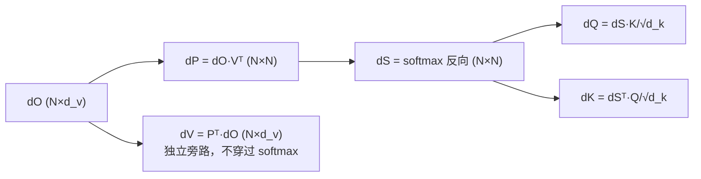

*图2.7.1-1 Attention 的反向计算图：dV 是一条独立旁路——O=PV 中 V 直接参与乘法，梯度无需穿过 softmax，这是反向里最便宜的一步*

#### 2.7.2 逐步推导

**① $O = PV$ 的两条梯度**。逐元素看： $O_{ic} = \sum_j P_{ij}V_{jc}$，对 $V_{jc}$ 求导得 $P_{ij}$，对 $P_{ij}$ 求导得 $V_{jc}$，链式法则汇总成矩阵形式：

$$
dV = P^\top dO, \qquad dP = dO\, V^\top
$$

正是"换位 + 转置"规则。

**② $P = \text{softmax}(S)$ 的雅可比（最容易踩坑的一步）**。单行 $p_i = e^{s_i}/\sum_k e^{s_k}$ 求导：

$$
\frac{\partial p_i}{\partial s_j} = p_i(\delta_{ij} - p_j)
$$

这是一个**满矩阵**而非对角阵——归一化分母依赖所有 $s$，每个输出都连着每个输入。代入链式法则并整理：

$$
\frac{\partial L}{\partial s_j} = p_j \frac{\partial L}{\partial p_j} - p_j \sum_i \frac{\partial L}{\partial p_i} p_i
$$

写成矩阵形式（ $\odot$ 为逐元素乘）：

$$
\boxed{\; dS = P \odot \big( dP - \text{rowsum}(dP \odot P) \big) \;}
$$

形状自洽： $dP \odot P$ 是 $N\times N$，按行求和得 $N\times1$ 广播回每行，结果仍 $N\times N$ ✓。

**关于减 rowmax 的重参数化**： $m = \text{rowmax}(S)$ 看似是 $S$ 的函数，却**不需要额外修正项**——softmax 对整行平移不变，其雅可比满足 $J \cdot \mathbf{1} = 0$（行常数方向被完全湮灭）。2.7.3 的数值实例会验证这一点。

**③ $S = QK^\top/\sqrt{d_k}$**：再用一次"换位 + 转置"：

$$
dQ = \frac{dS \cdot K}{\sqrt{d_k}}, \qquad dK = \frac{dS^\top \cdot Q}{\sqrt{d_k}}
$$

> 工程小优化：真实实现常把 $1/\sqrt{d_k}$ 提前折进 $Q$（前向做 $Q \leftarrow Q/\sqrt{d_k}$），反向就不再带这个因子，省一次乘法。

**④ 回到参数和输入**：

$$
dW_q = X^\top dQ, \quad dW_k = X^\top dK, \quad dW_v = X^\top dV
$$

$$
dX = dQ\,W_q^\top + dK\,W_k^\top + dV\,W_v^\top
$$

$dX$ 是**三项之和**——$X$ 同时喂给了三条投影通路，梯度必须在输入处汇合（加法节点规则）。这也是 attention 反向比前向更重的原因之一。

#### 2.7.3 数值实例：softmax 反向（沿用 2.2.2 的例子）

取 $dO = \begin{bmatrix} 1&0 \cr 0&1 \cr 1&0 \cr 0&1 \end{bmatrix}$（相当于挑选 $O$ 的特定元素求和）， $P$ 用 2.2.2 算出的结果。

**$dP = dO\,V^\top$**（每行由 $V$ 的行决定）：

$$
dP = \begin{bmatrix} 1.00 & 0 & 1.00 & -1.00 \cr 0 & 1.00 & 1.00 & 0.50 \cr 1.00 & 0 & 1.00 & -1.00 \cr 0 & 1.00 & 1.00 & 0.50 \end{bmatrix}
$$

**$dS = P \odot (dP - \text{rowsum}(dP \odot P))$**：

$$
dS \approx \begin{bmatrix} 0 & 0 & 0 & 0 \cr -0.22 & 0.22 & 0 & 0 \cr 0.02 & -0.15 & 0.13 & 0 \cr -0.03 & 0.08 & 0.06 & -0.11 \end{bmatrix}
$$

逐行验算第 2 行： $\Sigma = 0\times0.33 + 1\times0.67 = 0.67$，故 $dS_{21} = 0.33\times(0-0.67) = -0.2211$， $dS_{22} = 0.67\times(1-0.67) = +0.2211$ ✓。

**三条重要性质**（都是结构性必然，不是数值巧合）：

1. **第一行恒为零**： $q_1$ 只能看一个位置，softmax 输出恒为 1，与 $S_{11}$ 取值无关，梯度必为 0；
2. **每行之和恒为 0**：印证 $J\cdot\mathbf{1}=0$——输出行和恒为 1，"行常数方向"被雅可比湮灭；
3. **被 mask 的位置自动得 0**： $dS = P \odot (\cdots)$ 中 $P$ 是乘子，mask 处 $P=0$ 即梯度为 0，**无需额外清零逻辑**（ $dP$ 在 mask 处即使是垃圾值也无害）。

**$dV = P^\top dO$**：

$$
dV_1 = [1.10, 0.37], \quad dV_2 = [0.19, 0.95], \quad dV_3 = [0.71, 0.21], \quad dV_4 = [0.00, 0.47]
$$

漂亮的结构：**$dV_j$ = 所有关注过 $j$ 的 query 的梯度，按 $P$ 第 $j$ 列加权求和**。 $P$ 的列和 = 该 KV token"被关注的总强度"——长序列里很少被关注的开头 token，梯度会迅速衰减。

#### 2.7.4 多头的反向：严格对称地走回去

前向做了"拆头 → 各头独立注意力 → 拼合 → 乘 $W_O$"，反向必须对称：

- $dW_O = O_{\text{concat}}^\top\, dO_{\text{out}}$， $dO_{\text{concat}} = dO_{\text{out}} W_O^\top$；
- **拼合（merge）的反向就是拆头（split）**，拆头的反向就是拼合；
- 分叉处（ $X$ 喂三路投影）梯度累加。

> 最隐蔽的 bug：`_split` 用 `reshape + transpose`，反向必须用完全对称的 `transpose + reshape`。顺序写反会**形状仍然正确、数值错位**，不报错只错结果。

手工反向的核心代码（对应上面四条推导）：

```python
# 上游传入 dO (N, d_v)
dV = P.transpose(-1, -2) @ dO                       # 独立旁路
dP = dO @ V.transpose(-1, -2)
dS = P * (dP - (dP * P).sum(dim=-1, keepdim=True))  # softmax 雅可比
dQ = (dS @ K) / math.sqrt(d_k)                      # 若缩放已折进 Q 则无此因子
dK = (dS.transpose(-1, -2) @ Q) / math.sqrt(d_k)
```

**验证方法：中心差分梯度校验**。对每个参数元素 $\theta_i$，用 $\frac{L(\theta_i+\epsilon)-L(\theta_i-\epsilon)}{2\epsilon}$（ $\epsilon=10^{-6}$）数值求导，与解析梯度对比。实现正确时相对误差应在 $10^{-6}\sim10^{-10}$ 量级；若某参数误差达 $10^{-1}$，说明该步的转置/换位/累加写错了。

#### 2.7.5 FlashAttention 的反向：不存 P，重算

标准实现前向要保存 $P$（反向的 $dV$、 $dP$ 都需要它），每层多存一个 $N\times N$。FlashAttention 反其道而行：**前向只存 $O$ 和 $(m, \ell)$（都是 $O(N)$），反向逐块重算** $\tilde{P} = e^{S - m}$，再套同一套公式（全部分块累加）。

| | 前向保存 | 反向输入 | 峰值显存 |
|---|---|---|---|
| 标准实现 | $P$（ $N\times N$） | $P$, $dO$, $V$ | $O(N^2)$ |
| FlashAttention | $O$, $m$, $\ell$（ $O(N)$） | 重算 $P$ | $O(N)$ |

*表2.7.5-1 FlashAttention 反向：用重算换显存，代价是多算一遍 softmax*

减 max 的重参数化在反向依然成立（ $J\cdot\mathbf{1}=0$），直接用减过 max 的 $P$ 套公式即可，无需修正项。

#### 2.7.6 量化场景下反向的差异

- **scale 一般不参与反向**：`round()` 的导数几乎处处为 0，量化感知训练用 STE（直通估计量）或 `stop_gradient` 处理，否则梯度直接消失；
- **低精度存储引入梯度噪声**：反量化的 $\tilde{K}$ 与真值的误差经 $dK = dS^\top Q/\sqrt{d_k}$ 传播。精度损失在反向比前向更敏感，需要混合精度兜底（如序列末尾不足 64 token 的 V 尾块保留 BF16、P 量化后用 rowsum 校正消偏置）。

#### 2.7.7 前向-反向对照表与调试清单

| 前向步骤 | 形状 | 反向公式 |
|---|---|---|
| $Q = XW_q$（K/V 同理） | $N\times d_k$ | $dW_q = X^\top dQ$， $dX \mathrel{+}= dQ\,W_q^\top$ |
| $S = QK^\top/\sqrt{d_k}$ | $N\times N$ | $dQ = dS\,K/\sqrt{d_k}$， $dK = dS^\top Q/\sqrt{d_k}$ |
| mask | $N\times N$ | 无需处理（ $P=0$ 处梯度自动为 0） |
| $P = \text{softmax}(S)$ | $N\times N$ | $dS = P \odot (dP - \text{rowsum}(dP\odot P))$ |
| $O = PV$ | $N\times d_v$ | $dP = dO\,V^\top$， $dV = P^\top dO$ |
| concat + $W_O$ | $N\times d$ | $dW_O = O_{\text{cat}}^\top dO_{\text{out}}$，merge 反向 = split |

*表2.7.7-1 前向-反向完整对照*

调试检查清单（按顺序查，覆盖绝大多数 bug）：

1. **形状断言**：每个梯度形状必须与对应前向变量完全一致；
2. **$dS$ 行和恒为 0**（浮点误差外），否则 softmax 反向写错；
3. **mask 处 $dS$ 严格为 0**，若靠额外清零才成立说明漏了 $P$ 乘子；
4. **单一有效行的 $dS$ 全 0**；
5. **softmax 必须减 rowmax**，检查 exp 输入是否超 fp16 上限；
6. **$1/\sqrt{d_k}$ 的位置**：折进 Q 还是留在 S 上，混用会梯度整体差常数倍（不报错、只收敛慢）；
7. **拼合/拆头对称性**：reshape 与 transpose 顺序严格互逆；
8. **量化场景**：检查 scale 是否正确 stop-gradient、反量化偏差。

### 2.8 高效注意力变体：MQA 与 GQA

#### 2.8.1 动机：KV cache 里最贵的因子是头数

2.6.3 节的体积公式中， $H_{kv}$ 是线性因子。MHA 每个 query 头配一套独立 K/V，表达力最强但 cache 最大。能不能让多个 query 头**共享** K/V？

| 机制 | query 头数 | KV 组数 $H_{kv}$ | 每 token 每层 cache 元素 | 代表模型 |
|---|---|---|---|---|
| MHA | $h$ | $h$ | $2h\,d_{head}$ | 原始 Transformer、GPT-2/BERT |
| MQA | $h$ | $1$ | $2d_{head}$ | PaLM、StarCoder |
| GQA | $h$ | $g$（ $1<g<h$） | $2g\,d_{head}$ | LLaMA-2/3、Qwen、Mistral |

*表2.8.1-1 三种机制：唯一本质区别是 KV 组数与 query 头数的关系*

MQA 所有头共享同一组 K/V，cache 降到 $1/h$ 但过度共享导致质量下降；GQA 把 $h$ 个 query 头分成 $g$ 组、每组共享一组 K/V，是二者的统一推广（ $g=h$ 退化 MHA， $g=1$ 退化 MQA），2023 年后成为长上下文推理的默认配置。

#### 2.8.2 GQA 的数学定义

记 $m(i)$ 为 query 头 $i$ 所属的组。**投影时 K/V 只产生 $g$ 组**：

$$
Q_i = XW_q^{(i)}\ (i=1,\dots,h), \qquad K_j = XW_k^{(j)},\ V_j = XW_v^{(j)}\ (j=1,\dots,g)
$$

头 $i$ 只与所属组的 K/V 交互：

$$
S_i = \frac{Q_i K_{m(i)}^\top}{\sqrt{d_k}}, \qquad O_i = \text{softmax}(S_i)\,V_{m(i)}
$$

输出与 MHA 一样拼接后乘 $W_O$。实现上把 $g$ 组 K/V 沿头维重复 $h/g$ 次（`repeat_interleave`）即可复用标准 MHA 代码。KV cache 只存 $g$ 组，**压缩比恰好 $h/g$**。

#### 2.8.3 数值实例

$h=4$、 $g=2$（头 1/2 属组 A，头 3/4 属组 B）、 $d_k=d_v=2$、 $N=2$、无掩码、 $1/\sqrt{2}\approx0.707$：

```text
组A: K_A = [[1,0],[0,1]]   V_A = [[1,0],[0,1]]
组B: K_B = [[0,1],[1,1]]   V_B = [[1,1],[1,-1]]
head1: Q=[[1,0],[0,1]]   head2: Q=[[0,1],[1,0]]
head3: Q=[[1,1],[0,1]]   head4: Q=[[-1,0],[1,1]]
```

| head | 组 | $S$ | $P$ | $O = PV$ |
|---|---|---|---|---|
| 1 | A | [0.707, 0; 0, 0.707] | [0.670, 0.330; 0.330, 0.670] | [0.670, 0.330; 0.330, 0.670] |
| 2 | A | [0, 0.707; 0.707, 0] | [0.330, 0.670; 0.670, 0.330] | [0.330, 0.670; 0.670, 0.330] |
| 3 | B | [0.707, 1.414; 0.707, 0.707] | [0.330, 0.670; 0.500, 0.500] | [1.000, −0.340; 1.000, 0.000] |
| 4 | B | [0, −0.707; 0.707, 1.414] | [0.670, 0.330; 0.330, 0.670] | [1.000, 0.340; 1.000, −0.340] |

*表2.8.3-1 GQA 数值实例（格子内 `;` 分行）*

**要点**：head 1 与 head 2 用**完全相同的 K/V**，但查询不同，得到不同的注意力分布与输出——GQA 的本质是**用"更少的 KV 组"换取"同样多的 query 视角"**。

#### 2.8.4 对参数、计算、缓存的三方面影响

- **参数量**： $W_q$、 $W_O$ 不变； $W_k$、 $W_v$ 从 $[d,d]$ 缩到 $[d, g\cdot d_{head}]$。单层注意力参数从 $4d^2$ 变为 $2d^2(1+g/h)$。LLaMA-3-8B：MHA 67.1M/层 → GQA 41.9M/层；
- **计算量**：KV 投影 GEMM 同比例缩小；但 score/AV 的理论 FLOPs 按 $h_q \cdot d_{head} = d$ 计**不变**（K 被复用）——**GQA 省的是显存和带宽，不是打分的乘加次数**；
- **KV cache**：每 token 每层 $2g\,d_{head}\,b$，decode 每步全量读回——这是 $g$ 省得最狠的地方（表2.6.3-1）。

#### 2.8.5 参考实现（PyTorch）

```python
class GroupedQueryAttention(nn.Module):
    def __init__(self, d_model=4096, h=32, g=8, d_k=128):
        super().__init__()
        assert h % g == 0
        self.h, self.g, self.d_k = h, g, d_k
        self.W_q = nn.Linear(d_model, h * d_k, bias=False)   # h 组查询
        self.W_k = nn.Linear(d_model, g * d_k, bias=False)   # 只有 g 组键
        self.W_v = nn.Linear(d_model, g * d_k, bias=False)
        self.W_o = nn.Linear(h * d_k, d_model, bias=False)

    def forward(self, x):                                    # (B, N, d_model)
        B, N, _ = x.shape
        Q = self.W_q(x).view(B, N, self.h, self.d_k).transpose(1, 2)  # (B,h,N,d_k)
        K = self.W_k(x).view(B, N, self.g, self.d_k).transpose(1, 2)  # (B,g,N,d_k)
        V = self.W_v(x).view(B, N, self.g, self.d_k).transpose(1, 2)
        rep = self.h // self.g
        K = K.repeat_interleave(rep, dim=1)                  # 组内广播到 h 头
        V = V.repeat_interleave(rep, dim=1)
        S = Q @ K.transpose(-2, -1) / math.sqrt(self.d_k)
        O = S.softmax(dim=-1) @ V
        O = O.transpose(1, 2).reshape(B, N, self.h * self.d_k)
        return self.W_o(O)
```

训练时这等价于普通 MHA；只有**推理**时因为 K/V 只有 $g$ 组，cache 才真正省下 $h/g$。

### 2.9 低秩压缩的数学基础：SVD

GQA 靠"共享头"省 cache，代价是表达力受硬约束。MLA 换了一条路：**不减少头，而是把每头的 K/V 压缩进一个低维 latent，用时再还原**。这条路的数学依据是 SVD（奇异值分解）与截断低秩近似。本节把数学基础打牢，2.10 节再装回注意力。

#### 2.9.1 SVD 是什么：旋转 → 缩放 → 旋转

**存在性定理**：任何矩阵 $M \in \mathbb{R}^{m\times n}$ 都能分解为

$$
M = U \Sigma P^\top
$$

其中 $U$（ $m\times m$）、 $P$（ $n\times n$）是正交矩阵， $\Sigma$ 对角、对角元 $\sigma_1 \ge \sigma_2 \ge \cdots \ge 0$ 称为**奇异值**。（为避免与注意力的 Value 混淆，右奇异矩阵记作 $P$ 而非惯用的 $V$。）

**几何意义**：这个分解把任意线性变换拆成"旋转 $P^\top$ → 沿正交轴按 $\sigma_i$ 缩放 → 旋转 $U$"。单位球被映成半轴为 $\sigma_i$ 的椭球； $\sigma_i$ 是"沿输入方向 $p_i$ 到输出方向 $u_i$ 的放大率"。**大奇异值方向 = 矩阵作用的主要模式**——这是后面一切压缩的物理基础。

**为什么任何矩阵都有 SVD**（证明骨架，四步）：

1. $M^\top M$ 对称半正定（ $x^\top M^\top M x = \|Mx\|^2 \ge 0$），由谱定理可正交对角化： $M^\top M = P\Lambda P^\top$，特征值 $\lambda_i \ge 0$ 降序；
2. 定义 $\sigma_i = \sqrt{\lambda_i}$；非零 $\sigma$ 的个数恰等于 $\mathrm{rank}(M)$（因为 $M$ 与 $M^\top M$ 零空间相同）；
3. 对非零 $\sigma_i$ 令 $u_i = Mp_i/\sigma_i$，可验证 $\{u_i\}$ 标准正交； $\lambda_i=0$ 的方向满足 $Mp_i=0$（被矩阵"杀死"）；
4. 补全正交基后，两个线性算子 $M$ 与 $\sum_i \sigma_i u_i p_i^\top$ 在基 $\{p_j\}$ 上取值逐一相同，故恒等。∎

两个常用范数公式（后面反复用）：

$$
\|M\|_F^2 = \sum_i \sigma_i^2 \quad \text{（总能量）}, \qquad \|M\|_2 = \sigma_1 \quad \text{（最大放大率）}
$$

#### 2.9.2 截断 SVD：只取前 k 项，定理背书的最优压缩

把 $M$ 写成秩-1 项的降序叠加 $M = \sum_{i=1}^{r}\sigma_i u_i p_i^\top$，"只取前 $k$ 项"就是：

$$
M_k = \sum_{i=1}^{k}\sigma_i u_i p_i^\top = U_k\Sigma_k P_k^\top
$$

因为 $\sigma$ 降序，被砍掉的是**能量最小**的方向。误差可以精确刻画：

$$
\|M - M_k\|_2 = \sigma_{k+1}, \qquad \|M - M_k\|_F = \sqrt{\textstyle\sum_{i>k}\sigma_i^2}, \qquad \text{能量保留率} = \frac{\sum_{i\le k}\sigma_i^2}{\sum_i\sigma_i^2}
$$

**Eckart–Young–Mirsky 定理**：对**任意**秩 $\le k$ 的矩阵 $N$，都有 $\|M-N\|_2 \ge \sigma_{k+1}$、 $\|M-N\|_F \ge \sqrt{\sum_{i>k}\sigma_i^2}$。即截断 SVD 是所有秩-$k$ 近似中**全局最优**的——"取前 $k$ 项"不是工程直觉，而是有定理背书的最优线性压缩。

> 谱范数情形三行可证：秩 $\le k$ 的 $N$ 在 $k+1$ 维子空间 $\mathrm{span}\{p_1,\dots,p_{k+1}\}$ 上必有非零向量 $x$ 使 $Nx=0$，于是 $\|M-N\|_2 \ge \|Mx\| \ge \sigma_{k+1}$。∎

#### 2.9.3 压缩 = 投影：存坐标，不存本体

由正交性可得关键恒等式 $M_k = M\,P_kP_k^\top$。把 $M$ 的第 $t$ 行 $m_t$ 看作**一个 token 的 K 向量**，逐行读：

$$
c_t = m_t P_k \in \mathbb{R}^k \quad \text{（压缩：取前 } k \text{ 个主方向上的坐标）}
$$

$$
\hat{m}_t = c_t P_k^\top \in \mathbb{R}^n \quad \text{（升维：用共享基 } P_k \text{ 把坐标组合回 } n \text{ 维）}
$$

$$
m_t - \hat{m}_t \perp \mathrm{span}\{p_1,\dots,p_k\} \quad \text{（丢失的恰是正交补分量）}
$$

**升维后的矩阵 = 原矩阵在 $k$ 维主子空间上的正交投影**：子空间内一字不差，子空间外全部归零、不可恢复。压缩存的是"坐标"（每 token $k$ 个数），升维靠的是"基"（ $P_k$，全局共享、只存一次）。

**存储账本**：存 $M$ 要 $mn$ 个数；存因式分解要 $k(m+n)$ 个。真正的收益在**边际成本**——每个新 token 只存 $k$ 个数而非 $n$ 个，且要求谱衰减快（ $k \ll r$ 即覆盖绝大部分能量）。

一个真实的数字感受（457×591 灰度图做秩-$k$ 重建）： $k=20$（约占满秩 457 的 4%）即恢复 **99% 能量**，存储仅需 **7.8%**；继续增大 $k$ 边际收益递减。自然数据的谱衰减就是这么快——KV 矩阵亦然。

#### 2.9.4 三因子的物理意义：提取—加权—展开

MLA 实际分解的不是缓存数据，而是**投影权重**。设 $W_K \in \mathbb{R}^{d\times n_hd_h}$，截断 SVD 为 $W_K \approx U_r\Sigma_r P_r^\top$，则 MLA 的两个投影矩阵正是因子的组合：

$$
W^{DKV} = U_r\Sigma_r \in \mathbb{R}^{d\times r} \quad \text{（下投影 = 压缩）}, \qquad W^{UK} = P_r^\top \in \mathbb{R}^{r\times n_hd_h} \quad \text{（上投影 = 升维）}
$$

单个 token 的 Key 生成 $xW_K \approx x\,U_r\Sigma_r P_r^\top$ 被拆成三步：

| 步骤 | 运算 | 物理含义 |
|---|---|---|
| ① 提取 | $x\,U_r$ | 把输入投影到 $r$ 个"输入主方向"，得 $r$ 个坐标 |
| ② 加权 | $(\cdot)\,\Sigma_r$ | 每个坐标乘重要性权重 $\sigma_i$ |
| ③ 展开 | $(\cdot)\,P_r^\top$ | 沿 $r$ 个"输出主方向"展开回 Key 空间 |

*表2.9.4-1 SVD 三因子在数据流中的角色：压缩发生在①+②，升维发生在③*

三者合起来是"双向 PCA"： $U_r$ 是输入侧主成分， $P_r$ 是输出侧主成分， $\Sigma_r$ 是耦合强度。对权重做 SVD 与对数据做 SVD 得到同一个 latent： $C = X\,U_r\Sigma_r = XW_K\,P_r = K\,P_r$——"先算满秩 K 再投影"与"先投影成 C 再升维"结果相同，MLA 省掉的正是"算并存储满秩 K"这一步。

#### 2.9.5 手算示例：8×8 的 W_K 截断到秩 3

取 $d=8$、 $n_h=2$、 $d_h=4$、 $d_c=3$， $W_K$ 为块对角（前 4 维属头 1，后 4 维属头 2）：

$$
W_K = \begin{bmatrix} 4&1&0&0&0&0&0&0 \cr 1&4&0&0&0&0&0&0 \cr 0&0&2&1&0&0&0&0 \cr 0&0&1&2&0&0&0&0 \cr 0&0&0&0&0.5&0&0&0 \cr 0&0&0&0&0&0.2&0&0 \cr 0&0&0&0&0&0&0.1&0 \cr 0&0&0&0&0&0&0&0.05 \end{bmatrix}
$$

$W_K$ 对称，SVD 即特征分解，奇异值降序： $\Sigma = \mathrm{diag}(5, 3, 3, 1, 0.5, 0.2, 0.1, 0.05)$——**谱衰减很快**，前三个远大于其余。

输入 $X \in \mathbb{R}^{3\times 8}$（每行一个 token）：

$$
X = \begin{bmatrix} 1&0&1&0&0&1&0&0 \cr 0&1&0&1&0&0&1&0 \cr 1&1&0&0&1&0&0&1 \end{bmatrix}
$$

**满秩基线**（MHA 要缓存的 K）： $K = XW_K$，共 $3\times8=24$ 个数：

$$
K = \begin{bmatrix} 4&1&2&1&0&0.2&0&0 \cr 1&4&1&2&0&0&0.1&0 \cr 5&5&0&0&0.5&0&0&0.05 \end{bmatrix}
$$

**截断到秩 3**：取 $\sigma=5,3,3$ 对应的奇异向量，拼出 $W^{DKV} = U_3\Sigma_3$（8×3）与 $W^{UK} = P_3^\top$（3×8）。压缩得 latent（**只缓存这 9 个数**）：

$$
C^{KV} = X\,W^{DKV} = \begin{bmatrix} 3.536&2.121&2.121 \cr 3.536&-2.121&2.121 \cr 7.071&0&0 \end{bmatrix}
$$

**升维还原**并与基线对比：

$$
\hat{K} = C^{KV}\,W^{UK} = \begin{bmatrix} 4&1&1.5&1.5&0&0&0&0 \cr 1&4&1.5&1.5&0&0&0&0 \cr 5&5&0&0&0&0&0&0 \end{bmatrix}
$$

| 维度 | 基线 $K$ | 还原 $\hat{K}$ | 说明 |
|---|---|---|---|
| 1–2（ $\sigma=5,3$） | 精确 | 精确 | 大奇异值方向无损 |
| 3–4（ $\sigma=3,1$） | 2,1 / 1,2 | 1.5,1.5 | $\sigma=3$ 保留、 $\sigma=1$ 被丢，块坍缩 |
| 5–8（小 $\sigma$） | 0.2,0.1,0.5,0.05 | 全 0 | 被截断 |

*表2.9.5-1 秩-3 截断的保留与丢失：相对误差约 12%，主要来自被丢弃的小奇异值方向*

压缩比 $24/9 \approx 2.67$。真实 MLA 中比例高得多：DeepSeek-V2 的 $d_c=512$ 对 $n_hd_h=16384$，约 32 倍，且 K/V 共享同一份 latent。

**关键澄清**：真实 MLA 的 $W^{DKV}, W^{UK}, W^{UV}$ 是**随机初始化后由梯度下降端到端学出来的**，训练全程不运行任何 SVD。SVD 的角色是解释"这套瘦矩阵参数化为什么低损失"——模型从头学会把必须记住的信息主动放进低维 latent，这比"训练完再硬压缩"损失小得多。

### 2.10 MLA：多头潜在注意力

#### 2.10.1 核心公式

MLA（Multi-head Latent Attention，DeepSeek-V2/V3 采用）：**不减少头的数量，把每头要存的 K/V 一起压缩进共享的低秩 latent，用时再还原**。

**① KV 降维（压缩）**：

$$
c_t^{KV} = W^{DKV} h_t \in \mathbb{R}^{d_c}, \qquad d_c \ll h\,d_{head}
$$

**② 升维（按需还原每头 K/V）**：

$$
K_t = W^{UK} c_t^{KV}, \qquad V_t = W^{UV} c_t^{KV}
$$

**③ 查询也做低秩压缩**（省参数与计算，不省 cache）：

$$
c_t^{Q} = W^{DQ} h_t, \qquad Q_t = W^{UQ} c_t^{Q}
$$

> Q 的低秩压缩**不减小 KV cache**——Q 本就不被缓存（2.6.2 节）。真正省 cache 的是①②。

推理时**只缓存 $c_t^{KV}$**（加 2.10.3 的 RoPE 分量）。DeepSeek-V2 配置：

| 矩阵 | 形状 | 作用 |
|---|---|---|
| $W^{DKV}$ | $5120 \times 512$ | 把 $h_t$ 压成 KV latent |
| $W^{UK}$ / $W^{UV}$ | $512 \times 16384$ | latent 还原每头 Key / Value |
| $W^{DQ}$ | $5120 \times 1536$ | 压成 Query latent |
| $W^{UQ}$ | $1536 \times 16384$ | 还原每头 Query |
| $W^{KR}$ | $5120 \times 64$ | 共享的 RoPE 位置键（见下节） |

*表2.10.1-1 DeepSeek-V2 的 MLA 投影矩阵（ $d=5120$、 $h=128$、 $d_{head}=128$、 $d_c=512$、 $d_c'=1536$）*

#### 2.10.2 为什么 K、V 能共享同一个 latent

把 K、V 的投影按列拼成联合矩阵做一次截断 SVD：

$$
[\,W^K \mid W^V\,] \approx U_r\Sigma_r\,[\,P_r^{(K)\top} \mid P_r^{(V)\top}\,]
$$

**共享的是左半边**（从输入提取哪些主方向、各加权多少）→ latent 只有一份 $C^{KV}$；**分开的是右半边**（同一组坐标沿两组不同的输出基展开）→ $W^{UK} = P_r^{(K)\top}$、 $W^{UV} = P_r^{(V)\top}$。矩阵名 DKV = Down-projection for **K and V**。

共享为什么合理：① K、V 同源于 $h_t$，主输入方向高度重叠，联合谱衰减几乎与单边一样快；② 缓存减半（各存各的 latent 要 $2d_c$，共享只需 $d_c$）；③ 上投影不能也共享——K 负责打分、V 负责承载内容，职责不同，解码方向必须分开。

#### 2.10.3 解耦 RoPE：位置信息走旁路

**问题**：2.4.4 节埋的伏笔兑现了。若直接对压缩还原的 K 施加 RoPE，旋转矩阵 $R_j$ 夹在 $W^{UK}$ 与 $c^{KV}$ 之间且随位置 $j$ 变化，下节的矩阵吸收彻底失效。两种"硬套"都失败：

- **套法 A（对升维后的 K 旋转）**： $s_{t,j} = q_t^\top R_j W^{UK}_{(i)} c_j^{KV}$，复合矩阵 $R_jW^{UK}_{(i)}$ 逐 $j$ 变化， $N$ 个位置 $N$ 个矩阵，无法折进固定权重；
- **套法 B（对 latent 旋转）**：旋转与升维不可交换（ $RW \ne WR'$），破坏相对位置性质；且 q（每头 128 维）与 latent（512 维共享）维度空间不同，无法配对旋转。

**解法**：承认"可压缩的是内容，不可折叠的是位置"，把 K 拆成双通道：

$$
K_t = \big[\,\underbrace{W^{UK}c_t^{KV}}_{\text{内容，可压缩可吸收}};\ \underbrace{\text{RoPE}(W^{KR}h_t)}_{\text{位置，64 维旁路，各头共享}}\,\big]
$$

查询对称拆分，头 $i$ 对位置 $j$ 的打分是两段之和：

$$
S_{i} = \underbrace{\frac{Q_i^{\text{content}} \cdot K_j^{\text{content}}}{\sqrt{d_k}}}_{\text{内容匹配}} + \underbrace{\frac{Q_i^{\text{RoPE}} \cdot K_j^{\text{RoPE}}}{\sqrt{d_k}}}_{\text{位置匹配}}
$$

位置通道只有 64 维（DeepSeek-V2），逐对显式旋转的代价比展开 16384 维内容低两个数量级；实践中直接缓存已旋转的 $R_jk_j^R$，旋转只做一次。**解耦的全部代价被压到约 11% 的缓存占比（64/576），换来 512 维大通道的完全可吸收性。**

玩具验证（沿用 2.9.5 的数据， $d_R=2$、 $\theta=\pi/2$）：查询 $t=3$ 的内容分为 $[2.5, 2.5, 5.0]$，位置旁路算出 $[-2, 0, 2]$（绝对旋转与相对旋转两种算法结果一致，正是 RoPE 核心性质的最小验证），相加得 $[0.5, 2.5, 7.0]$。softmax 从 $[0.07, 0.07, 0.86]$ 变为 $[0.001, 0.011, 0.988]$——位置旁路在内容相似度之上叠加了明显的邻近偏好，全程没有动用 latent。

#### 2.10.4 矩阵吸收：latent 永不展开

MLA 的杀手锏。打分只涉及三个因子连乘，**结合律**给出恒等式：

$$
q^\top (W c) = (W^\top q)^\top c
$$

左边先算 $Wc$（展开每个历史位置的 K），右边先算 $\hat{q} = W^\top q$（把权重折进查询），两条路逐比特相等。而三个量的**变化频率**完全不对称：

| 量 | 随谁变 | 每步解码的计算次数 |
|---|---|---|
| $W^{UK}_{(i)}$ | 固定权重 | — |
| $q_t$ | 每步 1 个 | 1 |
| $c_j^{KV}$ | 每个历史一个，共 $T$ 个 | $T$ |

*表2.10.4-1 吸收的依据：把矩阵乘从"T 次"的 j 侧挪到"1 次"的 q 侧*

朴素路径每步解码做 $T$ 次升维矩阵乘；吸收路径只做 **1 次**矩阵乘 + $T$ 个 $d_c$ 维纯点积——$W^{UK}c_j^{KV}$ 这一步在计算流里**根本不存在**。这就是"永不展开"： $\hat{K}$ 既不存储（cache 只有 latent）、也不计算（点积在 latent 空间完成）。

**手算验证**（极小矩阵）：取

$$
W_1^{UQ} = \begin{bmatrix} 1&0 \cr 0&1 \end{bmatrix}, \quad W_1^{UK} = \begin{bmatrix} 1&0&1 \cr 0&1&1 \end{bmatrix}, \quad c_t^Q = \begin{bmatrix} 1 \cr 0 \end{bmatrix}, \quad c_j^{KV} = \begin{bmatrix} 2 \cr 1 \cr 0 \end{bmatrix}
$$

- 显式路径： $q = W^{UQ}c^Q = [1,0]^\top$， $k = W^{UK}c^{KV} = [2,1]^\top$，打分 $= 2$；
- 吸收路径： $\tilde{q} = (W^{UK})^\top W^{UQ} c^Q = [1,0,1]^\top$，打分 $= \tilde{q}^\top c^{KV} = 2$ ✓。

**Value 侧同理**（V 从不参与 softmax 权重计算，线性可交换）：

$$
o_{t,i} = \sum_j a_{t,j,i}\,W_i^{UV}c_j^{KV} = W_i^{UV}\underbrace{\Big(\sum_j a_{t,j,i}\,c_j^{KV}\Big)}_{\text{先在 latent 空间加权求和}}
$$

先在 latent 空间聚合，再一次升维；输出投影 $W_O$ 还可与 $W^{UV}$ 预融合成常数矩阵。于是推理时唯一要缓存的就是 $c^{KV}$（加 $k^R$）。

**权重 vs cache：两本账**。"只缓存 $c^{KV}$"与"推理还要用 $W^{UK}$"不矛盾——判据是**是否随 token 数线性增长**： $c^{KV}$ 是激活，每 token 每层 +576 个数； $W^{UK}$ 等是权重，模型加载起常驻、零增长。吸收改变的只是权重作用的位置：MHA 把权重作用前置到每个历史 token（cache 只能存展开后的 K），MLA 把作用挪到查询侧（cache 才能存未展开的坐标）。长上下文下 cache 是主导项（515 GB vs 权重 2.3 GB），省的正是这笔账。

#### 2.10.5 两套数学等价的形态

| 维度 | 形态 A（显式上投影） | 形态 B（权重吸收） |
|---|---|---|
| 适用阶段 | 训练 / 预填充 | 推理 / 解码 |
| 瓶颈 | 算力（compute-bound） | 访存（memory-bound） |
| KV 读取形态 | 每头完整 K/V | 单份 latent $c^{KV}$ |
| 注意力等价于 | MHA（ $h$ 个 KV 头） | MQA（1 个 $d_c$ 维 KV"头"） |
| 依赖 | — | 必须解耦 RoPE |

*表2.10.5-1 MLA 的两套形态：数学严格等价，差别只在计算顺序与瓶颈类型*

训练/预填充时 $Q$ 长度大、算力是瓶颈，显式展开的稠密矩阵乘正好喂饱张量核，且反向传播必须显式展开；解码时 query 只有 1 个而 KV 很长，带宽是瓶颈，吸收后读取量从 $h\,d_{head}=16384$ 维降到 $d_c=512$ 维，呈数量级下降。

#### 2.10.6 KV cache 体积对比

DeepSeek-V2 配置（ $h=128$、 $d_{head}=128$、 $d_c=512$、 $d_R=64$），单 token 单层：

| 机制 | 计算式 | 元素数 | 相对 MHA |
|---|---|---|---|
| MHA | $2h\,d_{head}$ | 32768 | $1\times$ |
| GQA（ $g=8$） | $2g\,d_{head}$ | 2048 | $1/16$ |
| **MLA** | $d_c + d_R$ | **576** | **$1/56.9$** |

*表2.10.6-1 三种机制的 cache 对比：MLA 的 576 维等价于 2.25 组 GQA 的缓存量*

按 128K 上下文、60 层、fp16 估算整条序列：MHA ≈ **515 GB**（单机不可行），MLA ≈ **9.1 GB**——这正是 MLA 能做超长上下文推理的关键。

> 口径提醒：DeepSeek 论文摘要的"KV cache 减少 93.3%"是与 DeepSeek 67B 整机部署对比的结果，与上表"单层单 token 相对同规模 MHA 约 98.2%"分母不同，两者不矛盾，引用时须区分。

#### 2.10.7 优势与代价

**优势**：① cache 降约 57×，长上下文从不可行变可行，同显存下 batch 更大；② decode 带宽受限，cache 小直接转化为吞吐（论文报告最大生成吞吐 5.76×）；③ KV 投影参数反而更少（168M → 19.4M/层，↓8.6×），投影 FLOPs 同降；④ 低秩约束是结构化正则，受控实验中 MLA 平均成绩优于 MHA/GQA/MQA——压缩与质量并非必然冲突。

**代价**：① 复合秩 $\le d_c$ 是硬容量上限，丢失不可恢复且随层数累积；② 吸收后打分是 512 维点积（MHA 为 128 维，×4），本质是**用计算换带宽**——decode 净赚，compute-bound 场景净亏；③ 需要专用 kernel（FlashMLA），PagedAttention/前缀缓存等生态需适配；④ latent 是高密度表示，单点量化误差升维时放大到全部头，量化更敏感；⑤ 秩在预训练时焊死，无法事后廉价扩容。

一句话：**GQA 是"少存几组完整向量"，MLA 是"把向量压小再展开"**；前者简单、后者极致。二者可叠加，并与 KV 量化正交共存。

#### 2.10.8 参考实现（PyTorch，训练形态）

```python
class MultiHeadLatentAttention(nn.Module):
    def __init__(self, d_model=5120, h=128, d_head=128,
                 d_head_rope=64, d_c=512, d_c_q=1536):
        super().__init__()
        self.h, self.d_head, self.d_head_rope = h, d_head, d_head_rope
        self.W_DKV = nn.Linear(d_model, d_c, bias=False)          # KV 下投影
        self.W_UK  = nn.Linear(d_c, h * d_head, bias=False)       # K 上投影
        self.W_UV  = nn.Linear(d_c, h * d_head, bias=False)       # V 上投影
        self.W_KR  = nn.Linear(d_model, d_head_rope, bias=False)  # 共享 RoPE 键
        self.W_DQ  = nn.Linear(d_model, d_c_q, bias=False)        # Q 下投影
        self.W_UQ  = nn.Linear(d_c_q, h * d_head, bias=False)
        self.W_QR  = nn.Linear(d_c_q, h * d_head_rope, bias=False)
        self.W_O   = nn.Linear(h * d_head, d_model, bias=False)

    def forward(self, x):                                         # (B,N,d_model)
        B, N, _ = x.shape
        c_kv = self.W_DKV(x)                  # (B,N,d_c) ← 推理只缓存它
        c_q  = self.W_DQ(x)
        k_c, v = self.W_UK(c_kv), self.W_UV(c_kv)
        k_r = self.W_KR(x)                    # (B,N,64) 头间共享
        q_c, q_r = self.W_UQ(c_q), self.W_QR(c_q)
        # 拆头 (B,N,h*d) -> (B,h,N,d)
        split = lambda t: t.view(B, N, self.h, -1).transpose(1, 2)
        k_c, v, q_c, q_r = split(k_c), split(v), split(q_c), split(q_r)
        q_r = self.rope(q_r)                                    # RoPE 只作用位置分量
        k_r = self.rope(k_r)[:, None].expand(-1, self.h, -1, -1)  # 共享键广播到每头
        S = (q_c @ k_c.transpose(-1, -2)
             + q_r @ k_r.transpose(-1, -2)) / math.sqrt(self.d_head + self.d_head_rope)
        O = S.softmax(dim=-1) @ v
        O = O.transpose(1, 2).reshape(B, N, self.h * self.d_head)
        return self.W_O(O)
    # rope() 为 2.4.2 节的配对旋转实现，此处略
```

推理解码改用吸收形态：缓存 `c_kv` 与 `k_r` 两份；`q_abs = einsum('bnhd,nhc->bnhc', q_c, W_UK)` 把上投影折进查询；`S_C = einsum('bnhc,btc->bnht', q_abs, c_kv)` 在 latent 空间打分；输出先 `A @ c_kv` 再乘 $W^{UV}$、 $W_O$。全程不物化每头 K/V。生产部署用 FlashMLA 等专用 kernel 融合这些计算。

### 2.11 本章小结

#### 2.11.1 知识地图

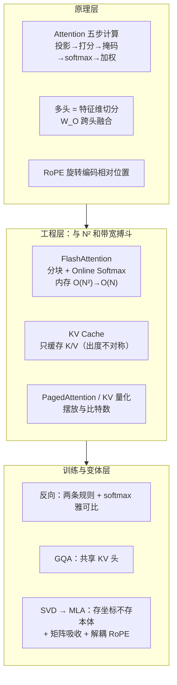

*图2.11.1-1 本章知识地图：原理 → 工程优化 → 训练与结构变体*

#### 2.11.2 核心公式速查

| 主题 | 公式 |
|---|---|
| Attention | $\text{softmax}(QK^\top/\sqrt{d_k})\,V$ |
| 缩放依据 | $\mathrm{Var}(q\cdot k) = d_k$，除 $\sqrt{d_k}$ 归一 |
| Online Softmax | $m' = \max(m, \tilde{m})$， $\ell' = e^{m-m'}\ell + e^{\tilde{m}-m'}\tilde{\ell}$， $O' = e^{m-m'}O + e^{\tilde{m}-m'}\tilde{P}V$ |
| KV cache 体积 | $2 \times L \times H_{kv} \times d_{head} \times b$ 字节/token |
| softmax 反向 | $dS = P \odot (dP - \text{rowsum}(dP\odot P))$ |
| 乘法节点反向 | 对谁求导，乘另一个的转置： $dV = P^\top dO$ |
| 截断 SVD 误差 | $\|M-M_k\|_F = \sqrt{\sum_{i>k}\sigma_i^2}$（Eckart–Young 最优） |
| MLA 吸收 | $q^\top(Wc) = (W^\top q)^\top c$； $o = W^{UV}(A\,c^{KV})$ |

*表2.11.2-1 核心公式速查*

#### 2.11.3 三条贯穿全章的主线

1. **注意力 = 按内容检索的加权平均**。Q/K/V 是语义分工， $N\times N$ 是信息交换枢纽，行管"谁和谁"、列管"交互什么"。
2. **所有优化都是计算图上的局部改造，数值不变**：FlashAttention 改计算顺序（分块 + rescale）、KV Cache 改复用策略、PagedAttention 改摆放、GQA/MLA 改参数化、量化改表示精度——每一步都精确等价或误差可控。
3. **瓶颈决定优化方向**：训练/prefill 是算力瓶颈（喂饱张量核），decode 是带宽瓶颈（少搬字节）。同一套数学（如 MLA 的两套形态）在不同瓶颈下选择不同计算顺序。

#### 2.11.4 参考与延伸

- Vaswani et al., *Attention Is All You Need* (2017), arXiv:1706.03762
- Dao et al., *FlashAttention* (2022), arXiv:2205.14135；*FlashAttention-2* (2023), arXiv:2307.08691
- Ainslie et al., *GQA* (2023), arXiv:2305.13245
- DeepSeek-AI, *DeepSeek-V2* (2024), arXiv:2405.04434（MLA）
- Su et al., *RoFormer* (2021), arXiv:2104.09864（RoPE）
- Kwon et al., *Efficient Memory Management for LLM Serving with PagedAttention* (2023), arXiv:2309.06180

下一章进入 Triton 算子开发：本章的 FlashAttention 分块、Online Softmax、KV cache 排布，将在那里变成可以亲手写出来、在 GPU 上跑起来的 kernel。

## 第三章 Triton算子

### 3.1 Triton 简介

Triton 是一种面向 GPU/NPU 的高性能内核编程语言与编译器，目标是让开发者以**接近 Python 的可读性**编写出**接近手写 CUDA/cuBLAS 性能**的算子内核。相比 CUDA：

- 无需手动管理线程级细节（warp 调度、共享内存 bank conflict 等），编译器自动处理；
- 以 **"程序（Program）× 数据块（Block）"** 的 SPMD 模型组织并行；
- 与 PyTorch 深度集成，张量对象自动退化为指针传入内核；
- 易于定制和扩展（如融合激活函数），这是闭源内核库（cuBLAS）难以做到的。

官方教程库按照从易到难的顺序编排，**建议按序阅读**。

---

### 3.2 安装指南

#### 3.2.1 二进制分发版（推荐）

支持 CPython 3.10–3.14：

```bash
pip install triton
```

#### 3.2.2 从源码安装

```bash
git clone https://github.com/triton-lang/triton.git
cd triton

pip install -r python/requirements.txt  # 构建期依赖
pip install -e .
```

说明：
- 若系统未安装 LLVM，`setup.py` 会自动下载官方 LLVM 静态库并链接；
- 需使用自定义 LLVM 构建时，参考 GitHub README 的 *Building with a custom LLVM* 部分。

#### 3.2.3 验证安装

```bash
# 一次性开发环境安装
make dev-install

# 运行全部测试（需要 GPU）
make test
# 无 GPU 环境运行测试
make test-nogpu
```

#### 3.2.4 教程依赖

```bash
cd triton
pip install -r python/tutorials/requirements.txt
```

#### 3.2.5 平台兼容性

支持的平台/操作系统/硬件清单见 GitHub 仓库 README 的 [Compatibility](https://github.com/triton-lang/triton?tab=readme-ov-file#compatibility) 部分。教程中的 FP8/TMA/块缩放等特性通常有**计算能力版本要求**（如 FP8 需 CUDA 计算能力 ≥ 9.0，块缩放需 ≥ 10.0 或 AMD CDNA4），后文各教程中会标注。

---

### 3.3 核心编程模型（必读）

在进入教程之前，先掌握贯穿全部 10 篇教程的 6 个核心概念。

#### 3.3.1 SPMD 并行模型

Triton 内核以 **SPMD（单程序多数据）** 方式执行：同一段内核代码被**大量程序实例**并行执行，每个实例通过 `tl.program_id(axis)` 获取自己的编号，进而计算出自己负责的数据块。

```python
pid = tl.program_id(axis=0)   # 1D 网格中当前程序的 id
```

启动网格（grid）在**主机端**指定，可以是整数元组，也可以是**可调用对象**（lambda），后者可引用内核元参数：

```python
grid = lambda meta: (triton.cdiv(n_elements, meta['BLOCK_SIZE']), )
add_kernel[grid](x, y, output, n_elements, BLOCK_SIZE=1024)
```

- `triton.cdiv(a, b)`：向上取整除法，用于计算块数；
- 每个 `torch.Tensor` 传入内核时**自动退化为指向首元素的指针**；
- 元参数（如 `BLOCK_SIZE`）必须以**关键字参数**形式传递；
- 内核启动是**异步**的，与 CUDA 语义一致。

#### 3.3.2 数据块与 `tl.constexpr`

- 块大小（如 `BLOCK_SIZE`）必须声明为 `tl.constexpr`，才能被用作张量形状值并在编译期展开；
- **Triton 的关键限制：每个块必须包含 2 的幂次个元素**。处理任意形状时需要"内部填充 + 掩码保护"。

#### 3.3.3 指针算术与 stride

对行优先二维张量 `X`，元素地址为：

```
&X[i, j] = x_ptr + i * stride_xi + j * stride_xj
```

stride 表示沿某一维度移动一步时指针需要跨越的元素数。通用公式 `addr = base_ptr + Σ i_k × stride[k]` 是所有内核访存的基石：

```python
# 一维块内偏移
offsets = pid * BLOCK_SIZE + tl.arange(0, BLOCK_SIZE)

# 二维块指针（矩阵乘法中的典型写法）
a_ptrs = a_ptr + (offs_am[:, None] * stride_am + offs_k[None, :] * stride_ak)
```

stride 的价值：支持非连续输入（转置、切片）、批处理多维度张量、零成本转置（交换 stride 角色）、配合 vLLM KV Cache 等 pooled buffer 的 slot 映射。

#### 3.3.4 掩码与越界保护

当数据规模不是块大小的整数倍时，用掩码保护所有内存操作：

```python
mask = offsets < n_elements
x = tl.load(x_ptr + offsets, mask=mask, other=-float('inf'))  # other 指定越界填充值
tl.store(output_ptr + offsets, output, mask=mask)
```

矩阵乘法中还有另一种技巧——**取模回绕**（处理 M/N 方向越界，配合最终 store 掩码）：

```python
offs_am = (pid_m * BLOCK_SIZE_M + tl.arange(0, BLOCK_SIZE_M)) % M
```

#### 3.3.5 归约与逐元素运算

```python
tl.max(row, axis=0)      # 归约最大值
tl.sum(numerator, axis=0)  # 归约求和
tl.exp(x)                # 指数（快速但近似，类似 CUDA __expf）
tl.where(cond, a, b)     # 条件选择
```

#### 3.3.6 tl.dot 与累加器

`tl.dot` 执行块级矩阵乘法，通过 `acc` 参数实现 K 维分块累加：

```python
accumulator = tl.zeros((BLOCK_SIZE_M, BLOCK_SIZE_N), dtype=tl.float32)  # FP32 累加保证精度
for k in range(0, tl.cdiv(K, BLOCK_SIZE_K)):
    a = tl.load(a_ptrs, mask=..., other=0.0)
    b = tl.load(b_ptrs, mask=..., other=0.0)
    accumulator = tl.dot(a, b, accumulator)   # acc += a @ b
    a_ptrs += BLOCK_SIZE_K * stride_ak
    b_ptrs += BLOCK_SIZE_K * stride_bk
```

要点：
- 累加器用 **FP32** 以保证数值精度，循环结束后再转回 FP16 等输出类型；
- `tl.dot` 对维度有约束（通常各维 ≥ 16 且为 2 的幂），不足时需填充；
- 融合激活函数的最佳时机是**累加器仍为 FP32 时**（见教程 03）。

---

### 3.4 教程详解

#### 3.4.1 教程 01：向量加法

> 原文：https://triton-lang.cn/main/getting-started/tutorials/01-vector-add.html

**学习目标**：Triton 基本编程模型；`triton.jit` 装饰器；验证与基准测试的最佳实践。

**(1) 计算内核**

```python
import torch
import triton
import triton.language as tl

DEVICE = triton.runtime.driver.active.get_active_torch_device()

@triton.jit
def add_kernel(
    x_ptr,                      # 第一个输入向量的指针
    y_ptr,                      # 第二个输入向量的指针
    output_ptr,                 # 输出向量的指针
    n_elements,                 # 向量长度
    BLOCK_SIZE: tl.constexpr,   # 每个程序处理的元素数
):
    pid = tl.program_id(axis=0)                       # 1D 网格
    block_start = pid * BLOCK_SIZE
    offsets = block_start + tl.arange(0, BLOCK_SIZE)  # 指针偏移列表
    mask = offsets < n_elements                       # 越界保护
    x = tl.load(x_ptr + offsets, mask=mask)
    y = tl.load(y_ptr + offsets, mask=mask)
    output = x + y
    tl.store(output_ptr + offsets, output, mask=mask)
```

**(2) 辅助函数（分配输出 + 启动内核）**

```python
def add(x: torch.Tensor, y: torch.Tensor):
    output = torch.empty_like(x)          # 预分配输出
    n_elements = output.numel()
    grid = lambda meta: (triton.cdiv(n_elements, meta['BLOCK_SIZE']), )
    add_kernel[grid](x, y, output, n_elements, BLOCK_SIZE=1024)
    return output                          # 注意：此时内核仍在异步执行
```

**(3) 正确性验证**

```python
torch.manual_seed(0)
size = 98432
x = torch.rand(size, device=DEVICE)
y = torch.rand(size, device=DEVICE)
output_torch = x + y
output_triton = add(x, y)
print(f'The maximum difference between torch and triton is '
      f'{torch.max(torch.abs(output_torch - output_triton))}')
# 输出：0.0
```

**(4) 基准测试（内置工具）**

利用 `triton.testing.perf_report` + `triton.testing.Benchmark` 对不同问题规模绘图：

```python
@triton.testing.perf_report(
    triton.testing.Benchmark(
        x_names=['size'],
        x_vals=[2**i for i in range(12, 28, 1)],
        x_log=True,
        line_arg='provider',
        line_vals=['triton', 'torch'],
        line_names=['Triton', 'Torch'],
        styles=[('blue', '-'), ('green', '-')],
        ylabel='GB/s',
        plot_name='vector-add-performance',
        args={},
    ))
def benchmark(size, provider):
    x = torch.rand(size, device=DEVICE, dtype=torch.float32)
    y = torch.rand(size, device=DEVICE, dtype=torch.float32)
    quantiles = [0.5, 0.2, 0.8]
    if provider == 'torch':
        ms, min_ms, max_ms = triton.testing.do_bench(lambda: x + y, quantiles=quantiles)
    if provider == 'triton':
        ms, min_ms, max_ms = triton.testing.do_bench(lambda: add(x, y), quantiles=quantiles)
    gbps = lambda ms: 3 * x.numel() * x.element_size() * 1e-9 / (ms * 1e-3)
    return gbps(ms), gbps(max_ms), gbps(min_ms)

benchmark.run(print_data=True, show_plots=True)
```

**结果要点**：规模较小时（几 KB）Triton 因启动开销略占优；随规模增大两者都逼近带宽极限（实测约 1680 GB/s）。向量加法是**带宽受限（memory-bound）**算子的典型代表，性能 = 读 2 份 + 写 1 份 = `3 * numel * element_size / time`。

**本教程惯例（后续所有教程沿用）**：
1. 内核 + 辅助包装函数分离；
2. 与 PyTorch 原生实现对比验证（`torch.allclose` / max diff）；
3. 用 `perf_report` 基准测试并以 GB/s（带宽受限）或 TFLOPS（计算受限）为指标。

---

#### 3.4.2 教程 02：融合 Softmax

> 原文：https://triton-lang.cn/main/getting-started/tutorials/02-fused-softmax.html

**学习目标**：带宽受限操作中**算子融合**的优势；Triton 中的归约算子。


**(1) 动机：为什么需要融合**

数值稳定的朴素 Softmax（逐行减最大值防止溢出）在 PyTorch 中的中间结果读写次数：

```python
def naive_softmax(x):
    x_max = x.max(dim=1)[0]           # 读 MN，写 M
    z = x - x_max[:, None]            # 读 MN+M，写 MN
    numerator = torch.exp(z)          # 读 MN，写 MN
    denominator = numerator.sum(dim=1)  # 读 MN，写 M
    ret = numerator / denominator[:, None]  # 读 MN+M，写 MN
    # 总计：读 5MN + 2M，写 3MN + 2M
    return ret
```

每个中间张量都要完整读写 DRAM。融合内核**只读一次 X、只写一次 Y**，数据量从 `8MN + 4M` 降为 `2MN`，理论上约 **4 倍加速**。`torch.jit.script` 想自动做融合，但实测差距很大。

**(2) 计算内核**

每个程序处理（跨步访问）输入矩阵的若干**行**：整行加载进 SRAM → 归一化 → 写回。

```python
@triton.jit
def softmax_kernel(output_ptr, input_ptr,
                   input_row_stride, output_row_stride,
                   n_rows, n_cols,
                   BLOCK_SIZE: tl.constexpr, num_stages: tl.constexpr):
    row_start = tl.program_id(0)
    row_step = tl.num_programs(0)                     # 程序总数，用于跨步
    for row_idx in tl.range(row_start, n_rows, row_step, num_stages=num_stages):
        row_start_ptr = input_ptr + row_idx * input_row_stride  # stride 定位行首
        col_offsets = tl.arange(0, BLOCK_SIZE)
        input_ptrs = row_start_ptr + col_offsets
        mask = col_offsets < n_cols                   # BLOCK_SIZE 可能 > n_cols
        row = tl.load(input_ptrs, mask=mask, other=-float('inf'))  # 填 -inf
        row_minus_max = row - tl.max(row, axis=0)     # 数值稳定
        numerator = tl.exp(row_minus_max)
        denominator = tl.sum(numerator, axis=0)
        softmax_output = numerator / denominator
        output_ptrs = output_ptr + row_idx * output_row_stride + col_offsets
        tl.store(output_ptrs, softmax_output, mask=mask)
```

**两个关键点**：
1. **填充**：`BLOCK_SIZE` 取大于 `n_cols` 的最小 2 的幂（`triton.next_power_of_2`），越界位置用 `-inf` 填充（softmax 后为 0，不影响结果）；
2. **持久化式调度**：程序数由**占用率（occupancy）**计算得出，而非每行一个程序，各程序跨步处理多行。Softmax算子的理解要点是需要了解二维、三维张量在内存中的存储模式。与GPU不同，因为昇腾NPU设计中将grid最大定为vector/AIcore数目，因此应优先在单个program内进行核内循环。

**(3) 基于占用率的调度（辅助函数）**

```python
properties = driver.active.utils.get_device_properties(DEVICE.index)
NUM_SM = properties["multiprocessor_count"]     # SM 数量
NUM_REGS = properties["max_num_regs"]           # 每SM寄存器
SIZE_SMEM = properties["max_shared_mem"]        # 共享内存大小
WARP_SIZE = properties["warpSize"]

def softmax(x):
    n_rows, n_cols = x.shape
    BLOCK_SIZE = triton.next_power_of_2(n_cols)
    num_warps = 8                               # 增加每行使用的线程数
    num_stages = 4 if SIZE_SMEM > 200000 else 2 # 软件流水级数

    y = torch.empty_like(x)
    # 预编译内核以获取寄存器用量，进而计算占用率
    kernel = softmax_kernel.warmup(y, x, x.stride(0), y.stride(0), n_rows, n_cols,
                                   BLOCK_SIZE=BLOCK_SIZE, num_stages=num_stages,
                                   num_warps=num_warps, grid=(1, ))
    kernel._init_handles()
    n_regs = kernel.n_regs
    size_smem = kernel.metadata.shared
    occupancy = NUM_REGS // (n_regs * WARP_SIZE * num_warps)   # CUDA 路径
    occupancy = min(occupancy, SIZE_SMEM // size_smem)
    num_programs = NUM_SM * occupancy
    num_programs = min(num_programs, n_rows)    # 不超过行数

    kernel[(num_programs, 1, 1)](y, x, x.stride(0), y.stride(0), n_rows, n_cols,
                                 BLOCK_SIZE, num_stages)
    return y
```


（HIP/CDNA 平台的占用率计算略有不同，见原文。）这段
代码在npu中不能实现，因为在A2中寄存器数量已定死，warp_size与num_stage执行虽然不会报错，但是不起作用，且无法查询到共享内存大小和regs数目，SM查询结果为vector核数和AI core核数，且AI核数为vector核数的一半，因此，在npu中直接以核数为grid数即可

**(4) 验证与基准**

用**行列数不规则**的矩阵测试（验证填充机制）：

```python
x = torch.randn(1823, 781, device=DEVICE)
assert torch.allclose(softmax(x), torch.softmax(x, axis=1))
```

基准测试结论：
- Triton 比 Torch JIT（naive_softmax）**快约 4 倍**，证实 Torch JIT 未做融合；
- Triton 快于 `torch.softmax` 且**更易读、易维护**（但 torch 版本对任意形状更通用）；
- 实测两者均可达到约 1400+ GB/s 的带宽。

---

#### 3.4.3 教程 03：矩阵乘法

> 原文：https://triton-lang.cn/main/getting-started/tutorials/03-matrix-multiplication.html

**学习目标**：块级矩阵乘法；多维指针算术；程序重排序提高 L2 缓存命中率；自动性能调优（autotune）。这是**全系列最重要的教程**。

**(1) 分块算法**

将 (M, K) @ (K, N) 分块计算，双重循环的每次迭代由一个 Triton 程序实例执行：

```python
# 伪代码
for m in range(0, M, BLOCK_SIZE_M):      # 并行
    for n in range(0, N, BLOCK_SIZE_N):  # 并行
        acc = zeros((BLOCK_SIZE_M, BLOCK_SIZE_N), dtype=float32)
        for k in range(0, K, BLOCK_SIZE_K):
            a = A[m : m+BLOCK_SIZE_M, k : k+BLOCK_SIZE_K]
            b = B[k : k+BLOCK_SIZE_K, n : n+BLOCK_SIZE_N]
            acc += dot(a, b)
        C[m : m+BLOCK_SIZE_M, n : n+BLOCK_SIZE_N] = acc
```

难点在于**多维指针算术**——确定内循环中 A、B 数据块的内存位置。

**(2) 指针算术**

```python
# 初始化（k=0 时）的 A、B 块指针
offs_am = (pid_m * BLOCK_SIZE_M + tl.arange(0, BLOCK_SIZE_M)) % M   # 取模处理 M 不整除
offs_bn = (pid_n * BLOCK_SIZE_N + tl.arange(0, BLOCK_SIZE_N)) % N
offs_k = tl.arange(0, BLOCK_SIZE_K)
a_ptrs = a_ptr + (offs_am[:, None] * stride_am + offs_k[None, :] * stride_ak)
b_ptrs = b_ptr + (offs_k[:, None] * stride_bk + offs_bn[None, :] * stride_bn)

# 内循环中沿 K 前进
a_ptrs += BLOCK_SIZE_K * stride_ak
b_ptrs += BLOCK_SIZE_K * stride_bk
```

M/N 方向用**取模回绕**填充无效数据（结果无影响），K 方向用**掩码加载**（`other=0.0`，乘法累加不受影响）。

**(3) L2 缓存优化：程序分组重排序**

程序计算块的**顺序**直接影响 L2 命中率。朴素行优先顺序下，计算前 9 个输出块需加载 90 个块；按 `GROUP_SIZE_M` 行"超分组"后只需 54 个：

```python
pid = tl.program_id(axis=0)
num_pid_m = tl.cdiv(M, BLOCK_SIZE_M)
num_pid_n = tl.cdiv(N, BLOCK_SIZE_N)
num_pid_in_group = GROUP_SIZE_M * num_pid_n
group_id = pid // num_pid_in_group
first_pid_m = group_id * GROUP_SIZE_M
group_size_m = min(num_pid_m - first_pid_m, GROUP_SIZE_M)  # 末组可能不满
# 组内按列优先排列
pid_m = first_pid_m + ((pid % num_pid_in_group) % group_size_m)
pid_n = (pid % num_pid_in_group) // group_size_m
```

实践中可在部分硬件上提升 **10%+** 性能（如 A100 上 220 → 245 TFLOPS）。

**(4) 自动调优（autotune）**

```python
def get_cuda_autotune_config():
    return [
        triton.Config({'BLOCK_SIZE_M': 128, 'BLOCK_SIZE_N': 256, 'BLOCK_SIZE_K': 64,
                       'GROUP_SIZE_M': 8}, num_stages=3, num_warps=8),
        triton.Config({'BLOCK_SIZE_M': 64, 'BLOCK_SIZE_N': 256, 'BLOCK_SIZE_K': 32,
                       'GROUP_SIZE_M': 8}, num_stages=4, num_warps=4),
        # ... 更多配置（含 fp8 专用配置）
    ]

@triton.autotune(
    configs=get_autotune_config(),
    key=['M', 'N', 'K'],          # key 变化时触发重新调优
)
@triton.jit
def matmul_kernel(...):
    ...
```

`triton.autotune` 接收：
- 一组 `triton.Config`（元参数组合 + 编译选项 `num_warps`/`num_stages`）；
- 调优 **key**：key 值变化将触发重新评估所有配置。

**(5) 完整内核骨架（节选核心）**

```python
@triton.autotune(configs=get_autotune_config(), key=['M', 'N', 'K'])
@triton.jit
def matmul_kernel(a_ptr, b_ptr, c_ptr, M, N, K,
                  stride_am, stride_ak, stride_bk, stride_bn, stride_cm, stride_cn,
                  BLOCK_SIZE_M: tl.constexpr, BLOCK_SIZE_N: tl.constexpr,
                  BLOCK_SIZE_K: tl.constexpr, GROUP_SIZE_M: tl.constexpr,
                  ACTIVATION: tl.constexpr):
    # 1) 分组排序计算 pid_m / pid_n（见上）
    ...
    # 2) 整数边界假设，帮助后端优化地址计算
    tl.assume(pid_m >= 0)
    tl.assume(stride_am > 0)
    ...
    # 3) 初始化块指针（见上）
    ...
    # 4) K 维循环累加（FP32 累加器）
    accumulator = tl.zeros((BLOCK_SIZE_M, BLOCK_SIZE_N), dtype=tl.float32)
    for k in range(0, tl.cdiv(K, BLOCK_SIZE_K)):
        a = tl.load(a_ptrs, mask=offs_k[None, :] < K - k * BLOCK_SIZE_K, other=0.0)
        b = tl.load(b_ptrs, mask=offs_k[:, None] < K - k * BLOCK_SIZE_K, other=0.0)
        accumulator = tl.dot(a, b, accumulator)
        a_ptrs += BLOCK_SIZE_K * stride_ak
        b_ptrs += BLOCK_SIZE_K * stride_bk

    # 5) 在累加器仍为 FP32 时融合任意激活函数
    if ACTIVATION == "leaky_relu":
        accumulator = leaky_relu(accumulator)
    c = accumulator.to(tl.float16)

    # 6) 带掩码写回 C 块
    c_mask = (offs_cm[:, None] < M) & (offs_cn[None, :] < N)
    tl.store(c_ptrs, c, mask=c_mask)

@triton.jit
def leaky_relu(x):
    return tl.where(x >= 0, x, 0.01 * x)
```

**(6) 包装函数与验证**

```python
def matmul(a, b, activation=""):
    assert a.shape[1] == b.shape[0], "Incompatible dimensions"
    assert a.is_contiguous(), "Matrix A must be contiguous"
    M, K = a.shape
    K, N = b.shape
    c = torch.empty((M, N), device=a.device, dtype=torch.float16)
    grid = lambda META: (triton.cdiv(M, META['BLOCK_SIZE_M']) * triton.cdiv(N, META['BLOCK_SIZE_N']), )
    matmul_kernel[grid](a, b, c, M, N, K,
                        a.stride(0), a.stride(1), b.stride(0), b.stride(1),
                        c.stride(0), c.stride(1), ACTIVATION=activation)
    return c
```

FP16 下与 cuBLAS 结果一致（`atol=1e-2`）；FP8（`float8_e5m2`）下误差容忍更大（`atol=0.125`）。高性能 FP16 matmul 可与 cuBLAS/rocBLAS **相媲美**。

---

#### 3.4.4 教程 04：低内存 Dropout

> 原文：https://triton-lang.cn/main/getting-started/tutorials/04-low-memory-dropout.html

**学习目标**：朴素 Dropout 的局限；Triton 中的并行伪随机数生成（PRNG）。

**(1) 背景**

Dropout 训练时以概率 p 置零（其余乘 `1/(1-p)` 保持期望），评估时 p=0。朴素实现的问题：
- 需要存储与输入同形状的**位掩码**（反向传播要用）；
- 与重计算/检查点（checkpointing）结合时 RNG 状态管理复杂。

**(2) 基线：掩码版 Dropout**

```python
@triton.jit
def _dropout(x_ptr, x_keep_ptr, output_ptr, n_elements, p, BLOCK_SIZE: tl.constexpr):
    pid = tl.program_id(axis=0)
    offsets = pid * BLOCK_SIZE + tl.arange(0, BLOCK_SIZE)
    mask = offsets < n_elements
    x = tl.load(x_ptr + offsets, mask=mask)
    x_keep = tl.load(x_keep_ptr + offsets, mask=mask)
    output = tl.where(x_keep, x / (1 - p), 0.0)   # 核心！
    tl.store(output_ptr + offsets, output, mask=mask)
```

**(3) 种子化 Dropout（本教程精髓）**

Triton 的 `tl.rand(seed, offsets)` 基于 **Philox 算法**，给定种子 + int32 偏移块，生成 [0,1) 均匀分布 float32——**随机数由元素偏移确定性导出**，无需存储掩码：

```python
@triton.jit
def _seeded_dropout(x_ptr, output_ptr, n_elements, p, seed, BLOCK_SIZE: tl.constexpr):
    pid = tl.program_id(axis=0)
    offsets = pid * BLOCK_SIZE + tl.arange(0, BLOCK_SIZE)
    mask = offsets < n_elements
    x = tl.load(x_ptr + offsets, mask=mask)
    random = tl.rand(seed, offsets)     # 由种子+偏移生成伪随机数
    x_keep = random > p
    output = tl.where(x_keep, x / (1 - p), 0.0)
    tl.store(output_ptr + offsets, output, mask=mask)

def seeded_dropout(x, p, seed):
    output = torch.empty_like(x)
    n_elements = x.numel()
    grid = lambda meta: (triton.cdiv(n_elements, meta['BLOCK_SIZE']), )
    _seeded_dropout[grid](x, output, n_elements, p, seed, BLOCK_SIZE=1024)
    return output
```

**相同 seed 产生完全相同的掩码**——状态只需一个 int32，内存更省、数据移动更少、跨内核调用持久化随机性更简单。

**(4) 练习（官方留题）**

1. 扩展为按矩阵行操作，每行一个种子向量；
2. 添加 stride 支持；
3. （挑战）实现稀疏 Johnson-Lindenstrauss 变换内核，即时生成投影矩阵。

---

#### 3.4.5 教程 05：层归一化

> 原文：https://triton-lang.cn/main/getting-started/tutorials/05-layer-norm.html

**学习目标**：Triton 中实现**反向传播**；实现**并行归约**。

**(1) 前向传播**

公式：`y = (x - E[x]) / sqrt(Var(x) + ε) * w + b`

```python
@triton.jit
def _layer_norm_fwd_fused(X, Y, W, B, Mean, Rstd, stride, N, eps,
                          BLOCK_SIZE: tl.constexpr):
    row = tl.program_id(0)          # 一个程序处理一行
    Y += row * stride
    X += row * stride
    # 计算均值（N 可能超过 BLOCK_SIZE，分块循环累加）
    _mean = tl.zeros([BLOCK_SIZE], dtype=tl.float32)
    for off in range(0, N, BLOCK_SIZE):
        cols = off + tl.arange(0, BLOCK_SIZE)
        a = tl.load(X + cols, mask=cols < N, other=0.).to(tl.float32)
        _mean += a
    mean = tl.sum(_mean, axis=0) / N
    # 计算方差
    _var = tl.zeros([BLOCK_SIZE], dtype=tl.float32)
    for off in range(0, N, BLOCK_SIZE):
        cols = off + tl.arange(0, BLOCK_SIZE)
        x = tl.load(X + cols, mask=cols < N, other=0.).to(tl.float32)
        x = tl.where(cols < N, x - mean, 0.)
        _var += x * x
    var = tl.sum(_var, axis=0) / N
    rstd = 1 / tl.sqrt(var + eps)
    tl.store(Mean + row, mean)      # 保存供反向传播用
    tl.store(Rstd + row, rstd)
    # 归一化 + 线性变换
    for off in range(0, N, BLOCK_SIZE):
        cols = off + tl.arange(0, BLOCK_SIZE)
        mask = cols < N
        w = tl.load(W + cols, mask=mask)
        b = tl.load(B + cols, mask=mask)
        x = tl.load(X + cols, mask=mask, other=0.).to(tl.float32)
        x_hat = (x - mean) * rstd
        y = x_hat * w + b
        tl.store(Y + cols, y, mask=mask)
```

要点：前向时把 `mean`、`rstd` 存下来，反向传播直接复用，避免重算。

**(2) 反向传播**

VJP 数学公式（∇x 由 ∇y、w、x̂、c1、c2 构成；∇w = ∇y⊙x̂，∇b = ∇y）实现于 `_layer_norm_bwd_dx_fused`。**难点**：所有行共享 w/b，梯度需要跨行求和。采用**并行归约策略**：

- 每个 kernel 实例把部分 ∇w/∇b 累加到 `GROUP_SIZE_M` 个独立缓冲区之一；
- 缓冲区用**锁**保护（同一时间只有一个实例写某缓冲区）；
- 第二个内核 `_layer_norm_bwd_dwdb` 对缓冲区做最终归约。

锁的实现使用**原子操作**：

```python
while tl.atomic_cas(Lock, 0, 1) == 1:   # 自旋获取锁
    pass
count = tl.load(Count)
if count == 0:
    tl.atomic_xchg(Count, 1)            # 首次存储不累加
else:
    partial_dw += tl.load(DW, mask=mask)
    partial_db += tl.load(DB, mask=mask)
tl.store(DW, partial_dw, mask=mask)
tl.store(DB, partial_db, mask=mask)
tl.debug_barrier()                      # 屏障：确保所有线程完成后
tl.atomic_xchg(Lock, 0)                 # 释放锁
```

**(3) 自定义 autograd.Function 集成**

通过继承 `torch.autograd.Function`，在 `forward` 中保存 `x, weight, bias, mean, rstd` 及 `BLOCK_SIZE/num_warps` 启发式，在 `backward` 中：

- `GROUP_SIZE_M` 根据 N 自适应（N≤1024 时 256，≤4096 时 128，≤8192 时 96，否则 64）；
- 锁数组 `locks = torch.zeros(2 * GROUP_SIZE_M, dtype=torch.int32)`；
- 前向限制：每特征小于 64KB（`MAX_FUSED_SIZE = 65536 // x.element_size()`）。

`num_warps` 启发式：`num_warps = min(max(BLOCK_SIZE // 256, 1), 8)`。

**(4) 基准结论**

大 N（≥6144）时 Triton 反向传播带宽显著超过 PyTorch（8192 时约 988 vs 562 GB/s）；小 N 时 PyTorch 占优。

---

#### 3.4.6 教程 06：融合注意力（Flash Attention v2）

> 原文：https://triton-lang.cn/main/getting-started/tutorials/06-fused-attention.html

**学习目标**：Tri Dao 的 Flash Attention v2 算法的 Triton 实现（OpenAI 内核团队出品）。这是全系列最复杂的教程，支持 FP16/FP8、causal 掩码、前向与反向。

**(1) 核心思想（在线 softmax）**

传统 softmax 需要先看到整行才能算 max 和 sum；Flash Attention 通过维护**运行统计量** `m_i`（行最大值）和 `l_i`（行指数和）实现流式计算：

```python
# 内循环核心逻辑（_attn_fwd_inner 节选）
for start_n in tl.range(lo, hi, BLOCK_N, warp_specialize=warp_specialize):
    start_n = tl.multiple_of(start_n, BLOCK_N)
    # -- 计算 qk --
    k = desc_k.load([offsetk_y, 0]).T
    qk = tl.dot(q, k)
    if STAGE == 2:                                   # causal 对角块需要掩码
        mask = offs_m[:, None] >= (start_n + offs_n[None, :])
        qk = qk * qk_scale + tl.where(mask, 0, -1.0e6)
        m_ij = tl.maximum(m_i, tl.max(qk, 1))
        qk -= m_ij[:, None]
    else:
        m_ij = tl.maximum(m_i, tl.max(qk, 1) * qk_scale)
        qk = qk * qk_scale - m_ij[:, None]
    p = tl.math.exp2(qk)                             # 用 exp2，乘 1/log(2) 预处理
    # -- 修正因子 --
    alpha = tl.math.exp2(m_i - m_ij)                 # 旧块指数的缩放修正
    l_ij = tl.sum(p, 1)
    # -- 更新输出累加器 --
    acc = acc * alpha[:, None]                       # 用 alpha 修正历史累加
    acc = tl.dot(p, v, acc)                          # 累加当前块贡献
    l_i = l_i * alpha + l_ij                         # 更新归一化分母
    m_i = m_ij                                       # 更新行最大值
```

**关键技巧**：
- `qk_scale` 预乘 `1.44269504`（= 1/log 2），把 `exp` 换成硬件更快的 `exp2`；
- `STAGE` 位掩码区分：STAGE&1 处理非对角块（causal 时不需掩码），STAGE&2 处理对角块（需掩码）；
- 修正因子 `alpha = exp2(m_i - m_ij)` 在块间传递时重缩放 acc/l_i；
- `m_i` 初始化为 `-inf`，`l_i` 初始化为 1.0；
- 尾声：`acc = acc / l_i`，并 `m_i += log2(l_i)` 存储日志值供反向使用。

**(2) 现代特性：TMA 张量描述符**

Hopper（计算能力 9.0）及以上可用 **Tensor Memory Accelerator**：

```python
# 设备端创建描述符
desc_q = tl.make_tensor_descriptor(desc_or_ptr, shape=[y_dim, HEAD_DIM],
                                   strides=[HEAD_DIM, 1], block_shape=[BLOCK_M, HEAD_DIM])
# 块加载 / 存储（无需手写指针算术）
q = desc_q.load([qo_offset_y, 0])
desc_o.store([qo_offset_y, 0], acc.to(dtype))
```

主机端用 `TensorDescriptor.from_tensor(tensor, block_shape)` 创建，autotune 的 `pre_hook` 在配置切换时更新 `block_shape`：

```python
def _host_descriptor_pre_hook(nargs):
    nargs["desc_q"].block_shape = [nargs["BLOCK_M"], nargs["HEAD_DIM"]]
    ...
configs = [triton.Config({'BLOCK_M': BM, 'BLOCK_N': BN}, num_stages=s, num_warps=w,
                          pre_hook=_host_descriptor_pre_hook)
           for BM in [64, 128] for BN in [32, 64, 128] ...]
```

**(3) autotune 进阶：配置剪枝**

```python
def prune_invalid_configs(configs, named_args, **kwargs):
    N_CTX = kwargs["N_CTX"]; STAGE = kwargs["STAGE"]
    # 过滤 BLOCK_M > N_CTX 的配置；causal 时过滤 BLOCK_M < BLOCK_N
    return [conf for conf in configs if ...]

@triton.autotune(configs=..., key=["N_CTX", "HEAD_DIM", "FP8_OUTPUT", "warp_specialize"],
                 prune_configs_by={'early_config_prune': prune_invalid_configs})
```

**(4) 其他特性**

- **warp specialization**：`tl.range(..., warp_specialize=True)`（Blackwell 特性），配合 acc 重排 `reshape/permute/split/join`；
- **反向传播**：`_attn_bwd_preprocess`（计算 Delta = sum(o*do)）→ `_attn_bwd_dkdv` / `_attn_bwd_dq`；
- 支持 `tl.static_assert(BLOCK_N <= HEAD_DIM)` 编译期断言。

**(5) 性能参考（H100，batch4/head32）**

前向 FP16 causal：约 112–164 TFLOPS（随序列长度增加）；d128 时可达 160–180 TFLOPS。

---

#### 3.4.7 教程 07：Libdevice 外部函数

> 原文：https://triton-lang.cn/main/getting-started/tutorials/07-extern-functions.html

**学习目标**：调用外部库（libdevice）中的自定义函数。

Triton 可以调用外部库函数。以 `asin`（反正弦）为例：

```python
from triton.language.extra import libdevice

@triton.jit
def asin_kernel(x_ptr, y_ptr, n_elements, BLOCK_SIZE: tl.constexpr):
    pid = tl.program_id(axis=0)
    offsets = pid * BLOCK_SIZE + tl.arange(0, BLOCK_SIZE)
    mask = offsets < n_elements
    x = tl.load(x_ptr + offsets, mask=mask)
    x = libdevice.asin(x)            # 调用 libdevice 函数
    tl.store(y_ptr + offsets, x, mask=mask)
```

**要点**：
- libdevice 将计算逻辑相同但数据类型不同的函数整合（如 `__nv_asin` 操作 double、`__nv_asinf` 操作 float），Triton **根据输入输出类型自动选择**正确的底层函数；
- 所有可用函数见 [CUDA libdevice 用户指南](https://docs.nvda.net.cn/cuda/libdevice-users-guide/index.html) 与 [HIP device-lib 源码](https://github.com/ROCm/llvm-project/tree/amd-staging/amd/device-libs/ocml/src)；
- 可通过 `extern_libs` 参数自定义 libdevice 库路径：

```python
if is_cuda():
    libdir = current_dir.parent.parent / 'third_party/nvidia/backend/lib'
    extern_libs = {'libdevice': str(libdir / 'libdevice.10.bc')}
elif is_hip():
    libdir = current_dir.parent.parent / 'third_party/amd/backend/lib'
    extern_libs = {}
    for lib in ["ocml", "ockl"]:
        extern_libs[lib] = str(libdir / f'{lib}.bc')

asin_kernel[grid](x, output_triton, n_elements, BLOCK_SIZE=1024, extern_libs=extern_libs)
```

实测与 `torch.asin` 最大误差 2.4e-7。

---

#### 3.4.8 教程 08：分组 GEMM

> 原文：https://triton-lang.cn/main/getting-started/tutorials/08-grouped-gemm.html

**学习目标**：单内核计算**一组**形状各异的 GEMM（典型场景：MoE、多 expert 批处理）。启动固定数量的 CTA，**调度在设备端静态完成**。

**(1) 核心设计**

主机端把**所有 GEMM 的指针、尺寸、leading dimension 打包为设备张量**传入内核：

```python
d_a_ptrs = torch.tensor(A_addrs, device=DEVICE)     # 各 A 矩阵的指针
d_b_ptrs = torch.tensor(B_addrs, device=DEVICE)
d_c_ptrs = torch.tensor(C_addrs, device=DEVICE)
d_g_sizes = torch.tensor(g_sizes, dtype=torch.int32, device=DEVICE)  # [group_size, 3] 扁平存 M,N,K
d_g_lds = torch.tensor(g_lds, dtype=torch.int32, device=DEVICE)      # lda,ldb,ldc

grid = lambda META: (META['NUM_SM'], )    # CTA 数固定为 SM 数
grouped_matmul_kernel[grid](d_a_ptrs, d_b_ptrs, d_c_ptrs, d_g_sizes, d_g_lds, group_size)
```

内核通过 `tl.load` 从**设备端**读取指针并 `.to(tl.pointer_type(tl.float16))` 转换类型：

```python
@triton.autotune(configs=[...], key=['group_size'])
@triton.jit
def grouped_matmul_kernel(group_a_ptrs, group_b_ptrs, group_c_ptrs,
                          group_gemm_sizes, g_lds, group_size,
                          NUM_SM: tl.constexpr,
                          BLOCK_SIZE_M: tl.constexpr, BLOCK_SIZE_N: tl.constexpr,
                          BLOCK_SIZE_K: tl.constexpr):
    tile_idx = tl.program_id(0)
    last_problem_end = 0
    for g in range(group_size):
        # 从设备端读取第 g 个 GEMM 的尺寸
        gm = tl.load(group_gemm_sizes + g * 3)
        gn = tl.load(group_gemm_sizes + g * 3 + 1)
        gk = tl.load(group_gemm_sizes + g * 3 + 2)
        num_m_tiles = tl.cdiv(gm, BLOCK_SIZE_M)
        num_n_tiles = tl.cdiv(gn, BLOCK_SIZE_N)
        num_tiles = num_m_tiles * num_n_tiles
        # 当前 CTA 负责的 tile 落在此 GEMM 范围内则处理
        while (tile_idx >= last_problem_end and tile_idx < last_problem_end + num_tiles):
            ...
            a_ptr = tl.load(group_a_ptrs + g).to(tl.pointer_type(tl.float16))
            ...
            # 常规 GEMM 内循环
            for kk in range(0, tl.cdiv(k, BLOCK_SIZE_K)):
                tl.multiple_of(a_ptrs, [16, 16])   # 提示编译器做循环流水
                tl.multiple_of(b_ptrs, [16, 16])
                a = tl.load(a_ptrs)
                b = tl.load(b_ptrs)
                accumulator += tl.dot(a, b)
                a_ptrs += BLOCK_SIZE_K
                b_ptrs += BLOCK_SIZE_K * ldb
            ...
            tile_idx += NUM_SM       # 跳到下一个本 CTA 负责的 tile
        last_problem_end += num_tiles
```

**调度模式**：CTA `i` 处理第 `i, i+NUM_SM, i+2*NUM_SM...` 个 tile——静态负载均衡，无 host 端参与。

**(2) TMA 版本**

Hopper+ 上用 `tl.make_tensor_descriptor` 在**设备端**创建描述符加载 B 矩阵的转置布局（`b_desc` 形状 `[gn, gk]`，`tl.dot(a, b.T)`），需要先设置分配器：

```python
def alloc_fn(size: int, alignment: int, stream: Optional[int]):
    return torch.empty(size, device="cuda", dtype=torch.int8)

triton.set_allocator(alloc_fn)   # TMA 描述符需要全局内存分配
```

**(3) 性能参考**

小规模（N=128–512）时 Triton 比 cuBLAS 快约 1.8 倍（0.012 vs 0.023 ms）；大规模时互有胜负。

---

#### 3.4.9 教程 09：持久化矩阵乘法

> 原文：https://triton-lang.cn/main/getting-started/tutorials/09-persistent-matmul.html

**学习目标**：持久化内核（persistent kernel）矩阵乘法；朴素 / 持久化 / TMA / TMA 持久化 / Tensor Descriptor 持久化共 5 种实现；proton 分析器。FP16/FP8 双支持（FP8 需计算能力 ≥ 9.0）。注意：共享内存较小的设备（如 RTX-4090）会运行失败。

**(1) 什么是持久化内核**

普通内核：tile 数 = 程序数，每个程序算一个 tile 后退出。
持久化内核：**程序数固定为 NUM_SMS**，每个程序通过 `tl.range(start_pid, num_tiles, NUM_SMS)` 跨步循环处理多个 tile——消除内核启动/调度开销，改善尾效应。

```python
@triton.autotune(configs=matmul_get_configs(), key=["M", "N", "K"])
@triton.jit(launch_metadata=_matmul_launch_metadata)
def matmul_kernel_persistent(a_ptr, b_ptr, c_ptr, M, N, K, ...,
                             BLOCK_SIZE_M: tl.constexpr, ..., NUM_SMS: tl.constexpr):
    start_pid = tl.program_id(axis=0)
    num_pid_m = tl.cdiv(M, BLOCK_SIZE_M)
    num_pid_n = tl.cdiv(N, BLOCK_SIZE_N)
    k_tiles = tl.cdiv(K, BLOCK_SIZE_K)
    num_tiles = num_pid_m * num_pid_n

    for tile_id in tl.range(start_pid, num_tiles, NUM_SMS, flatten=True):
        pid_m, pid_n = _compute_pid(tile_id, num_pid_in_group, num_pid_m, GROUP_SIZE_M, NUM_SMS)
        ...
        accumulator = tl.zeros((BLOCK_SIZE_M, BLOCK_SIZE_N), dtype=tl.float32)
        for ki in range(k_tiles):
            ...
            accumulator = tl.dot(a, b, accumulator)
        ...
        tl.store(c_ptrs, c, mask=c_mask)
```

启动时：`grid = min(NUM_SMS, cdiv(M,BM)*cdiv(N,BN))`。

**(2) TMA + 持久化 + warp specialization**

```python
for k in tl.range(k_tiles, warp_specialize=WARP_SPECIALIZE):
    a = a_desc.load([offs_am, offs_k])
    b = b_desc.load([offs_bn, offs_k])
    accumulator = tl.dot(a, b.T, accumulator)    # B 以转置布局存储
```

主机端创建描述符：

```python
from triton.tools.tensor_descriptor import TensorDescriptor

a_desc = TensorDescriptor.from_tensor(a, dummy_block)   # dummy block, 由 pre_hook 更新
```

**(3) 其他技术点**

- **launch_metadata**：`@triton.jit(launch_metadata=_matmul_launch_metadata)` 为 profiler 提供内核名称/FLOPS/字节数元信息；
- **编译器提示**：`tl.max_contiguous(tl.multiple_of(offs_am, BLOCK_SIZE_M), BLOCK_SIZE_M)` 提示对齐与连续性；
- **输出子分块（EPILOGUE_SUBTILE）**：`c_desc.block_shape = [BLOCK_M, BLOCK_N // 2]` 减小 epilogue 寄存器压力；
- **proton 性能分析**：

```bash
# 命令行
python 09-persistent-matmul.py --prec fp16 --K_range 128 1024 --K_step 128
```

proton 输出示例（M=N=8192, K=512，单位 ms）：cuBLAS 3881 / naive 3866 / persistent 4084（含 nan 标记的树状视图）。

**(4) 验证输出**

M=8192, N=8192, K=512 时：Torch ✅、cuBLAS ✅、Persistent ✅、TMA ⭕（H100 上 TMA 系列为新增路径，⭕ 表示跳过或非严格比对，详见原文）。

---

#### 3.4.10 教程 10：块缩放矩阵乘法（FP4/FP8）

> 原文：https://triton-lang.cn/main/getting-started/tutorials/10-block-scaled-matmul.html

**学习目标**：NVIDIA（计算能力 10，第五代 Tensor Core / tcgen05）与 AMD（CDNA4 矩阵核心）上通用的 **FP4/FP8 块缩放矩阵乘法**：OCP 微缩放格式（mxfp4/mxfp8）、nvfp4（NVIDIA）、mxfp4（AMD）。核心 API 是 `tl.dot_scaled`。

**(1) 背景：缩放因子预重排（Scale Preshuffling)**

块缩放 MMA 指令计算 `C = (A * scale_a) @ (B * scale_b)`，每个缩放因子沿 K 轴广播乘以 VEC_SIZE 个元素。为让 Tensor Core 内层循环低延迟访问缩放因子，全局内存中须以**打包块布局**存储：

- 逻辑布局（tl.dot_scaled 语义）：`(M, K // VEC_SIZE)`
- 物理打包布局（LHS）：`(M // 128, K // VEC_SIZE // 4, 32, 4, 4)` 5D 布局

这样每个 MMA 可沿 M 轴连续访问 128 行缩放因子。5D 布局先逻辑转置再重塑为 2D：

```python
scale_a = scale_a.reshape(rep_m, rep_k, 32, 4, 4).trans(0, 3, 2, 1, 4).reshape(BLOCK_M, BLOCK_K // VEC_SIZE)
```

AMD CDNA4 上缩放因子为 8-bit、每值缩放 32 个元素；MFMA 指令（如 16x16x128）中各线程沿 K 看到的是交错步长访问，因此按 `mfma_op_0, op_2, op_1, op_3` 的顺序把每线程 4 个缩放值打包连续存储以提升合并访存。

**(2) 内核核心**

```python
@triton.jit(launch_metadata=_matmul_launch_metadata)
def block_scaled_matmul_kernel(a_desc, a_scale_desc, b_desc, b_scale_desc, c_desc,
                               M, N, K, output_type,
                               ELEM_PER_BYTE_A, ELEM_PER_BYTE_B, VEC_SIZE,
                               BLOCK_M, BLOCK_N, BLOCK_K, rep_m, rep_n, rep_k, NUM_STAGES):
    pid = tl.program_id(axis=0)
    ...
    accumulator = tl.zeros((BLOCK_M, BLOCK_N), dtype=tl.float32)
    for k in tl.range(0, tl.cdiv(K, BLOCK_K), num_stages=NUM_STAGES):
        a = a_desc.load([offs_am, offs_k_a])           # FP4 按 byte 打包：K 维步长 K//ELEM_PER_BYTE
        b = b_desc.load([offs_bn, offs_k_b])
        scale_a = a_scale_desc.load([0, offs_scale_m, offs_scale_k, 0, 0])  # 5D TMA 描述符
        scale_b = b_scale_desc.load([0, offs_scale_n, offs_scale_k, 0, 0])
        scale_a = scale_a.reshape(rep_m, rep_k, 32, 4, 4).trans(0, 3, 2, 1, 4).reshape(BLOCK_M, BLOCK_K // VEC_SIZE)
        ...
        if MIXED_PREC:      # FP8 A × FP4 B 混合精度
            accumulator = tl.dot_scaled(a, scale_a, "e4m3", b.T, scale_b, "e2m1", accumulator)
        elif ELEM_PER_BYTE_A == 2 and ELEM_PER_BYTE_B == 2:
            accumulator = tl.dot_scaled(a, scale_a, "e2m1", b.T, scale_b, "e2m1", accumulator)  # fp4
        else:
            accumulator = tl.dot_scaled(a, scale_a, "e4m3", b.T, scale_b, "e4m3", accumulator)  # fp8
        ...
```

**(3) 数据准备细节**

- FP4 打包：每 byte 沿 K 打包 2 个元素（`MXFP4Tensor.to_packed_tensor(dim=1)`）；
- FP4 RHS 期望列主序（类似 Hopper wgmma fp8）：数据按列主序生成、沿 K 打包后逻辑转置；混合精度下 TMA 加载 fp4 RHS 必须列主序；
- 缩放张量形状 `[M // 128, K // VEC_SIZE // 4, 32, 16]`，nvfp4 用 FP8 E4M3 缩放，mxfp 用 E8M0（`MXScaleTensor`）；
- 5D TMA 缩放描述符块形状 `[1, rep_m, rep_k, 2, 256]`（256 元素以更好利用 L2，避免 TMA 发出大量 16B 小消息）；
- cuBLAS 基线：`nvidia.cublas.CublasLt.block_scaled_matmul_mxfp8 / _nvfp4`。

**(4) 运行方式**

```bash
# FP4
python 10-block-scaled-matmul.py --format nvfp4
python 10-block-scaled-matmul.py --format mxfp4 --K_range 512 8192 --bench
# FP8
python 10-block-scaled-matmul.py --format mxfp8 --K_range 8192 16384 --K_step 2048 --bench
```

---

### 3.5 常用 API 速查表

#### 3.5.1 语言核心（triton.language as tl）<a id="api-lang"></a>

| API | 说明 | 教程 |
|---|---|---|
| `tl.program_id(axis)` / `tl.num_programs(axis)` | 当前程序 id / 程序总数 | 01 |
| `tl.arange(start, end)` | 创建块内偏移序列（2 的幂） | 01 |
| `tl.load(ptr, mask=, other=)` | 掩码加载 | 01 |
| `tl.store(ptr, val, mask=)` | 掩码存储 | 01 |
| `tl.where(cond, a, b)` | 条件选择 | 01/04 |
| `tl.max / tl.sum / tl.exp / tl.sqrt` | 归约与数学 | 02/05 |
| `tl.math.exp2 / tl.math.log2` | 底 2 指数/对数（快） | 06 |
| `tl.dot(a, b, acc)` | 块级矩阵乘 + 累加 | 03/06 |
| `tl.dot_scaled(a, scale_a, fmt_a, b, scale_b, fmt_b, acc)` | 块缩放矩阵乘（e2m1/e4m3/e5m2/e8m0） | 10 |
| `tl.zeros(shape, dtype)` | 块常量（累加器初始化） | 03 |
| `tl.constexpr` | 编译期常量标注 | 全部 |
| `tl.cdiv(a, b)` | 向上取整除 | 01 |
| `tl.range(lo, hi, step, num_stages=, warp_specialize=, flatten=)` | 可带流水/专用化提示的循环 | 02/06/09 |
| `tl.make_tensor_descriptor(ptr, shape, strides, block_shape)` | 设备端 TMA 描述符 | 06/08 |
| `desc.load([off...])` / `desc.store([off...], v)` | TMA 块加载/存储 | 06/08/09/10 |
| `tl.atomic_cas / tl.atomic_xchg` | 原子比较交换 / 交换 | 05 |
| `tl.debug_barrier()` | 块内线程屏障 | 05 |
| `tl.assume(x >= 0)` | 整数边界假设（辅助后端优化） | 03 |
| `tl.multiple_of(x, n)` / `tl.max_contiguous(x, n)` | 对齐/连续性提示 | 08/09 |
| `tl.static_assert(cond)` | 编译期断言 | 06 |
| `tl.rand(seed, offsets)` | Philox 伪随机数 | 04 |
| `x.reshape/permute/trans/split/join` | 块形状操作 | 06/10 |
| `triton.language.extra.libdevice` | libdevice 外部函数（asin 等） | 07 |
| `tl.pointer_type(dtype)` | 指针类型转换 | 08 |

#### 3.5.2 运行时 / 工具 <a id="api-runtime"></a>

| API | 说明 |
|---|---|
| `triton.jit` | 内核装饰器（可带 `launch_metadata`） |
| `kernel[grid](args, BLOCK=..., num_warps=, num_stages=)` | 启动内核 |
| `triton.Config({...}, num_warps=, num_stages=, pre_hook=)` | autotune 配置项 |
| `triton.autotune(configs=, key=, prune_configs_by=)` | 自动调优装饰器 |
| `kernel.warmup(...)` / `kernel._init_handles()` / `kernel.n_regs` / `kernel.metadata.shared` | 预编译获取资源用量（占用率计算） | 
| `triton.cdiv / triton.next_power_of_2` | 工具函数 |
| `triton.runtime.driver.active.get_active_torch_device()` | 获取设备 |
| `driver.active.utils.get_device_properties(idx)` | SM 数/寄存器/共享内存/warpSize |
| `driver.active.get_current_target().backend / .arch` | 后端（cuda/hip）与架构判断 |
| `triton.testing.perf_report` + `triton.testing.Benchmark` | 基准绘图框架 |
| `triton.testing.do_bench(fn, quantiles=, grad_to_none=, rep=)` | 计时 |
| `triton.set_allocator(fn)` | TMA 全局内存分配器 |
| `triton.tools.tensor_descriptor.TensorDescriptor.from_tensor(t, block)` | 主机端 TMA 描述符 |
| `triton.profiler (proton)` | 性能分析器 |
| `triton._C.libtriton.nvidia.cublas.CublasLt(ws)` | Triton 内置 cuBLAS 绑定（基线对比用） |

---

### 3.6 性能优化技巧汇总

从 10 篇教程提炼出的优化清单，按"由浅入深"排列：

1. **掩码与填充**：块大小取 2 的幂 + `mask`/`other`；M/N 方向取模回绕、K 方向掩码加载（03）。
2. **算子融合**：把多个中间张量的逐元素/归约操作合进一个内核，减少 DRAM 往返（02 的 4 倍加速）。
3. **FP32 累加器**：`tl.dot` 用 FP32 累加保精度，循环结束再转 FP16/FP8（03）。
4. **激活融合时机**：在累加器仍为 FP32 时融合激活函数（03）。
5. **L2 缓存重排序**：`GROUP_SIZE_M` 分组排序 program id，组内列优先（03，10%+ 提升）。
6. **占用率驱动网格**：用 `warmup()` 拿寄存器/共享内存用量，算 occupancy，决定持久化程序数（02）。
7. **autotune**：`num_warps`/`num_stages`/块大小组合自动搜索；`key` 控制重调优时机；`prune_configs_by` 剪枝；`pre_hook` 更新 TMA 描述符（03/06/09）。
8. **软件流水**：`num_stages`（由共享内存大小决定 2 或 4）、`tl.range(..., num_stages=)`（02/10）。
9. **编译器提示**：`tl.assume`（整数边界）、`tl.multiple_of`/`tl.max_contiguous`（对齐与连续性）（03/08/09）。
10. **持久化内核**：程序数 = NUM_SMS，跨步处理多个 tile，消除启动开销（09）。
11. **TMA 张量描述符**：Hopper+ 上替代手写指针算术，硬件异步搬运，支持 5D 描述符（06/08/09/10）。
12. **warp specialization**：Blackwell 上 `tl.range(..., warp_specialize=True)`（06/09）。
13. **exp2 替代 exp**：预乘 1/log(2)，配合在线 softmax（06）。
14. **低精度块缩放**：`tl.dot_scaled` + 缩放因子预重排打包布局，FP4/FP8 硬件加速（10）。
15. **并行归约 + 原子锁**：跨行梯度累加用 GROUP_SIZE_M 缓冲区 + `atomic_cas` 自旋锁（05）。

---

### 3.7 基准测试方法论

官方教程反复使用的标准流程：

#### 3.7.1 指标选择

- **带宽受限**算子（vector-add、softmax、layer-norm）：GB/s = 移动字节数 / 时间
  - vector-add：`3 * numel * element_size`（读 2 写 1）
  - softmax：`2 * numel * element_size`（读 1 写 1）
  - layer-norm backward：`3 * numel * element_size`
- **计算受限**算子（matmul、attention）：TFLOPS = `2*M*N*K / 时间`

#### 3.7.2 标准框架

```python
@triton.testing.perf_report(
    triton.testing.Benchmark(
        x_names=['N'],              # 横轴变量
        x_vals=[128 * i for i in range(2, 100)],
        line_arg='provider',        # 曲线变量
        line_vals=['triton', 'torch'],
        line_names=['Triton', 'Torch'],
        styles=[('blue', '-'), ('green', '-')],
        ylabel='GB/s',
        plot_name='softmax-performance',  # 也是保存文件名
        args={'M': 4096},           # 固定参数
    ))
def benchmark(M, N, provider):
    ...
    ms = triton.testing.do_bench(lambda: softmax(x))
    return gbps(ms)

benchmark.run(show_plots=True, print_data=True)
# 可选：save_path='.' 保存图表与 CSV 原始数据
```

#### 3.7.3 验证规范

- 非整除规模测试（如 1823×781）验证掩码/填充；
- `torch.allclose(triton, torch, atol=..., rtol=...)`，FP16 用 `atol=1e-2`，FP8 用 `atol=0.125`；
- 先 `torch.manual_seed(0)` 保证可复现。

---

### 3.8 学习路径建议

（源文档仅列出本节目录，未提供正文）

#### 3.8.1 阶段一：入门（教程 01–02）

#### 3.8.2 阶段二：核心 GEMM（教程 03，反复精读）

#### 3.8.3 阶段三：进阶模式（教程 04–05, 07）

#### 3.8.4 阶段四：现代 GPU 特性（教程 06, 08–10）

#### 3.8.5 与 vLLM/vllm-ascend 实践的衔接

### 3.9 Gluon：底层 GPU 编程语言

（源文档仅列出本节目录，未提供正文）

#### 3.9.1 概述：Gluon 与 Triton 的关系

#### 3.9.2 张量布局（BlockedLayout）

#### 3.9.3 异步复制与软件流水线（Ampere+）

#### 3.9.4 TMA 张量内存加速器（Hopper+）

#### 3.9.5 WGMMA：Hopper Warp-Group MMA（MMAv3）

#### 3.9.6 tcgen05 与张量内存（Blackwell，MMAv5）

#### 3.9.7 持久化内核

#### 3.9.8 Warp 专门化

#### 3.9.9 原生 TMA Gather 与 Scatter（Blackwell）

#### 3.9.10 tcgen05_copy 与块缩放矩阵乘法（Blackwell）

#### 3.9.11 集群启动控制（CLC，Blackwell）

#### 3.9.12 多 CTA 协作（CGA）

#### 3.9.13 TMA im2col 与卷积

#### 3.9.14 Gluon 学习建议与资源

### 3.10 参考链接

（源文档仅列出本节目录，未提供正文）

#### 3.10.1 官方教程（本文来源）

#### 3.10.2 论文

#### 3.10.3 其他

### 3.11 附录 A：语言核心 API 详解

本附录对第 5 章「语言核心」速查表中的 API 逐一展开：**实例用法、注意事项、高危操作、使用技巧**。所有代码片段来自官方教程或按官方语义改写。

#### 3.11.1 程序标识与索引生成

**(1) `tl.program_id(axis)` / `tl.num_programs(axis)`**

返回当前程序实例在 grid 第 `axis`（0/1/2）维上的编号/总数。它是 SPMD 模型的"我是谁"入口。

```python
pid = tl.program_id(0)          # int32 标量
row_start = tl.program_id(0)    # 教程 02：跨行处理的起始行
row_step = tl.num_programs(0)   # 步长 = 程序总数 → 网格跨步循环（Grid Stride Loop）
for row_idx in tl.range(row_start, n_rows, row_step):
    ...
```

- **注意**：返回 `int32`；`axis` 只能取 0/1/2。
- **高危**：`pid * stride` 在大矩阵下会发生 **int32 溢出**（如 `pid * 100000 * 32768`）。元素总数超过 2^31 时必须先转 `pid.to(tl.int64)` 再做指针算术——这是生产内核最经典的越界原因之一。
- **技巧**：把 `num_programs` 当步长可实现"每程序处理多行"（教程 02 的占用率驱动调度）；持久化内核用它计算每个程序分到的 tile 数。

**(2) `tl.arange(start, end)`**

生成 `[start, end)` 的整数序列（块内偏移），长度必须是 **2 的幂**。

```python
offs = tl.arange(0, BLOCK_SIZE)            # [0, 1, ..., BLOCK-1]，int32
offs_2d = offs[:, None] * stride + offs_k[None, :]   # 广播成二维指针块（教程 03）
```

- **注意**：`end - start` 必须是 2 的幂，否则编译报错；结果类型 `int32`。
- **高危**：同上 int32 溢出问题——`tl.arange` 结果与 `pid`、`stride` 相乘前先评估上界。
- **技巧**：`x[:, None]` 与 `y[None, :]` 相加是构造二维偏移矩阵的标准手法（广播零成本）；配合取模可做越界回绕（教程 03 的 M/N 维 `% M`）。

**(3) `tl.cdiv(a, b)`**

向上取整除 `(a + b - 1) // b`，设备端/主机端均可用。grid 计算的标准写法：

```python
grid = (triton.cdiv(M, BLOCK_M), triton.cdiv(N, BLOCK_N))
num_tiles = tl.cdiv(num_pid, num_kernels)   # 内核内：每程序分到的 tile 数
```

- **技巧**：任何"总元素除以块大小"都应使用它而不是 `a // b`（会漏掉尾部块）。

#### 3.11.2 内存访问

**(1) `tl.load(ptr, mask=None, other=None, cache_modifier="", eviction_policy="", volatile=False)`**

从指针/指针块加载，支持掩码与越界填充。

```python
# 无掩码：编译器可完全向量化（最快）
x = tl.load(ptr)

# 掩码加载：other 是越界位置的填充值
row = tl.load(input_ptrs, mask=col_offsets < n_cols, other=-float('inf'))  # 教程 02

# cache modifier / eviction policy
a = tl.load(a_ptrs, cache_modifier=".ca")          # L1 缓存
b = tl.load(b_ptrs, eviction_policy="evict_first") # 流式数据，不污染 L2
```

- **注意**：
  - `other` 的类型必须与加载数据类型一致（float 加载不能填 `1`，应写 `1.0`）；
  - 带掩码的加载比无掩码慢（生成 predicated 指令），确有边界保证时就去掉掩码；
  - `mask=False` 位置读到的是 `other`，**不会真正访存**——这正是掩码保护越界的机制。
- **高危**：
  - **无 mask 且指针越界 → Illegal Memory Access（IMA）**，且常常在内核结束很久后才报错，极难定位；
  - softmax 类内核把 `other` 填 `0` 而不是 `-inf`，会导致 `exp(0)=1` 混入归约结果，**输出 NaN 或错误概率**（教程 02 的关键细节）；
  - 掩码形状必须与指针块形状完全一致。
- **技巧**：教程 03 的三方向边界策略——M/N 方向用 `% M` 取模回绕（垃圾数据不参与最终写入即可），K 方向用掩码 + `other=0`（0 乘任何数为 0，不影响累加）。

**(2) `tl.store(ptr, value, mask=None)`**

掩码存储，语义与 `tl.load` 对称。

```python
tl.store(output_ptrs, softmax_output, mask=col_offsets < n_cols)
```

- **高危**：无 mask 写越界会**破坏相邻内存**，比读越界危害更大（可能静默污染其他张量）。
- **技巧**：加载和存储用同一个 mask，保证读写边界一致；写带宽受限内核（如归约写回）优先合并写。

**(3) `tl.make_tensor_descriptor(ptr, shape, strides, block_shape)`**

**设备端**创建 TMA 张量描述符（Hopper+）。描述符是一个驻留在全局内存中的结构体（含形状/步长/块形状）。

```python
a_desc = tl.make_tensor_descriptor(
    a_ptr, a_shape, a_stride, [BLOCK_M, BLOCK_K])   # 教程 08
a = a_desc.load([pid_m * BLOCK_M, k])               # 坐标是标量列表
```

- **注意**：使用设备端描述符**必须先在主机设置分配器**（见附录 B 的 `triton.set_allocator`），因为 Triton 需要一块 scratch 显存来构造描述符。
- **高危**：最内层坐标与 stride 必须 **16 字节对齐**（fp16 下块最内维 ≥8）；对齐违例在 Hopper 上是硬件错误。
- **技巧**：形状在运行时才确定（如 grouped GEMM 的各组尺寸）时用设备端版本；形状固定时优先主机端 `TensorDescriptor.from_tensor`（省去每次启动的 scratch 分配）。

**(4) `desc.load([off...])` / `desc.store([off...], value)`**

TMA 块加载/存储。坐标为每维起点（标量），**越界自动按描述符形状掩码**（读补零、写丢弃），无需手写 mask。

```python
a = a_desc.load([off_m, k])            # 返回 [BLOCK_M, BLOCK_K] 张量
acc = tl.dot(a, b, acc)
c_desc.store([off_m, off_n], acc.to(tl.float16))   # 尾声写回
```

- **技巧**：TMA 路径可绕过逐元素 64 位地址计算，显著降低寄存器压力（教程 09 实测提升）；存储完成与否由 Triton 自动插入的同步保证。

#### 3.11.3 计算与数据操作

**(1) `tl.zeros(shape, dtype)` / `tl.full(...)`**

块常量初始化，最常见的是 FP32 累加器：

```python
acc = tl.zeros((BLOCK_M, BLOCK_N), dtype=tl.float32)   # 教程 03
mean = tl.sum(x, axis=0) / N
```

- **注意**：`shape` 是元组且每维 2 的幂；dtype 写 `tl.float32` 而非 `"float32"`。
- **高危**：累加器用 fp16/bf16 会累积舍入误差，大 K 下结果明显偏差——除非明确知道在做什么，**累加器一律 fp32**。
- **技巧**：`tl.full((BLOCK,), val, dtype)` 与 `x * 0 + val` 等价但意图更清晰。

**(2) `tl.where(cond, a, b)`**

按元素条件选择（三目运算符）。

```python
# 教程 04：把均匀随机数映射到 {-1, +1}
x = tl.where(x < 0.5, -1.0, 1.0)
keep_mask = x > 0.8
# 组合掩码的经典写法
result = tl.where(mask & keep, x, 0.0)
```

- **注意**：`a`、`b` 会做隐式类型提升；标量与张量混用会广播。
- **技巧**：`tl.where` 是掩码算术的粘合剂——"掩码内计算、掩码外置零"全靠它。

**(3) `tl.max / tl.sum / tl.exp / tl.sqrt`（归约与数学）**

```python
row_max = tl.max(row, axis=0)          # 教程 02：axis 归约，结果降一维
numerator = tl.exp(row_minus_max)
denominator = tl.sum(numerator, axis=0)
y = x * tl.rsqrt(variance + eps)       # rsqrt：教程 05 用的是 1/tl.sqrt 组合
```

- **注意**：
  - 归约必须指定 `axis`（一维张量用 `axis=0`）；
  - `tl.exp` 是**快速近似版**（对应 CUDA `__expf`），精度略低于 `tl.math.exp`；
  - `tl.sum`/`tl.max` 等跨线程归约会经过 warp shuffle，对一维块是唯一正确语义。
- **高危**：掩码外位置是 `-inf` 时做 `tl.max` 没问题（天然忽略），但 `tl.exp(-inf)=0` 之后再 `tl.sum` 必须确保没有 `NaN`（`-inf - (-inf)` 会产生 NaN）——先减 max 再 exp 的顺序不可颠倒。
- **技巧**：数值稳定三件套 `max → sub → exp`；`tl.math.rsqrt` 快于 `1 / tl.sqrt`。

**(4) `tl.math.exp2 / tl.math.log2`**

底 2 指数/对数（硬件原生支持，比 e 为底快）。

```python
# 教程 06：softmax 用 exp2 改写
qk = tl.sum(q * k, axis=1) * qk_scale * 1.44269504    # log2(e) 折进缩放因子
p = tl.math.exp2(qk - m)
```

- **技巧**：把 `log2(e)` 常数折进缩放因子、用 `exp2` 替代 `exp`，是 flash attention 内层循环的标准提速手段；`log2` 同理用于反向 dropout 的掩码概率。

**(5) `tl.dot(input, other, acc=None, input_precision=None, out_dtype=None)`**

块级矩阵乘（进 Tensor Core），Triton 的性能核心。

```python
acc = tl.zeros((BLOCK_M, BLOCK_N), dtype=tl.float32)
for k in range(0, K, BLOCK_K):
    a = tl.load(a_ptrs, mask=..., other=0.0)
    b = tl.load(b_ptrs, mask=..., other=0.0)
    acc = tl.dot(a, b, acc)             # acc 累加进结果并返回
c = acc.to(tl.float16)
```

- **注意**：
  - 输入 dtype 限 `{int8, fp8e5m2, fp16, bf16, fp32}`；2D/3D（3D 为 batched dot）；
  - 形状约束：每维 ≥16（fp8 输入 K 维 ≥32），且 M/N 为 16 的倍数；
  - `input_precision` 控制 fp32×fp32 的实现：`"tf32"`（默认，快）、`"tf32x3"`（3-pass，接近 fp32 精度）、`"ieee"`（完全精确）；`allow_tf32` 参数已废弃；
  - 官方警告：**TF32 是直接截断而非舍入到 19 位浮点**，可能引入系统性偏差；要精确结果时显式传 `input_precision="ieee"` 或用带 `round_f32_to_tf32=True` 的 TensorDescriptor 加载。
- **高危**：
  - fp32 累加器 + fp16 输入是安全组合；**fp16 累加器**在大 K 下精度灾难；
  - 不满足最小形状约束直接编译失败（这是好事，不是运行期错误）。
- **技巧**：
  - `acc` 参数形式让编译器识别累加链，是流水线化的前提；
  - 激活函数在累加器仍为 fp32 时融合（教程 03：`(acc + bias).to(fp16)` 之后接激活是浪费）。

**(6) `tl.dot_scaled(lhs, lhs_scale, lhs_format, rhs, rhs_scale, rhs_format, acc=None, fast_math=False, out_dtype=tl.float32)`**

微缩放（MX）格式的块缩放矩阵乘：`C = (A * A_scale) @ (B * B_scale)`。

```python
# 教程 10：mxfp4 GEMM
a = a_desc.load([off_m, k])                          # uint8 打包的 fp4，[BLOCK_M, BLOCK_K//2]
b = b_desc.load([k, off_n])                          # fp8 或 fp4
acc = tl.dot_scaled(a, a_scale, "e2m1",
                    b, b_scale, "e4m3", acc)          # fp4 × fp8 混合精度
```

- **注意**：
  - 格式串限 `{e2m1, e4m3, e5m2, bf16, fp16}`；fp4 以 2 个元素/字节打包进 uint8，**低位在前**；
  - scale 是 **e8m0（即 uint8）**张量：`lhs_scale.shape = [M, K//32]`、`rhs_scale.shape = [N, K//32]`（group_size=32）；**rhs_scale 千万不要转置**（官方文档加粗警告）；
  - `lhs_k_pack=False` 表示 fp4 沿 M 维打包（少见）；
  - 无原生硬件（如 Hopper 跑 fp4）时走软件模拟：操作数 upcast 到 bf16 再 dot——能跑但慢；
  - NVIDIA 上仅 Blackwell（cc≥10）硬件加速，AMD 上是 CDNA4。
- **高危**：nvfp4 与 OCP mx 格式（scale 类型不同）不能在同一 dot 中混用；scale 形状或转置错误产生的是**静默错误结果**（不越界、不崩溃）。
- **技巧**：量化/打包用 `triton.tools.mxfp` 的 `MXFP4Tensor`/`MXScaleTensor`（`.to_packed_tensor(dim=1)`）；Blackwell 上先做 scale 预重排（教程 10 的 5D 布局）再喂 `dot_scaled`。

#### 3.11.4 控制流与常量

**(1) `tl.constexpr`**

把参数标注为**编译期常量**，触发内核特化与缓存。

```python
def add_kernel(x_ptr, y_ptr, out_ptr, n_elements,
               BLOCK_SIZE: tl.constexpr):        # 类型注解即声明
    ...
kernel[grid](x, y, out, n, BLOCK_SIZE=1024, num_warps=4)
```

- **注意**：
  - constexpr 值不同的调用会**各自编译一份内核**（缓存键之一）；形状多样时把块大小做成 constexpr 恰好实现"按形状特化"；
  - 标注了 constexpr 的参数不能在运行时改变；
  - 反向陷阱：**未标注的 int 参数值为 1 时会被自动特化**（1 视为 constexpr），可通过 `@triton.jit(do_not_specialize=["stride"])` 关闭——stride=1 的张量与 stride≠1 的会编译两份。
- **高危**：autotune 的 key 应包含会改变内核行为的所有 constexpr，否则会复用错误配置。
- **技巧**：`for i in tl.static_range(N)` 中循环边界自动是 constexpr；`if COND:`（COND 为 constexpr）是编译期裁剪，两个分支只有一份代码被生成。

**(2) `tl.range(lo, hi, step, num_stages=, loop_unroll_factor=, disallow_acc_multi_buffer=, flatten=, warp_specialize=, disable_licm=)`**

带编译器提示的循环（比裸 `range`/`for ... in ...` 可控性强）。

```python
# 教程 02：按 num_stages 流水化的网格跨步循环
for row_idx in tl.range(row_start, n_rows, row_step, num_stages=num_stages):
    ...

# 教程 06：Blackwell 上对内层循环自动 warp 专门化
for start_n in tl.range(0, seqlen, BLOCK_N, warp_specialize=True):
    ...
```

- **参数详解**（官方文档）：
  - `num_stages`：循环级流水深度。**与 kernel 参数 `num_stages` 的区别**：kernel 级只流水"喂给 dot 的加载"，循环级尝试流水循环内**几乎所有加载**——对非 GEMM 内核（如 softmax）必须用它；
  - `loop_unroll_factor`：循环展开次数（<2 表示不展开）；
  - `disallow_acc_multi_buffer`：阻止 dot 累加器被多缓冲（省共享内存，代价是损失一点重叠）；
  - `flatten`：自动把从该层开始的循环嵌套拍平成单层再流水，避免 stage 间停顿；
  - `warp_specialize`：自动 warp 专门化（把内存/MMA/向量操作划入异步分区），**仅 Blackwell 且仅简单 matmul 循环**，会增加内核总 warp 数；
  - `disable_licm`：禁止把循环不变量外提（用于避免超长存活期带来的寄存器压力）；
  - 负步长必须是 constexpr；运行时步长必须为正。
- **高危**：`num_stages` 过大爆共享内存（编译失败并提示）；`warp_specialize=True` 在不支持的平台直接报错。
- **技巧**：软流水深度由"共享内存能容纳几份缓冲"决定（教程 02：228KB 下 128×128 块只能 2 级，64×128 可 4 级）。

#### 3.11.5 原子操作与同步

**(1) `tl.atomic_cas(ptr, cmp, val, sem, scope)` / `tl.atomic_xchg(ptr, val, sem, scope)`**

原子比较交换/交换，返回旧值。教程 05 用它实现跨程序锁做并行均值/方差归约：

```python
# 教程 05：0=解锁 1=上锁
tl.debug_barrier()                                # 块内先同步
count = tl.atomic_add(lock_ptr, 1, sem="acq_rel") # 计数我是否是本锁第 N 个到达者
while tl.atomic_cas(lock_ptr, 0, 1) == 1:         # 自旋等锁（失败=旧值为 1）
    pass
# ... 临界区：累加部分和到全局缓冲 ...
count = tl.atomic_add(lock_ptr, 1, sem="release") # 释放
if count == 2 * BLOCK_M - 1:                      # 我是最后一个 → 消费结果
    _layer_norm_wc(...)
```

- **注意**：`sem` 可取 `"acquire"/"release"/"acq_rel"/"relaxed"`，`scope` 可取 `"gpu"/"cta"/"sys"`（默认 gpu）；cas 语义：旧值==cmp 则写入 val，**始终返回旧值**。
- **高危**：
  - 自旋锁若释放逻辑写错（计数不等）会**永久死锁整个 GPU**（所有 SM 占满空转）；
  - 锁保护的临界区内必须保证只有"一个写者"，否则还是竞态——原子指令只保证单条指令原子，不保证复合操作；
  - 对非对齐/跨缓存的地址做原子操作行为未定义。
- **技巧**：`sem="release"` 的 add 天然做锁释放（值变为 0 的那次 add 由"最后一个到达者"发出）；跨程序通信优先考虑"每程序写独立缓冲 + 单程序汇总"（教程 05 的两阶段归约），锁是最后手段。

**(2) `tl.debug_barrier()`**

块内线程屏障（`bar.sync`）。Triton 编译器通常会在需要处**自动插入**屏障，只有手动管理共享内存/明确要求执行序时才需要显式调用（如教程 05 上锁前确保全块完成写）。

- **高危**：放在**非全线程到达**的条件分支内 → 未定义行为（GPU 上的屏障发散）。
- **技巧**：排查疑似同步问题时可以用它做实验，但交付代码中应尽量让编译器自动管理。

#### 3.11.6 编译器提示（务必如实声明）

**(1) `tl.multiple_of(input, values)`**

告诉编译器 `input` 的值都是 `values[d]` 的倍数（每维一项，值须为 2 的幂）。它是**恒等函数**，仅附加元数据。

```python
# 教程 09：保证 tile 起点对齐，解锁向量加载
pid_m = tl.multiple_of(pid_m, 16)
# 教程 06/08 的常见组合
a_ptrs = tl.multiple_of(a_ptrs, 16)
```

**(2) `tl.max_contiguous(input, values)`**

声明 `input` 沿每维形成长度为 `values[d]`（2 的幂）的**连续值段**。例：`[0,1,2,3, 8,9,10,11]` 满足 `max_contiguous(x, [4])`。与 `multiple_of` 配合启用向量化加载/存储：

```python
offs = tl.max_contiguous(tl.multiple_of(offs, 16), 16)   # 教程 09 的成对写法
```

**(3) `tl.assume(x >= 0)`**

整数区间/关系假设，辅助后端优化（消除边界检查、选择更窄类型）：

```python
tl.assume(k >= 0)                       # 教程 03
offs_am = (offs_am + k * BLOCK_K) % M   # 编译器可据此删除断言指令
```

- **本组共同注意**：三个 API 都**不在运行时校验**——它们是纯提示。
- **本组共同高危**：**谎报约束 = 编译器生成错误代码**，典型症状是向量化加载撕裂/非法内存访问/静默错误数据（官方对 multiple_of 的警告原文："lying to the compiler usually results in illegal memory access or incorrect results"）。只在数学上**能证明**的约束上使用。
- **技巧**：提示失败无性能损失（只是不优化），但提示错误有正确性损失——拿不准就先去掉做 A/B；`tl.static_assert`（见下）用来把"可静态验证的前提"变成编译期检查，与提示互补。

**(4) `tl.static_assert(cond, msg)`**

编译期断言，常用于校验 constexpr 前提：

```python
tl.static_assert(BLOCK_M % 16 == 0)         # 教程 06
tl.static_assert(dsk.shape == dv.shape)
```

- **技巧**：把对块形状/格式/对齐的所有前置假设写成一串 static_assert，错误在编译期暴露而非运行期出 IMA。

#### 3.11.7 随机数

**(1) `tl.rand(seed, offsets, n_rounds=10)`（Philox 4x32-10）**

确定性伪随机数：给定相同 `seed` 与 `offsets` 生成相同序列。返回 **4 个 uint32** 组成的张量，取 `[0]`（或其他分量）转浮点：

```python
# 教程 04：种子化 dropout——掩码是偏移量的纯函数，无需物化
offs = row_start + tl.arange(0, BLOCK)
r = tl.rand(seed, offs)                    # [4, BLOCK] uint32
random_uniform = r[0].to(tl.float32)       # → [0, 1)
keep = random_uniform > threshold
```

- **注意**：`seed` 与 `offsets` 都是 int32 标量/张量；亲戚 API：`tl.rand4x`（一次 4 组）、`tl.randint`、`tl.randn`（正态）。
- **高危**：不同程序使用了**相同的 (seed, offsets) 组合** → 生成完全相关的"随机"掩码，训练效果劣化且难以察觉（教程 04 的练习题专门考这一点：把 pid 混进 seed 或 offsets）。
- **技巧**：把 `pid * numels` 加进 offsets 或用 `philox_seed` 异或 pid 实现程序间独立；掩码是 `offsets` 的纯函数意味着**可重放、可验证**（反向 dropout 用同一掩码两次）。

#### 3.11.8 形状操作

**(1) `x.reshape / permute / trans / split / join`**

```python
# reshape：任意重排（数据移动可能经共享内存）
q = q.reshape(BLOCK_M, HEAD_DIM)

# trans：2D 转置
b_t = b.trans()                       # 等价 b.permute(1, 0)

# permute：N 维置换
b = b_smem.permute((1, 0))            # 转置交给 MMA 处理（教程 06/09）

# split：最后一维一分为二 → 形状 [..., N] 变 [..., N//2, 2]
lo, hi = acc.split()                  # 取回两个子张量（教程 06 的寄存器重排）
# join：沿新的最末维合并两个同形张量
acc = tl.join(a, b)                   # [M, N] + [M, N] → [M, N, 2]
```

- **注意**：`split` 要求最末维为 2 的倍数；`reshape` 前后元素总数一致。
- **高危**：`reshape`/`permute` 可能触发**跨线程数据重排**（经共享内存的 layout conversion），在热循环里代价昂贵——排查性能回归时优先怀疑新加的 reshape。
- **技巧**：`reshape → permute → split → join` 的组合是 Blackwell warp 专门化下重排累加器的官方套路（教程 06：`acc.reshape(...).permute(...).split()` 适配 2-warp-group MMA 布局）；能用 `permute` 表达就别用 `reshape+索引`。

#### 3.11.9 外部函数与类型工具

**(1) `triton.language.extra.libdevice`**

访问 CUDA libdevice（`__nv_*`）/ HIP OCML 的设备端数学函数（asin、exp2、fast_expf 等），教程 07 的完整示例：

```python
import triton
import triton.language as tl
from triton.language.extra import libdevice

@triton.jit
def asin_kernel(x_ptr, y_ptr, n, BLOCK: tl.constexpr):
    pid = tl.program_id(0)
    offs = pid * BLOCK + tl.arange(0, BLOCK)
    mask = offs < n
    x = tl.load(x_ptr + offs, mask=mask)
    # 直接调用，名称与 CUDA libdevice 对应（__nv_asin → libdevice.asin）
    y = libdevice.asin(x)
    tl.store(y_ptr + offs, y, mask=mask)
```

- **注意**：函数名与 [libdevice 用户指南](https://docs.nvda.net.cn/cuda/libdevice-users-guide/index.html)一一对应（如 `libdevice.rsqrt`、`libdevice.fast_expf`）；跨后端时 HIP 侧自动映射到 OCML 同名实现。
- **技巧（教程 07 的独门秘籍）**：libdevice 是 C 扩展，主机端 `dir()` 看不到设备端函数——在 `@triton.jit` 内部 `print(dir(tl.extra.libdevice))`，print 在**编译期**执行，日志里就能看到全部可用函数：
  ```python
  @triton.jit
  def enum_kernel():
      print(dir(tl.extra.libdevice))   # 编译时打印完整函数清单
  ```
- **高危**：不同 Triton 版本间 libdevice 函数集有差异（新版拆出 `libdevice.cuda`/`libdevice.hip` 子模块），升级后留意 import 路径变化。

**(2) `tl.pointer_type(dtype)`**

构造"元素指针类型"，用于**指针数组**——分组 GEMM 的关键工具：

```python
# 教程 08：group_a_ptrs 的元素类型是 fp16 指针
a_ptrs = tl.load(group_a_ptrs + g)    # 取第 g 组的矩阵首地址（标量指针）
# 配合类型转换做异构分组
d_a_ptrs = a_ptr.to(tl.pointer_type(tl.float16))
```

- **注意**：`.to(tl.pointer_type(dtype))` 把同一块内存按指定元素类型重解释——要求 dtype 位宽与实际存储一致（fp16 内存按 fp16 指针取，不能 fp32 内存取成 fp16 指针后步长全错）。
- **高危**：位宽不匹配的重解释会让所有后续 stride 计算错乱（静默错误数据）。
- **技巧**：指针数组模式让一个内核处理任意多个不同矩阵（MoE/分组卷积场景），比多内核 launch 节省大量开销。

---

### 3.12 附录 B：运行时与工具 API 详解

本附录对第 5 章「运行时/工具」速查表中的 API 逐一展开，格式与附录 A 相同。

#### 3.12.1 内核定义与启动

**(1) `@triton.jit`**

把 Python 函数编译为 GPU 内核的装饰器。

```python
import triton
import triton.language as tl

@triton.jit
def add_kernel(x_ptr, y_ptr, output_ptr, n_elements, BLOCK_SIZE: tl.constexpr):
    pid = tl.program_id(0)
    offsets = pid * BLOCK_SIZE + tl.arange(0, BLOCK_SIZE)
    mask = offsets < n_elements
    x = tl.load(x_ptr + offsets, mask=mask)
    y = tl.load(y_ptr + offsets, mask=mask)
    tl.store(output_ptr + offsets, x + y, mask=mask)
```

- **注意**：
  - `@triton.jit` 函数可以互相调用（内联）；只允许受限的 Python 子集（无任意对象操作、闭包变量只读）；
  - **编译缓存**：内核按"参数特化签名（含 constexpr 值、值为 1/None 的参数、dtype）"缓存，同签名第二次调用零编译开销；
  - 装饰器参数：`debug=True`（禁用部分优化便于单步）、`noinline=True`（阻止内联）、`do_not_specialize=[...]`（关闭指定参数的自动特化）、`launch_metadata=fn`（生成剖析元数据）；
  - 函数内的 `print` 在**编译期**执行（Python 前端 trace 时）——这是官方枚举 libdevice 函数的技巧来源。
- **高危**：
  - 意外捕获了可变闭包变量（如 list），且后续修改它——内核里用的是编译时快照，行为"看似随机"地不更新；
  - 在内核内调用未加 `@triton.jit` 的普通 Python 函数 → 编译错误。
- **技巧**：`TRITON_INTERPRET=1` 环境变量下用解释器模式运行（CPU 逐元素模拟），无需 GPU 即可验证索引逻辑。

**(2) `kernel[grid](args, BLOCK=..., num_warps=4, num_stages=3, ...)`**

启动内核。`grid` 可以是元组（静态）或 `lambda META: ...`（读取 autotune 后的配置）。

```python
# 静态 grid
grid = (triton.cdiv(n_elements, BLOCK_SIZE),)
add_kernel[grid](x, y, out, n_elements, BLOCK_SIZE=1024)

# 动态 grid：依赖 autotune 选出的 BLOCK_SIZE
grid = lambda META: (triton.cdiv(M, META['BLOCK_SIZE_M']) * triton.cdiv(N, META['BLOCK_SIZE_N']),)
matmul_kernel[grid](a, b, c, M, N, K)

# 关键字启动参数
kernel[grid](..., num_warps=8, num_stages=4, num_ctas=1, maxnreg=128)
```

- **注意**：
  - `num_warps`：每 CTA 的 warp 数（默认 4，通常 4/8）；`num_stages`：编译器自动流水深度（默认 3，喂 dot 的加载）；`maxnreg`：每线程寄存器上限；
  - PyTorch 张量自动转换为指针；标量直接传值；
  - grid 最多三维。
- **高危**：
  - grid 算错（如忘了 `cdiv`）→ 部分数据没人处理（**静默错误**，无报错）；
  - `num_warps` 与块内归约/布局不匹配可能产生未定义行为（例如块内线程间 shuffle 归约需要 warp 对齐）。
- **技巧**：从 `META` 读配置让 grid 与 autotune 联动；生产代码中把 launch 包装成普通函数并对输入做 `assert x.is_contiguous()`（stride 假设显式化）。

#### 3.12.2 自动调优

**(1) `triton.Config(kwargs, num_warps=4, num_stages=3, num_ctas=1, maxnreg=None, pre_hook=None, post_hook=None)`**

一个候选配置 = constexpr 组合 + 启动参数 + 钩子。

```python
triton.Config({'BLOCK_SIZE_M': 128, 'BLOCK_SIZE_K': 64, 'GROUP_SIZE_M': 8},
              num_stages=3, num_warps=8,
              pre_hook=pre_hook)    # 每次启动前调用（如更新 TMA 描述符）
```

- **注意**：`pre_hook(metadata)` 在该配置每次内核启动前执行，教程 09 用它重建与块形状绑定的 TMA 描述符。
- **技巧**：用推导式批量生成配置（教程 03 的 `[Config({...}) for BM in ... for BN in ...]`），避免手写组合爆炸。

**(2) `@triton.autotune(configs, key, prune_configs_by=None, reset_to_zero=None, restore_value=None, warmup=25, rep=100)`**

对同一内核自动搜索最佳配置。

```python
@triton.autotune(
    configs=[...],
    key=['M', 'N', 'K'],            # 这些参数的值变化时重新调优
    prune_configs_by={
        'early_config_prune': prune_invalid_configs,   # 教程 06：启动前剪掉非法配置
        'perf_model': estimate_sass_time,              # 教程 06：用性能模型估计耗时
        'top_k': 10,                                   # 只实测模型最优的前 10 个
    },
    restore_value=['c_ptr'],        # 每次实验后恢复被写坏的输入
)
@triton.jit
def matmul_kernel(...): ...
```

- **注意**：
  - `key` 是参数名列表——**只有 key 中列出的参数参与缓存键**；某个影响行为的选择（如 `FP8_OUTPUT`）漏进不了 key 就会复用错误配置；
  - autotune 会用真实输入反复运行内核做基准，**因此会对输入张量产生副作用**（输出被写、输入被读破）；
  - `reset_to_zero` / `restore_value` 用来在每次实验间复位状态。
- **高危**：
  - 内核原地修改输入（如 `_add`）而未声明 `restore_value` → 后续配置的基准建立在脏数据上，选出错误"最优"；
  - key 漏掉关键参数 → 不同形状共用一个配置（**正确性可能仍对，性能错**）；
  - 基准期间内核有跨程序竞态 → autotune 反复运行放大竞态，偶发错误难复现。
- **技巧**：
  - `TRITON_PRINT_AUTOTUNING=1` 打印每个内核最终选中的配置；
  - 配置太多时先 `prune_configs_by` 剪枝（教程 06 把上百个组合剪到十几个）；
  - 生产部署可以在 key 里放"形状分桶"而非原始形状（如 `M // 256`），减少重调优次数。

#### 3.12.3 资源探查与占用率

**(1) `kernel.warmup(*args, grid)` / `kernel._init_handles()` / `kernel.n_regs` / `kernel.metadata.shared`**

预编译并探查资源占用——教程 02 占用率驱动调度的核心：

```python
# 编译但不运行（参数只需类型匹配，可用空张量）
compiled = softmax_kernel.warmup(y, x, x.stride(0), y.stride(0), n_rows, n_cols,
                                 BLOCK_SIZE=BLOCK_SIZE, num_stages=num_stages,
                                 grid=(1,))
compiled._init_handles()                     # 强制加载到 GPU

n_regs = compiled.n_regs                     # 每线程寄存器数
n_spills = compiled.n_spills                 # 寄存器溢出数（>0 说明该减块大小）
shared = compiled.metadata.shared            # 共享内存字节数

# 占用率计算（教程 02）
occupancy = NUM_REGS * WARP_SIZE * num_warps / NUM_REGS_PER_SM   # 寄存器限制
interleave = max(int(occupancy) // int(2 * num_warps), 1)        # 每程序驻留数
num_programs = NUM_SM * interleave
```

- **注意**：`n_spills > 0` 几乎总是需要缩小块或减少缓冲——溢出到本地内存的性能代价巨大。
- **技巧**：把"资源探查 → grid 决策"做成启动器的一部分（教程 02 的 `softmax()` 包装函数范式）；`device_properties` 提供的 `max_num_regs`/`max_shared_mem` 是计算的原料。

**(2) `driver.active.*`（设备与目标探查）**

```python
from triton.runtime import driver

DEVICE = driver.active.get_active_torch_device()          # 当前 torch 设备
props = driver.active.utils.get_device_properties(DEVICE.index)
NUM_SM = props["multiprocessor_count"]                    # SM 数（grid 上限依据）
NUM_REGS = props["max_num_regs"]                          # 每 SM 寄存器数
SIZE_SMEM = props["max_shared_mem"]                       # 共享内存上限
WARP_SIZE = props["warpSize"]

target = driver.active.get_current_target()
is_cuda = target.backend == "cuda"    # 后端：cuda / hip
arch = target.arch                    # 如 '90'、'100'（NVIDIA cc 版本）
```

- **技巧**：所有教程的可移植写法都以这三件套开头——后端判断 + 能力判断 + 属性探查；在 vllm-ascend 类项目中同样用它隔离平台分支。

#### 3.12.4 基准测试与报告

**(1) `triton.testing.do_bench(fn, warmup=25, rep=100, grad_to_none=None, quantiles=None, fast_flush=True, return_mode="mean")`**

Triton 标准计时器（清 L2、多次取均值/分位数）：

```python
ms = triton.testing.do_bench(lambda: naive_matmul(a, b, c))
# 带分位数：返回 [中位数, 20%分位, 80%分位]
med, mini, maxi = triton.testing.do_bench(fn, quantiles=[0.5, 0.2, 0.8])
# 清梯度（防基准被 autograd 污染）
ms = triton.testing.do_bench(fn, grad_to_none=[x, y])
```

- **注意**：每次迭代前写入一块 flush 缓冲区**清空 L2**（否则第二次起命中缓存，测出虚高带宽）；`do_bench_cudagraph(fn)` 用 CUDA Graph 捕获消除 launch 开销，对微小内核更准（教程 09/10 用它）。
- **高危**：用 `time.time()` 手动计时不清缓存、不预热——结果可以差 2~5 倍；比较 cuBLAS 与 Triton 时**必须**同一计时器。
- **技巧**：带宽受限内核报告 `GB/s`（`2*M*N*esize/ms`），计算受限报告 `TFLOPS`（`2*M*N*K/ms`）——单位错了结论就错。

**(2) `triton.testing.perf_report` + `triton.testing.Benchmark`**

批量基准 + 表格/图输出的官方框架（教程 01/03 全在用）：

```python
@triton.testing.perf_report([
    triton.testing.Benchmark(
        x_names=['N'],                          # x 轴参数名
        x_vals=[128 * i for i in range(2, 50)], # x 轴取值
        line_arg='provider',                    # 每条线的参数名
        line_vals=['cublas', 'triton'],
        line_names=['cuBLAS', 'Triton'],
        styles=[('green', '-'), ('blue', '-')],
        ylabel='GB/s',
        plot_name='vector-add',
        args={},
    )
])
def benchmark(N, provider):
    x = torch.rand(N, device='cuda', dtype=torch.float32)
    y = torch.rand(N, device='cuda', dtype=torch.float32)
    quantiles = [0.5, 0.2, 0.8]
    if provider == 'cublas':
        ms, min_ms, max_ms = triton.testing.do_bench(lambda: torch.add(x, y), quantiles=quantiles)
    if provider == 'triton':
        ms, min_ms, max_ms = triton.testing.do_bench(lambda: add(x, y), quantiles=quantiles)
    gbps = lambda ms: 3 * x.numel() * x.element_size() / ms * 1e-6
    return gbps(ms), gbps(max_ms), gbps(min_ms)

benchmark.run(show_plots=True, print_data=True)   # 直接出表和图
```

- **技巧**：返回 `(中位数, 上界, 下界)` 三元组即可自动画误差带；`save_path=` 存图，`print_data=True` 打印 markdown 表。

#### 3.12.5 TMA 基础设施

**(1) `triton.set_allocator(fn)`**

**设备端张量描述符的强制前置步骤**：`tl.make_tensor_descriptor` 需要在全局内存里构造描述符，Triton 通过这个全局分配器要 scratch：

```python
# 教程 08：标准写法
def alloc_fn(size: int, alignment: int, stream):
    if size % 16 != 0:                          # Triton 只保证 16B 对齐
        size = size + 16 - size % 16
    return torch.empty(size, device='cuda', dtype=torch.int8)

triton.set_allocator(alloc_fn)
```

- **注意**：分配器必须返回一个**至少 size 字节、对齐到 alignment** 的对象（通常是 torch tensor）；每次带设备端描述符的内核启动都会调用它。
- **高危**：不设置就使用 `tl.make_tensor_descriptor` → 直接报错（很多初学者第一反应是"API 有 bug"，其实是缺这行）；分配器返回的缓冲区在内核运行期间必须存活（不要复用/释放）。
- **技巧**：复用一个池化缓冲区可以消除每次启动的 `torch.empty` 开销；主机端描述符（下一项）不需要分配器。

**(2) `TensorDescriptor.from_tensor(tensor, block_shape)`**

**主机端**构造 TMA 描述符（形状启动时已知时用它，免 scratch 分配）：

```python
from triton.tools.tensor_descriptor import TensorDescriptor

a_desc = TensorDescriptor.from_tensor(a, [BLOCK_M, BLOCK_K])   # 教程 09
c_desc = TensorDescriptor.from_tensor(c, [BLOCK_M, BLOCK_N])
matmul_kernel[(grid_m, grid_n)](a_desc, b_desc, c_desc, ...)
```

- **注意**：要求张量最内维 stride 为 1 且 **16 字节对齐**；描述符与块形状绑定——autotune 改变块大小时要重建（这正是 `pre_hook` 的用途）。
- **高危**：传入非连续张量（如转置视图）不满足 stride 约束 → 启动失败。
- **技巧**：形状固定的推理内核优先主机端描述符；`round_f32_to_tf32=True` 选项可控制 TF32 加载的舍入行为（配合 `tl.dot` 精度讨论见 A.3）。

#### 3.12.6 性能分析与基线

**(1) `triton.profiler`（proton）**

Triton 官方剖析器，内核级耗时树：

```python
import triton.profiler as proton

proton.start("benchmark09")        # 开始记录
# ... 运行各内核 ...
proton.stop()                      # 输出耗时树
```

教程 09 的输出示例（每个内核一节点，含总耗时）：

```
ROOT
├─ cuBLAS [M=8192, N=8192, K=512]
├─ matmul_kernel [M=8192, N=8192, K=512]
├─ matmul_kernel_persistent [...]
└─ torch [...]
```

- **技巧**：`launch_metadata` 回调（见 `triton.jit`）生成的键值（flops/bytes/形状）会显示在剖析节点上——这就是 `_matmul_launch_metadata` 的用途；配合 proton 可直接算出每内核的算术强度。

**(2) `triton._C.libtriton.nvidia.cublas.CublasLt(workspace)`**

Triton 内置的 cuBLASLt 绑定，教程用它提供"厂商极限"基线：

```python
from triton._C.libtriton import nvidia
workspace = torch.empty(32 * 1024 * 1024, device="cuda", dtype=torch.uint8)
cublas = nvidia.cublas.CublasLt(workspace)

cublas.matmul(a, b, c)                       # 教程 09 的 fp16/fp8 基线
cublas.block_scaled_matmul_mxfp8(a, a_scale, b, b_scale, c)   # 教程 10
```

- **高危**：这是**内部 API**（`triton._C` 路径就是信号），无稳定性承诺，仅用于基准对比，**不要**进生产代码。
- **技巧**：需要 workspace（≥32MB 是安全值）；AMD 平台对应 `amd.hipblas.HipblasLt`。

#### 3.12.7 杂项工具

**(1) `triton.cdiv` / `triton.next_power_of_2`**

主机端工具：`next_power_of_2(n)` 返回 ≥n 的最小 2 的幂——`BLOCK_SIZE = triton.next_power_of_2(n_cols)` 是"任意形状适配块大小"的标准一行（教程 01/02）。

- **注意**：块随形状膨胀时注意共享内存/寄存器上限（如 n_cols=100000 会导致巨块编译失败），必要时对超大维度分块循环处理。

#### 3.12.8 API 使用的通用检查清单

写完一个 Triton 内核后，按此清单自查（综合本附录与教程要点）：

1. **边界**：三个方向（M/N/K 或行/列）各自用什么策略（回绕/掩码）？`other` 的取值对该归约安全吗（`-inf` vs `0`）？
2. **溢出**：偏移量最大值会超过 2^31 吗？→ `.to(tl.int64)`。
3. **精度**：累加器是 fp32 吗？`tl.dot` 的 `input_precision` 明确了吗？激活在 fp32 阶段融合了吗？
4. **提示**：`multiple_of`/`max_contiguous`/`assume` 的每一条都能证明吗？证明不了的删掉。
5. **随机性**：`tl.rand` 的 (seed, offsets) 在程序间唯一吗？
6. **autotune**：key 覆盖所有行为参数了吗？原地写操作声明 `restore_value` 了吗？
7. **原子/锁**：释放路径覆盖所有分支吗？有没有更简单的两阶段归约替代？
8. **资源**：`n_spills == 0`？共享内存 < `max_shared_mem`？占用率符合带宽/算力瓶颈类型？
9. **计时**：用 `do_bench`（清 L2）了吗？单位（GB/s vs TFLOPS）对吗？
10. **平台**：TMA/warp specialization/CLC 等 API 有硬件门槛判断吗（`get_current_target()`）？

---

*本文档由官方教程内容整理而成，代码片段均来自官方教程示例（略作排版规范化），性能数据为官方教程在特定硬件上的实测值，仅作参考。*


## 第四章 AscendC算子

## 第五章 昇腾各版本硬件架构

## 第六章 数据类型与量化
## 第七章 Tiling优化


## 附录

### 1 大语言模型的数学基础

#### 2.1 线性代数：向量、矩阵乘法、转置、范数、特征值

——理解 Embedding 和 Attention 中的 QK⊤ 所需。

#### 2.2 微积分与优化：偏导、链式法则、梯度下降、学习率

——理解训练循环中 `loss.backward()` 在做什么。

#### 2.3 概率与信息论：Softmax、交叉熵、KL 散度

——语言建模损失和后训练中偏好优化的数学语言。
