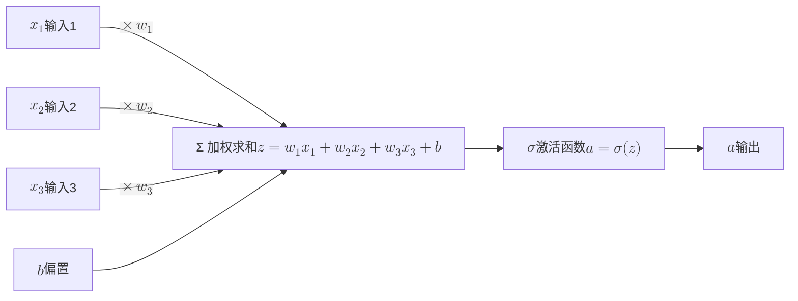
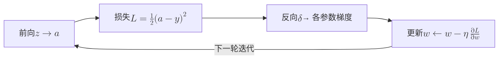
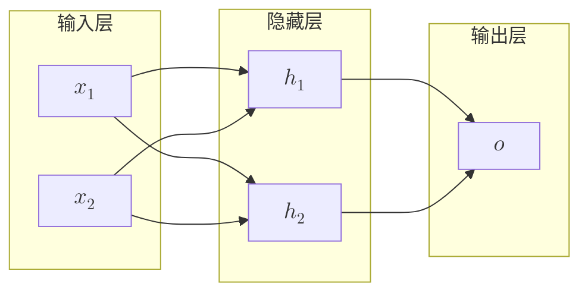
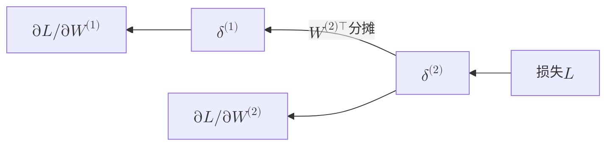
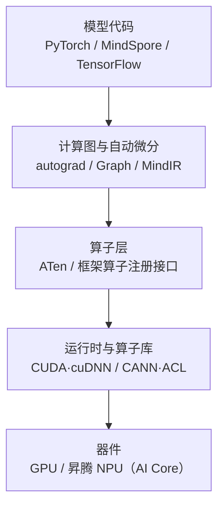

# 第一卷 配置、流程与工具
## 第一章 基础配置
## 第二章 算子组沟通地图
### 2.1 蓝区电脑配置
#### 2.1.1 如何申请蓝区服务器
#### 2.1.2 如何使用Xshell/VScode连接npu服务器
#### 2.1.3 如何建立容器及工作注意事项
### 2.2 API申请与使用

### 2.3 权限申请清单
### 2.4 新员工培养目标
## 第三章 工作流程

### 3.1 问题单处理流程
### 3.2 开发上线流程
## 第四章 常用算子测试与调优工具


# 第二卷 算子基础知识
## 第0章 大模型基础

### 0.1 神经网络

#### 0.1.1 神经元的结构与计算过程

> **学习目标**
> - 说出单个神经元的组成部件及各自职责
> - 手写前向计算公式，并解释激活函数的作用
> - 用链式法则推导单个神经元的梯度，完成一次梯度下降更新
> - 通过交互实验直观感受"学习率"与"误差信号"的作用

##### 0.1.1.1 引言：神经网络的最小积木

神经网络听起来高深，但它的最小积木——**单个神经元**——本质上就是一个"带旋钮的打分器"：把几个输入按重要程度加权求和，再经过一个"压缩函数"输出一个结果。训练的过程就是不断拧旋钮（调参数），让输出更接近目标。

本节按"结构 → 前向数学 → 反向数学 → 数值实例 → 交互实验"的顺序，把这一个最小积木彻底讲透。后续章节的全连接网络、乃至 Transformer，都是在此基础上堆叠与扩展出来的。

##### 0.1.1.2 神经元的结构与组成部件

单个神经元内部的数据从左往右流动，经过三道工序：**① 加权 → ② 求和加偏置 → ③ 激活**。



*图0.1.1-1 单个神经元的结构（Mermaid 静态图）*

各部件的职责如下：

| 部件 | 符号 | 是什么 | 类比 |
|---|---|---|---|
| 输入 | $x_1, x_2, \dots$ | 外部喂进来的数据（特征） | 评委看到的各项指标 |
| 权重 | $w_1, w_2, \dots$ | 每个输入的"重要程度"，**可学习** | 每项指标的打分权重 |
| 偏置 | $b$ | 一个整体平移量，**可学习** | 评委的"基础印象分" |
| 加权求和 | $z$ | 把所有输入按权重混合成一个数 | 算出总分 |
| 激活函数 | $\sigma$ | 对 $z$ 做非线性变换 | 把总分压成"录取概率" |
| 输出 | $a$ | 神经元最终对外的信号 | 最终判定 |

*表0.1.1-1 神经元的组成部件*

**关键点：神经元里真正"学出来"的东西只有 $w$ 和 $b$**，其余都是固定的计算规则。所谓"训练一个神经网络"，本质上就是在海量数据上反复调整这些 $w$ 和 $b$。

##### 0.1.1.3 前向计算（Forward）的数学机理

前向就是"给定输入和参数，算出输出"，共两步。

###### 0.1.1.3.1 第一步：线性加权求和

$$
z = \sum_{i=1}^{n} w_i x_i + b
$$

这是一个线性运算：每个输入乘以自己的权重，全部加起来，再加偏置。$b$ 的作用是：即使所有输入都是 0，神经元也能有一个非零的"基准输出"，相当于直线的截距。

###### 0.1.1.3.2 第二步：激活函数（以 sigmoid 为例）

$$
a = \sigma(z) = \frac{1}{1 + e^{-z}}
$$

**为什么需要这一步？** 如果只有线性求和，那么无论叠多少层神经元，整体仍然等价于一个线性函数，无法表达"曲线关系"。激活函数引入**非线性**，是神经网络能拟合复杂规律的根本原因。

sigmoid 把任意实数压缩到 $(0, 1)$ 区间，常被解释为"概率/激活强度"：

- $z$ 很大（正）→ $a$ 接近 1（强烈激活）
- $z$ 很小（负）→ $a$ 接近 0（几乎沉默）
- $z = 0$ → $a$ 恰好 0.5

完整的 S 形曲线见附件（自包含 HTML，双击即可离线打开）：

[图0.1.1-2 Sigmoid 激活函数曲线](resources/chapter0/chapter0.1.1-sigmoid_activation_curve.html)

注意曲线两端几乎水平——这叫**饱和区**：$z$ 太大或太小时，输出对输入变化几乎不敏感，梯度接近 0，学习会变得极慢。这是 sigmoid 的著名缺点，0.1.1.4 节会看到它的数学体现。

sigmoid 还有一个对反向传播极其友好的性质——**它的导数可以用输出自身表示**：

$$
\sigma'(z) = \sigma(z)\bigl(1 - \sigma(z)\bigr) = a(1 - a)
$$

前向时已经算出了 $a$，反向时直接复用，无需重新计算指数，这是它当年被广泛采用的重要原因。

##### 0.1.1.4 反向计算（Backward / 反向传播）的数学机理

前向是"用参数算输出"，反向是"根据输出的错误，算出每个参数该怎么改"。分四小步。

###### 0.1.1.4.1 第一步：定义损失函数——量化"错得有多离谱"

设真实目标为 $y$，用平方误差（乘 $\frac{1}{2}$ 只是为了求导后系数干净）：

$$
L = \frac{1}{2}(a - y)^2
$$

$L$ 越大错得越多。训练的唯一目标：**调整 $w$ 和 $b$，让 $L$ 变小**。

###### 0.1.1.4.2 第二步：链式法则——把"错误的责任"层层摊派

我们想知道 $\frac{\partial L}{\partial w_1}$（$w_1$ 动一点点，$L$ 会动多少）。但 $L$ 不直接依赖 $w_1$，依赖链条是 $w_1 \to z \to a \to L$，所以用链式法则把三段导数乘起来：

$$
\frac{\partial L}{\partial w_1} = \frac{\partial L}{\partial a} \cdot \frac{\partial a}{\partial z} \cdot \frac{\partial z}{\partial w_1}
$$

三段导数各自都非常简单：

$$
\begin{aligned}
\frac{\partial L}{\partial a} &= a - y && \text{（损失对输出的敏感度）} \cr
\frac{\partial a}{\partial z} &= a(1 - a) && \text{（sigmoid 的导数，恰好能用输出 } a \text{ 表示）} \cr
\frac{\partial z}{\partial w_1} &= x_1 && \text{（} z \text{ 对 } w_1 \text{ 的导数就是对应输入）}
\end{aligned}
$$

把前两段合并，记作 **$\delta$（误差信号）**，它是反向传播的核心中间量：

$$
\delta = \frac{\partial L}{\partial z} = (a - y)\, a(1 - a)
$$

于是每个参数的梯度一步到位：

$$
\frac{\partial L}{\partial w_i} = \delta \, x_i, \qquad \frac{\partial L}{\partial b} = \delta
$$

**直觉解读**：梯度 = 误差信号 × 当初的输入。哪个输入当初贡献大（$x_i$ 大），它对应的权重就要为错误承担更多责任。而 $a(1-a)$ 这一项解释了饱和区问题：$a$ 接近 0 或 1 时它趋近 0，$\delta$ 被"掐灭"，参数几乎不更新。

###### 0.1.1.4.3 第三步：梯度下降——沿"下坡方向"拧旋钮

梯度指向 $L$ 上升最快的方向，所以我们朝反方向走一小步：

$$
w_i \leftarrow w_i - \eta \, \frac{\partial L}{\partial w_i}, \qquad b \leftarrow b - \eta \, \frac{\partial L}{\partial b}
$$

$\eta$ 是**学习率**，控制步长：太大会震荡甚至发散，太小则进步缓慢。

###### 0.1.1.4.4 第四步：重复，形成训练闭环

更新后再前向、再反向……成千上万次迭代后，$L$ 逐渐降到很低，参数就"学会"了任务。



*图0.1.1-3 单神经元的训练闭环（Mermaid 静态图）*

##### 0.1.1.5 完整数值实例（手算一遍）

取一个 2 输入神经元，初始参数和目标如下：

$$
\begin{aligned}
&\text{输入：} x_1 = 1,\ x_2 = 2 \qquad \text{目标：} y = 1 \cr
&\text{参数：} w_1 = 0.5,\ w_2 = -0.3,\ b = 0.1 \qquad \text{学习率：} \eta = 0.5
\end{aligned}
$$

**（1）前向：**

$$
z = 0.5 \times 1 + (-0.3) \times 2 + 0.1 = 0.5 - 0.6 + 0.1 = 0
$$

$$
a = \sigma(0) = \frac{1}{1 + e^{0}} = 0.5
$$

**（2）损失：**

$$
L = \frac{1}{2}(0.5 - 1)^2 = \frac{1}{2} \times 0.25 = 0.125
$$

目标是 1，输出只有 0.5，错得不少。开始反向摊派责任。

**（3）反向：**

$$
\begin{aligned}
\frac{\partial L}{\partial a} &= a - y = 0.5 - 1 = -0.5 \cr
\frac{\partial a}{\partial z} &= a(1 - a) = 0.5 \times 0.5 = 0.25 \cr
\delta &= (-0.5) \times 0.25 = -0.125
\end{aligned}
$$

$$
\begin{aligned}
\frac{\partial L}{\partial w_1} &= \delta \, x_1 = -0.125 \times 1 = -0.125 \cr
\frac{\partial L}{\partial w_2} &= \delta \, x_2 = -0.125 \times 2 = -0.25 \cr
\frac{\partial L}{\partial b} &= \delta = -0.125
\end{aligned}
$$

其中 $x_2$ 更大，所以 $w_2$ 担责更多。

**（4）梯度下降更新（$\eta = 0.5$）：**

$$
\begin{aligned}
w_1 &\leftarrow 0.5 - 0.5 \times (-0.125) = 0.5625 \cr
w_2 &\leftarrow -0.3 - 0.5 \times (-0.25) = -0.175 \cr
b &\leftarrow 0.1 - 0.5 \times (-0.125) = 0.1625
\end{aligned}
$$

**（5）验证：用新参数再前向一次**

$$
z = 0.5625 \times 1 + (-0.175) \times 2 + 0.1625 = 0.375
$$

$$
a = \sigma(0.375) \approx 0.5927
$$

$$
L = \frac{1}{2}(0.5927 - 1)^2 \approx 0.0829
$$

损失从 **0.125 降到 0.0829**——仅一步，输出就从 0.5 向目标 1 靠近了。这就是"学习"发生的最小完整闭环。

##### 0.1.1.6 交互实验

下面的实验台演示 0.1.1.3～0.1.1.5 节的整套流程。改动输入、目标或学习率，所有中间量会实时重算。点击「梯度下降更新一步」可以观察参数和损失的变化。

[单神经元一步训练实验台](resources/chapter0/chapter0.1.1-single_neuron_training_demo.html)

建议动手做三个小实验：

1. **连续更新**：保持默认参数，连点 10 次"更新一步"，观察 $L$ 如何一步步逼近 0，输出 $a$ 如何逼近目标 1。
2. **学习率过大**：把 $\eta$ 调到 2 再连续更新，观察损失是否震荡、不降反升——体会"步长太大越过谷底"。
3. **目标反转**：把目标 $y$ 改成 0，观察梯度符号如何反转、参数朝相反方向更新——体会"误差信号决定方向"。

##### 0.1.1.7 小结

把整个闭环压缩成一张清单：

1. **结构**：输入 $x$ → 权重 $w$ 加权 → 加偏置 $b$ → 求和得 $z$ → 激活函数 $\sigma$ → 输出 $a$。可学习的只有 $w$ 和 $b$。
2. **前向**：$z = \sum_i w_i x_i + b$，$a = \sigma(z)$——用参数算预测。
3. **损失**：$L = \frac{1}{2}(a-y)^2$——量化预测与目标的差距。
4. **反向**：链式法则求 $\delta = (a-y)\,a(1-a)$，再得 $\frac{\partial L}{\partial w_i} = \delta \, x_i$、$\frac{\partial L}{\partial b} = \delta$——把错误责任摊派到每个参数。
5. **更新**：$w \leftarrow w - \eta \cdot \text{梯度}$——朝损失下降方向走一小步，循环往复。

多个神经元并排成"层"、层与层再串起来，反向传播的链式法则就继续往更深的层传递——这正是"深度"网络的学习原理，而本节已经掌握了它的最小单元。0.2 节将把多个神经元组织成**全连接神经网络**，看矩阵如何一次性描述整层的计算，以及误差信号如何逐层回传。

### 0.2 从神经元到多层全连接神经网络

#### 0.2.1 组合规则与矩阵形式

##### 0.2.1.1 组合规则：分层与全连接

单个神经元只能做一件简单的"打分"。把多个神经元**并排成一层**、再把层与层**串起来**，就得到了网络：

- **输入层**：接收原始特征 $x$，本身不做计算，记 $a^{(0)} = x$；
- **隐藏层**：中间的神经元层，可以有多层，每层提取更抽象的组合特征；
- **输出层**：给出最终预测 $a^{(L)}$。

**全连接（Fully Connected / Dense）** 的含义：相邻两层的神经元**两两相连**，每条连线都有一个独立的权重。上一层每个神经元的输出，都会送给下一层每个神经元当输入。

下面是一个 2-2-1 网络（2 输入、2 隐藏神经元、1 输出）：



*图0.2-1 2-2-1 全连接网络（每条连线对应一个独立权重）*

隐藏层的每个神经元，内部仍然是 0.1.1.2 节那套"加权求和 + 激活"，只是它的输入换成了上一层的输出。

##### 0.2.1.2 参数账：网络一共有多少个旋钮

每个神经元有自己的权重向量和偏置。对 2-2-1 网络逐层清点：

| 层 | 权重矩阵形状 | 权重数 | 偏置数 | 小计 |
|---|---|---|---|---|
| 隐藏层（2 神经元） | $W^{(1)}$: $2 \times 2$ | 4 | 2 | 6 |
| 输出层（1 神经元） | $W^{(2)}$: $1 \times 2$ | 2 | 1 | 3 |
| 合计 | — | 6 | 3 | **9** |

*表0.2-1 2-2-1 网络的参数清单*

一般地，第 $l$ 层（$n_l$ 个神经元，接收 $n_{l-1}$ 个输入）的参数量为：

$$
n_l \times n_{l-1} + n_l
$$

"训练网络"就是同时调整所有这些参数。现代大模型有数十亿个这样的旋钮，但每个旋钮的更新规则和本章完全一样。

##### 0.2.1.3 矩阵形式：一次算完一整层

每个神经元的加权求和是一个点积；把一层所有神经元的点积**打包**，就是一次矩阵乘法：

$$
z^{(l)} = W^{(l)} a^{(l-1)} + b^{(l)}, \qquad a^{(l)} = \sigma\bigl(z^{(l)}\bigr)
$$

其中 $W^{(l)} \in \mathbb{R}^{n_l \times n_{l-1}}$，**第 $i$ 行恰好是第 $i$ 个神经元的权重**；$\sigma$ 对向量逐元素作用。把第一层展开写，就能看清"矩阵 = 一排神经元"：

$$
\begin{bmatrix} z^{(1)}_1 \cr z^{(1)}_2 \end{bmatrix} =
\begin{bmatrix} w^{(1)}_{11} & w^{(1)}_{12} \cr w^{(1)}_{21} & w^{(1)}_{22} \end{bmatrix}
\begin{bmatrix} x_1 \cr x_2 \end{bmatrix} +
\begin{bmatrix} b^{(1)}_1 \cr b^{(1)}_2 \end{bmatrix}
$$

**为什么矩阵形式重要？** 不是数学上更高级，而是工程上更高效：矩阵乘法可以在 GPU/NPU 上大规模并行，一次算完一层成百上千个神经元。这正是深度学习框架把 **MatMul（矩阵乘）算子**作为核心算子的原因——本课程后续的算子开发与调优，很大程度上就是在优化这一步。

##### 0.2.1.4 多层反向传播：误差信号逐层回传

输出层的 $\delta$ 和单神经元一模一样。关键问题是：**隐藏层没有直接的目标 $y$，它的误差从哪来？** 答案：从后一层**按权重分摊回来**。

对 2-2-1 网络（输出层记为第 2 层）：

$$
\delta^{(2)} = (a^{(2)} - y)\, a^{(2)}(1 - a^{(2)})
$$

$$
\delta^{(1)} = \bigl(W^{(2)\top} \delta^{(2)}\bigr) \odot a^{(1)}(1 - a^{(1)})
$$

$\odot$ 表示逐元素相乘。直觉解读分两步：

1. $W^{(2)\top} \delta^{(2)}$：输出端的误差信号，沿着连线**按权重原路分摊**回每个隐藏神经元——当初谁的输出权重绝对值大，谁分到的责任就多；
2. 再乘本地的 $a^{(1)}(1-a^{(1)})$：和单神经元一样，经过本地激活函数的导数"闸门"。

有了每层的 $\delta$，梯度就是**外积**（列向量 × 行向量 = 矩阵）：

$$
\frac{\partial L}{\partial W^{(l)}} = \delta^{(l)} \bigl(a^{(l-1)}\bigr)^\top, \qquad \frac{\partial L}{\partial b^{(l)}} = \delta^{(l)}
$$



*图0.2-2 误差信号的反向流动：先算输出层 δ，再逐层回传*

推广到任意深度，就是反向传播的通用递推式：

$$
\delta^{(l)} = \bigl(W^{(l+1)\top} \delta^{(l+1)}\bigr) \odot a^{(l)}(1 - a^{(l)})
$$

**前向逐层算 $a$，反向逐层传 $\delta$，每层用自己的 $\delta$ 和上一层的 $a$ 算梯度**——这就是"深度"网络学习的完整骨架。

#### 0.2.2 实例：2-2-1 网络的一次完整训练

沿用图0.2-1 的网络，给定初始参数（中间量按全精度计算，显示保留四位小数）：

$$
x = \begin{bmatrix} 1 \cr 2 \end{bmatrix}, \qquad y = 1, \qquad \eta = 0.5
$$

$$
W^{(1)} = \begin{bmatrix} 0.5 & -0.3 \cr 0.2 & 0.4 \end{bmatrix}, \quad
b^{(1)} = \begin{bmatrix} 0.1 \cr -0.1 \end{bmatrix}, \quad
W^{(2)} = \begin{bmatrix} 0.6 & -0.5 \end{bmatrix}, \quad
b^{(2)} = 0.2
$$

**（1）前向——隐藏层：**

$$
z^{(1)} = W^{(1)}x + b^{(1)} = \begin{bmatrix} 0.5 - 0.6 + 0.1 \cr 0.2 + 0.8 - 0.1 \end{bmatrix} = \begin{bmatrix} 0 \cr 0.9 \end{bmatrix}
$$

$$
a^{(1)} = \sigma(z^{(1)}) \approx \begin{bmatrix} 0.5 \cr 0.7109 \end{bmatrix}
$$

**（2）前向——输出层：**

$$
z^{(2)} = 0.6 \times 0.5 + (-0.5) \times 0.7109 + 0.2 \approx 0.1446
$$

$$
a^{(2)} = \sigma(0.1446) \approx 0.5361
$$

**（3）损失：**

$$
L = \frac{1}{2}(0.5361 - 1)^2 \approx 0.1076
$$

**（4）反向——输出层：**

$$
\delta^{(2)} = (0.5361 - 1) \times 0.5361 \times 0.4639 \approx -0.1154
$$

$$
\frac{\partial L}{\partial W^{(2)}} = \delta^{(2)} a^{(1)\top} \approx \begin{bmatrix} -0.0577 & -0.0820 \end{bmatrix}, \qquad \frac{\partial L}{\partial b^{(2)}} \approx -0.1154
$$

**（5）反向——隐藏层（误差回传）：**

$$
W^{(2)\top}\delta^{(2)} \approx \begin{bmatrix} -0.0692 \cr 0.0577 \end{bmatrix}, \qquad a^{(1)}(1-a^{(1)}) \approx \begin{bmatrix} 0.25 \cr 0.2055 \end{bmatrix}
$$

$$
\delta^{(1)} = \bigl(W^{(2)\top}\delta^{(2)}\bigr) \odot a^{(1)}(1-a^{(1)}) \approx \begin{bmatrix} -0.0173 \cr 0.0119 \end{bmatrix}
$$

注意 $\delta^{(1)}_2$ 是**正号**：隐藏神经元 2 的输出权重 $w^{(2)}_2 = -0.5$ 为负，"增大它的输出"反而有助于降低损失。梯度的方向完全由链式法则自动决定，不需要人为指定。

$$
\frac{\partial L}{\partial W^{(1)}} = \delta^{(1)} x^\top \approx \begin{bmatrix} -0.0173 & -0.0346 \cr 0.0119 & 0.0237 \end{bmatrix}, \qquad \frac{\partial L}{\partial b^{(1)}} = \delta^{(1)}
$$

**（6）更新全部 9 个参数（$\eta = 0.5$）：**

$$
W^{(1)} \leftarrow \begin{bmatrix} 0.5087 & -0.2827 \cr 0.1941 & 0.3881 \end{bmatrix}, \qquad b^{(1)} \leftarrow \begin{bmatrix} 0.1087 \cr -0.1059 \end{bmatrix}
$$

$$
W^{(2)} \leftarrow \begin{bmatrix} 0.6288 & -0.4590 \end{bmatrix}, \qquad b^{(2)} \leftarrow 0.2577
$$

**（7）验证：用新参数再前向一次**

$$
a^{(2)}_{\text{new}} \approx 0.5640, \qquad L_{\text{new}} = \frac{1}{2}(0.5640 - 1)^2 \approx 0.0951
$$

损失从 **0.1076 降到 0.0951**——9 个参数各自朝自己的"下坡方向"走了一步，网络整体输出向目标靠近。反复迭代，就是一次完整的训练。

#### 0.2.3 交互实验（全连接网络）

下面的实验台把 0.2.1～0.2.2 节的 2-2-1 网络做成了可交互页面（自包含 HTML，双击即可离线打开）：实时显示两层的前向结果、损失、各层 $\delta$ 与全部梯度；点"梯度下降更新一步"，9 个参数同时更新。

🧪 [交互实验：2-2-1 全连接网络训练实验台](resources/chapter0/chapter0.2-fc_network_training_demo.html)

建议动手做四个小实验：

1. **连续更新**：连点 20 次"更新一步"，观察 $L$ 逐步逼近 0、$a^{(2)}$ 逼近目标 1。
2. **观察误差回传**：注意隐藏层 $\delta^{(1)}_2$ 的符号与输出权重 $w^{(2)}_2$ 的符号关系——体会"按权重分摊责任"。
3. **学习率过大**：把 $\eta$ 调到 2 再连续更新，观察损失震荡——多层网络对步长更敏感。
4. **目标反转**：把 $y$ 改成 0，观察所有梯度符号整体反转。

#### 0.2.4 小结

单神经元的闭环清单已在 0.1.1.7 节给出，此处小结"组合成网络"的三个要点：

1. **组合**：相邻层全连接，每条连线一个独立权重；第 $l$ 层参数量 $n_l n_{l-1} + n_l$。
2. **整层前向**：$z^{(l)} = W^{(l)}a^{(l-1)} + b^{(l)}$，$a^{(l)} = \sigma(z^{(l)})$——一次矩阵乘法算完一层，这是 MatMul 算子的用武之地。
3. **整层反向**：$\delta^{(l)} = \bigl(W^{(l+1)\top}\delta^{(l+1)}\bigr) \odot a^{(l)}(1-a^{(l)})$，梯度为外积 $\delta^{(l)}(a^{(l-1)})^\top$——误差从输出层逐层回传。

至此，"深度网络如何学习"的完整骨架已经就位。

### 0.3 机器学习框架简介

> **本节定位**：简要认识主流机器学习框架"是什么、怎么分层、和算子/器件是什么关系"。对算子开发者而言，框架不是要精通的对象，而是**你的算子被谁调用、以什么形式调用**的上下文。

#### 0.3.1 PyTorch

**背景**：Meta（Facebook）于 2016 年推出，源自 Torch。目前是**学术界与工业界研究领域的事实标准**，HuggingFace、vLLM 等主流生态均构建其上。

**核心特点：动态图（Define-by-Run）**。代码执行到哪，计算图就建到哪，可以用普通 Python 控制流（if/for）写模型，调试如同调试普通程序。

**四个核心组件**：

| 组件 | 职责 | 与第0章知识的对应 |
|---|---|---|
| `Tensor` | 多维数组，携带 `device`（CPU/GPU/NPU）与 `requires_grad` 标记 | 向量 $x$、矩阵 $W^{(l)}$ 的载体 |
| `autograd` | 前向时录制计算图，`backward()` 自动求梯度 | 自动完成 0.2.1.4 节的 $\delta$ 逐层回传 |
| `nn.Module` | 封装参数与层结构（`Linear`、`Transformer` 等） | 全连接层 $z = Wa + b$ 的现成实现 |
| `optim` | 参数更新策略（SGD、Adam 等） | 梯度下降 $w \leftarrow w - \eta\,\nabla_w L$ |

*表0.3-1 PyTorch 核心组件*

**一个呼应前文的例子**——0.2.2 节的 2-2-1 网络，用 PyTorch 只需几行，反向传播全部自动：

```python
import torch

x  = torch.tensor([1.0, 2.0])
W1 = torch.tensor([[0.5, -0.3], [0.2, 0.4]], requires_grad=True)
b1 = torch.tensor([0.1, -0.1], requires_grad=True)
W2 = torch.tensor([[0.6, -0.5]], requires_grad=True)
b2 = torch.tensor([0.2], requires_grad=True)

a1 = torch.sigmoid(W1 @ x + b1)          # 隐藏层前向
a2 = torch.sigmoid(a1 @ W2.T + b2)       # 输出层前向
L  = 0.5 * ((a2 - 1.0) ** 2).sum()       # 损失
L.backward()                             # 自动完成逐层反向
print(W1.grad)   # ≈ [[-0.0173, -0.0346], [0.0119, 0.0237]]，与手算一致
```

**执行路径（算子视角）**：Python API → **ATen 算子库** → **Dispatcher** 按设备/数据类型分发 → 具体后端 kernel（GPU 走 CUDA/cuDNN，昇腾走 CANN）。2.x 引入 `torch.compile`（TorchInductor），在保留动态图体验的同时捕获子图做编译优化。

**昇腾适配**：通过 `torch_npu` 插件把 NPU 注册为一种设备后端，模型代码基本不改即可运行——这正是 0.3.4 节"框架-器件"关系的实例。

#### 0.3.2 TensorFlow

**背景**：Google 于 2015 年开源，工业界部署的先驱，与 TPU 深度绑定。

**核心特点：从静态图走向动静结合**。1.x 是"先建图、后执行"（Define-then-Run）：Python 只负责描述计算图，`Session.run()` 才真正计算，利于整图优化与跨平台部署，但调试困难。2.x 默认 **Eager 模式**（与 PyTorch 类似的即时执行），用 `tf.function` 把热点函数编译回静态图，兼顾灵活与性能。

**关键组件与生态**：

- **Keras**：高层建模 API（`tf.keras`），搭网络像搭积木；
- **Grappler / XLA**：图优化器与编译器，XLA 把子图编译成针对硬件的高效 kernel；
- **部署链**：TF Serving（服务端）、TFLite（移动端）、TF.js（浏览器）、SavedModel（标准模型格式）。

**现状**：研究领域份额已明显让位于 PyTorch，但在**大规模工业部署、TPU 场景**仍占重要地位。对算子开发者，重点理解其"图优化 + XLA 编译"的思路——这与昇腾的图编译（GE）理念相通。

#### 0.3.3 其他框架

| 框架 | 主导方 | 特点 | 与本课程的关联 |
|---|---|---|---|
| **MindSpore** | 华为 | 昇腾原生框架，动静统一，自动并行；配套 MindIR 图格式 | **昇腾生态第一方**，算子经 CANN/GE 下发到 AI Core |
| **JAX** | Google | 函数式风格，`jit`/`vmap`/`grad` 变换组合，底层 XLA | 前沿研究常用，TPU 主力 |
| **PaddlePaddle** | 百度 | 国产，产业级部署工具链完整（飞桨） | 国产器件适配路线可参考 |
| **MXNet** | Apache | 早期动静结合代表，已停止活跃维护 | 了解历史演进即可 |
| **OneFlow** | 一流科技 | 静态图 + Actor 调度，主打分布式效率 | 图执行机制的另一种设计 |

*表0.3-2 其他主流框架速览*

**一句话总结**：框架之争主要在"动态图易用性 vs 静态图可优化性"与生态绑定；底层殊途同归——**都要把模型拆成算子，交给器件执行**。

#### 0.3.4 硬件、算子、学习框架的关系

**算子（Operator）**：框架中可调度的最小计算单元，如 MatMul、Add、Softmax、Conv2d。模型无论多复杂，最终都被分解为算子序列；每个算子有明确的输入/输出张量规格（shape、dtype、layout）。

**器件 kernel**：同一个算子在具体硬件上的实现。例如矩阵乘 $C = AB$：GPU 上是 cuBLAS kernel，昇腾上是 CANN 的 `aclnnMatmul` 或 AscendC 自定义 kernel。

**分层关系**（自上而下）：



*图0.3-1 硬件、算子与学习框架的分层关系*

以 `torch.matmul` 在昇腾上执行为例，完整调用链：

```text
torch.matmul(A, B)
  → ATen matmul 算子（框架统一接口）
  → Dispatcher 按 device=npu 分发（torch_npu 适配层）
  → CANN aclnnMatmul（昇腾算子库）
  → AI Core 上的矩阵乘 kernel（真正干活的硬件代码）
```

**三个关键结论**：

1. **框架是"调用方"，器件是"执行方"，算子是两者之间的契约**。框架不关心 kernel 怎么写，只关心算子的语义与规格；器件不关心模型长什么样，只关心收到什么算子任务。
2. **新器件接入框架 = 实现适配层 + 算子库**。`torch_npu` 之于昇腾、CUDA 后端之于 GPU，都是这个模式。算子覆盖度与性能，直接决定器件能不能跑主流模型、跑得多快。
3. **本课程的位置在最底层**：用 AscendC/Triton 编写或调优的，就是图0.3-1 最下方那个 kernel。理解上层框架，是为了知道——你的算子**被谁调用、输入从哪来、shape/dtype 由谁决定、性能瓶颈在哪一层被放大**。

> **学习建议**：不必深入框架 API，但建议动手跑通 0.3.1 的 PyTorch 小例子，并用 `print` 观察中间张量的 shape——建立"模型 → 算子 → 张量规格"的直觉，后续算子开发会反复用到。

**章末桥梁：从全连接到大模型**。全连接网络有一个根本局限：每条连线的权重训练完就固定了，对所有输入一视同仁，难以表达"序列中元素之间的动态关联"——而语言恰恰是强关联的序列（"它"指代谁，取决于上下文）。把"固定权重连接"换成"按内容动态计算关联权重"，就得到了**注意力机制（Attention）**；以注意力为核心堆叠出的网络就是 **Transformer**，即当今大模型的骨架。这正是第一章的主题。而无论模型多大，最终仍被拆成算子落到器件执行——本章建立的"硬件-算子-框架"视角将贯穿全课程。

## 第一章 Transformer基础

### 1.1 Attention 的数学定义（基础）

#### 1.1.1 记号

#### 1.1.2 计算定义

#### 1.1.3 数值实例：4-token 因果注意力

### 1.2 维度语义与多头机制

#### 1.2.1 两类维度：行与列

#### 1.2.2 行维度 N：序列位置

#### 1.2.3 列维度 d_k 与 d_v：特征子空间

#### 1.2.4 缩放因子 √d_k 的统计意义

#### 1.2.5 多头：维度切分与完整流转

#### 1.2.6 输出拼接与 W_O：跨头信息融合

#### 1.2.7 数值示例：多头维度账

#### 1.2.8 参考实现（PyTorch，多头）

### 1.3 前向传播的实现演进

#### 1.3.1 朴素实现与其瓶颈

#### 1.3.2 FlashAttention：分块流式

##### 1.3.2.1 简介：为什么标准 Attention 的内存是瓶颈

##### 1.3.2.2 GPU 内存层次：SRAM vs HBM

##### 1.3.2.3 标准 Attention 的内存访问模式

##### 1.3.2.4 分块策略：Tiling Q, K, V

##### 1.3.2.5 双层循环结构

##### 1.3.2.6 Online Softmax：核心创新的详细推导

##### 1.3.2.7 完整实例：N=4, d=3, B=2 的分块计算

##### 1.3.2.8 内存从 O(N²) 到 O(N) 的推导

##### 1.3.2.9 IO 复杂度分析：为什么更快

##### 1.3.2.10 下界

##### 1.3.2.11 Flash Attention v1 vs v2

##### 1.3.2.12 总结

#### 1.3.3 Online Softmax 的递推公式

#### 1.3.4 KV Cache

#### 1.3.5 KV Cache 的体积

#### 1.3.6 PagedAttention

#### 1.3.7 KV 量化

#### 1.3.8 反量化的两个施加位置

#### 1.3.9 全量化 Attention 的 A8C8 记法与误差传播

### 1.4 反向传播

#### 1.4.1 反向计算图

#### 1.4.2 逐步推导

#### 1.4.3 dX：三条通路汇合

#### 1.4.4 数值实例：softmax 反向

#### 1.4.5 FlashAttention 的反向

#### 1.4.6 量化场景下反向传播的差异

### 1.5 高效注意力变体：GQA 与 MLA

#### 1.5.1 为什么要省 KV：从 MHA 到 MQA 到 GQA

#### 1.5.2 GQA 的数学定义

#### 1.5.3 GQA 数值实例

#### 1.5.4 GQA 参考实现（PyTorch）

#### 1.5.5 MLA：低秩 KV 联合压缩

#### 1.5.6 Decoupled RoPE：解耦位置编码

#### 1.5.7 推理时的矩阵吸收

#### 1.5.8 训练/预填充 vs 推理/解码：两套等价形态

#### 1.5.9 完整数值实例：形状追踪与手算吸收验证

#### 1.5.10 KV cache 体积对比

#### 1.5.11 MLA 参考实现（PyTorch）

#### 1.5.12 GQA 与 MLA 对比小结


## 第二章 Triton算子

### 2.1 Triton 简介

Triton 是一种面向 GPU/NPU 的高性能内核编程语言与编译器，目标是让开发者以**接近 Python 的可读性**编写出**接近手写 CUDA/cuBLAS 性能**的算子内核。相比 CUDA：

- 无需手动管理线程级细节（warp 调度、共享内存 bank conflict 等），编译器自动处理；
- 以 **"程序（Program）× 数据块（Block）"** 的 SPMD 模型组织并行；
- 与 PyTorch 深度集成，张量对象自动退化为指针传入内核；
- 易于定制和扩展（如融合激活函数），这是闭源内核库（cuBLAS）难以做到的。

官方教程库按照从易到难的顺序编排，**建议按序阅读**。

---

### 2.2 安装指南

#### 2.2.1 二进制分发版（推荐）

支持 CPython 3.10–3.14：

```bash
pip install triton
```

#### 2.2.2 从源码安装

```bash
git clone https://github.com/triton-lang/triton.git
cd triton

pip install -r python/requirements.txt  # 构建期依赖
pip install -e .
```

说明：
- 若系统未安装 LLVM，`setup.py` 会自动下载官方 LLVM 静态库并链接；
- 需使用自定义 LLVM 构建时，参考 GitHub README 的 *Building with a custom LLVM* 部分。

#### 2.2.3 验证安装

```bash
# 一次性开发环境安装
make dev-install

# 运行全部测试（需要 GPU）
make test
# 无 GPU 环境运行测试
make test-nogpu
```

#### 2.2.4 教程依赖

```bash
cd triton
pip install -r python/tutorials/requirements.txt
```

#### 2.2.5 平台兼容性

支持的平台/操作系统/硬件清单见 GitHub 仓库 README 的 [Compatibility](https://github.com/triton-lang/triton?tab=readme-ov-file#compatibility) 部分。教程中的 FP8/TMA/块缩放等特性通常有**计算能力版本要求**（如 FP8 需 CUDA 计算能力 ≥ 9.0，块缩放需 ≥ 10.0 或 AMD CDNA4），后文各教程中会标注。

---

### 2.3 核心编程模型（必读）

在进入教程之前，先掌握贯穿全部 10 篇教程的 6 个核心概念。

#### 2.3.1 SPMD 并行模型

Triton 内核以 **SPMD（单程序多数据）** 方式执行：同一段内核代码被**大量程序实例**并行执行，每个实例通过 `tl.program_id(axis)` 获取自己的编号，进而计算出自己负责的数据块。

```python
pid = tl.program_id(axis=0)   # 1D 网格中当前程序的 id
```

启动网格（grid）在**主机端**指定，可以是整数元组，也可以是**可调用对象**（lambda），后者可引用内核元参数：

```python
grid = lambda meta: (triton.cdiv(n_elements, meta['BLOCK_SIZE']), )
add_kernel[grid](x, y, output, n_elements, BLOCK_SIZE=1024)
```

- `triton.cdiv(a, b)`：向上取整除法，用于计算块数；
- 每个 `torch.Tensor` 传入内核时**自动退化为指向首元素的指针**；
- 元参数（如 `BLOCK_SIZE`）必须以**关键字参数**形式传递；
- 内核启动是**异步**的，与 CUDA 语义一致。

#### 2.3.2 数据块与 `tl.constexpr`

- 块大小（如 `BLOCK_SIZE`）必须声明为 `tl.constexpr`，才能被用作张量形状值并在编译期展开；
- **Triton 的关键限制：每个块必须包含 2 的幂次个元素**。处理任意形状时需要"内部填充 + 掩码保护"。

#### 2.3.3 指针算术与 stride

对行优先二维张量 `X`，元素地址为：

```
&X[i, j] = x_ptr + i * stride_xi + j * stride_xj
```

stride 表示沿某一维度移动一步时指针需要跨越的元素数。通用公式 `addr = base_ptr + Σ i_k × stride[k]` 是所有内核访存的基石：

```python
# 一维块内偏移
offsets = pid * BLOCK_SIZE + tl.arange(0, BLOCK_SIZE)

# 二维块指针（矩阵乘法中的典型写法）
a_ptrs = a_ptr + (offs_am[:, None] * stride_am + offs_k[None, :] * stride_ak)
```

stride 的价值：支持非连续输入（转置、切片）、批处理多维度张量、零成本转置（交换 stride 角色）、配合 vLLM KV Cache 等 pooled buffer 的 slot 映射。

#### 2.3.4 掩码与越界保护

当数据规模不是块大小的整数倍时，用掩码保护所有内存操作：

```python
mask = offsets < n_elements
x = tl.load(x_ptr + offsets, mask=mask, other=-float('inf'))  # other 指定越界填充值
tl.store(output_ptr + offsets, output, mask=mask)
```

矩阵乘法中还有另一种技巧——**取模回绕**（处理 M/N 方向越界，配合最终 store 掩码）：

```python
offs_am = (pid_m * BLOCK_SIZE_M + tl.arange(0, BLOCK_SIZE_M)) % M
```

#### 2.3.5 归约与逐元素运算

```python
tl.max(row, axis=0)      # 归约最大值
tl.sum(numerator, axis=0)  # 归约求和
tl.exp(x)                # 指数（快速但近似，类似 CUDA __expf）
tl.where(cond, a, b)     # 条件选择
```

#### 2.3.6 tl.dot 与累加器

`tl.dot` 执行块级矩阵乘法，通过 `acc` 参数实现 K 维分块累加：

```python
accumulator = tl.zeros((BLOCK_SIZE_M, BLOCK_SIZE_N), dtype=tl.float32)  # FP32 累加保证精度
for k in range(0, tl.cdiv(K, BLOCK_SIZE_K)):
    a = tl.load(a_ptrs, mask=..., other=0.0)
    b = tl.load(b_ptrs, mask=..., other=0.0)
    accumulator = tl.dot(a, b, accumulator)   # acc += a @ b
    a_ptrs += BLOCK_SIZE_K * stride_ak
    b_ptrs += BLOCK_SIZE_K * stride_bk
```

要点：
- 累加器用 **FP32** 以保证数值精度，循环结束后再转回 FP16 等输出类型；
- `tl.dot` 对维度有约束（通常各维 ≥ 16 且为 2 的幂），不足时需填充；
- 融合激活函数的最佳时机是**累加器仍为 FP32 时**（见教程 03）。

---

### 2.4 教程详解

#### 2.4.1 教程 01：向量加法

> 原文：https://triton-lang.cn/main/getting-started/tutorials/01-vector-add.html

**学习目标**：Triton 基本编程模型；`triton.jit` 装饰器；验证与基准测试的最佳实践。

##### 2.4.1.1 计算内核

```python
import torch
import triton
import triton.language as tl

DEVICE = triton.runtime.driver.active.get_active_torch_device()

@triton.jit
def add_kernel(
    x_ptr,                      # 第一个输入向量的指针
    y_ptr,                      # 第二个输入向量的指针
    output_ptr,                 # 输出向量的指针
    n_elements,                 # 向量长度
    BLOCK_SIZE: tl.constexpr,   # 每个程序处理的元素数
):
    pid = tl.program_id(axis=0)                       # 1D 网格
    block_start = pid * BLOCK_SIZE
    offsets = block_start + tl.arange(0, BLOCK_SIZE)  # 指针偏移列表
    mask = offsets < n_elements                       # 越界保护
    x = tl.load(x_ptr + offsets, mask=mask)
    y = tl.load(y_ptr + offsets, mask=mask)
    output = x + y
    tl.store(output_ptr + offsets, output, mask=mask)
```

##### 2.4.1.2 辅助函数（分配输出 + 启动内核）

```python
def add(x: torch.Tensor, y: torch.Tensor):
    output = torch.empty_like(x)          # 预分配输出
    n_elements = output.numel()
    grid = lambda meta: (triton.cdiv(n_elements, meta['BLOCK_SIZE']), )
    add_kernel[grid](x, y, output, n_elements, BLOCK_SIZE=1024)
    return output                          # 注意：此时内核仍在异步执行
```

##### 2.4.1.3 正确性验证

```python
torch.manual_seed(0)
size = 98432
x = torch.rand(size, device=DEVICE)
y = torch.rand(size, device=DEVICE)
output_torch = x + y
output_triton = add(x, y)
print(f'The maximum difference between torch and triton is '
      f'{torch.max(torch.abs(output_torch - output_triton))}')
# 输出：0.0
```

##### 2.4.1.4 基准测试（内置工具）

利用 `triton.testing.perf_report` + `triton.testing.Benchmark` 对不同问题规模绘图：

```python
@triton.testing.perf_report(
    triton.testing.Benchmark(
        x_names=['size'],
        x_vals=[2**i for i in range(12, 28, 1)],
        x_log=True,
        line_arg='provider',
        line_vals=['triton', 'torch'],
        line_names=['Triton', 'Torch'],
        styles=[('blue', '-'), ('green', '-')],
        ylabel='GB/s',
        plot_name='vector-add-performance',
        args={},
    ))
def benchmark(size, provider):
    x = torch.rand(size, device=DEVICE, dtype=torch.float32)
    y = torch.rand(size, device=DEVICE, dtype=torch.float32)
    quantiles = [0.5, 0.2, 0.8]
    if provider == 'torch':
        ms, min_ms, max_ms = triton.testing.do_bench(lambda: x + y, quantiles=quantiles)
    if provider == 'triton':
        ms, min_ms, max_ms = triton.testing.do_bench(lambda: add(x, y), quantiles=quantiles)
    gbps = lambda ms: 3 * x.numel() * x.element_size() * 1e-9 / (ms * 1e-3)
    return gbps(ms), gbps(max_ms), gbps(min_ms)

benchmark.run(print_data=True, show_plots=True)
```

**结果要点**：规模较小时（几 KB）Triton 因启动开销略占优；随规模增大两者都逼近带宽极限（实测约 1680 GB/s）。向量加法是**带宽受限（memory-bound）**算子的典型代表，性能 = 读 2 份 + 写 1 份 = `3 * numel * element_size / time`。

**本教程惯例（后续所有教程沿用）**：
1. 内核 + 辅助包装函数分离；
2. 与 PyTorch 原生实现对比验证（`torch.allclose` / max diff）；
3. 用 `perf_report` 基准测试并以 GB/s（带宽受限）或 TFLOPS（计算受限）为指标。

---

#### 2.4.2 教程 02：融合 Softmax

> 原文：https://triton-lang.cn/main/getting-started/tutorials/02-fused-softmax.html

**学习目标**：带宽受限操作中**算子融合**的优势；Triton 中的归约算子。


##### 2.4.2.1 动机：为什么需要融合

数值稳定的朴素 Softmax（逐行减最大值防止溢出）在 PyTorch 中的中间结果读写次数：

```python
def naive_softmax(x):
    x_max = x.max(dim=1)[0]           # 读 MN，写 M
    z = x - x_max[:, None]            # 读 MN+M，写 MN
    numerator = torch.exp(z)          # 读 MN，写 MN
    denominator = numerator.sum(dim=1)  # 读 MN，写 M
    ret = numerator / denominator[:, None]  # 读 MN+M，写 MN
    # 总计：读 5MN + 2M，写 3MN + 2M
    return ret
```

每个中间张量都要完整读写 DRAM。融合内核**只读一次 X、只写一次 Y**，数据量从 `8MN + 4M` 降为 `2MN`，理论上约 **4 倍加速**。`torch.jit.script` 想自动做融合，但实测差距很大。

##### 2.4.2.2 计算内核

每个程序处理（跨步访问）输入矩阵的若干**行**：整行加载进 SRAM → 归一化 → 写回。

```python
@triton.jit
def softmax_kernel(output_ptr, input_ptr,
                   input_row_stride, output_row_stride,
                   n_rows, n_cols,
                   BLOCK_SIZE: tl.constexpr, num_stages: tl.constexpr):
    row_start = tl.program_id(0)
    row_step = tl.num_programs(0)                     # 程序总数，用于跨步
    for row_idx in tl.range(row_start, n_rows, row_step, num_stages=num_stages):
        row_start_ptr = input_ptr + row_idx * input_row_stride  # stride 定位行首
        col_offsets = tl.arange(0, BLOCK_SIZE)
        input_ptrs = row_start_ptr + col_offsets
        mask = col_offsets < n_cols                   # BLOCK_SIZE 可能 > n_cols
        row = tl.load(input_ptrs, mask=mask, other=-float('inf'))  # 填 -inf
        row_minus_max = row - tl.max(row, axis=0)     # 数值稳定
        numerator = tl.exp(row_minus_max)
        denominator = tl.sum(numerator, axis=0)
        softmax_output = numerator / denominator
        output_ptrs = output_ptr + row_idx * output_row_stride + col_offsets
        tl.store(output_ptrs, softmax_output, mask=mask)
```

**两个关键点**：
1. **填充**：`BLOCK_SIZE` 取大于 `n_cols` 的最小 2 的幂（`triton.next_power_of_2`），越界位置用 `-inf` 填充（softmax 后为 0，不影响结果）；
2. **持久化式调度**：程序数由**占用率（occupancy）**计算得出，而非每行一个程序，各程序跨步处理多行。Softmax算子的理解要点是需要了解二维、三维张量在内存中的存储模式。与GPU不同，因为昇腾NPU设计中将grid最大定为vector/AIcore数目，因此应优先在单个program内进行核内循环。

##### 2.4.2.3 基于占用率的调度（辅助函数）

```python
properties = driver.active.utils.get_device_properties(DEVICE.index)
NUM_SM = properties["multiprocessor_count"]     # SM 数量
NUM_REGS = properties["max_num_regs"]           # 每SM寄存器
SIZE_SMEM = properties["max_shared_mem"]        # 共享内存大小
WARP_SIZE = properties["warpSize"]

def softmax(x):
    n_rows, n_cols = x.shape
    BLOCK_SIZE = triton.next_power_of_2(n_cols)
    num_warps = 8                               # 增加每行使用的线程数
    num_stages = 4 if SIZE_SMEM > 200000 else 2 # 软件流水级数

    y = torch.empty_like(x)
    # 预编译内核以获取寄存器用量，进而计算占用率
    kernel = softmax_kernel.warmup(y, x, x.stride(0), y.stride(0), n_rows, n_cols,
                                   BLOCK_SIZE=BLOCK_SIZE, num_stages=num_stages,
                                   num_warps=num_warps, grid=(1, ))
    kernel._init_handles()
    n_regs = kernel.n_regs
    size_smem = kernel.metadata.shared
    occupancy = NUM_REGS // (n_regs * WARP_SIZE * num_warps)   # CUDA 路径
    occupancy = min(occupancy, SIZE_SMEM // size_smem)
    num_programs = NUM_SM * occupancy
    num_programs = min(num_programs, n_rows)    # 不超过行数

    kernel[(num_programs, 1, 1)](y, x, x.stride(0), y.stride(0), n_rows, n_cols,
                                 BLOCK_SIZE, num_stages)
    return y
```


（HIP/CDNA 平台的占用率计算略有不同，见原文。）这段
代码在npu中不能实现，因为在A2中寄存器数量已定死，warp_size与num_stage执行虽然不会报错，但是不起作用，且无法查询到共享内存大小和regs数目，SM查询结果为vector核数和AI core核数，且AI核数为vector核数的一半，因此，在npu中直接以核数为grid数即可

##### 2.4.2.4 验证与基准

用**行列数不规则**的矩阵测试（验证填充机制）：

```python
x = torch.randn(1823, 781, device=DEVICE)
assert torch.allclose(softmax(x), torch.softmax(x, axis=1))
```

基准测试结论：
- Triton 比 Torch JIT（naive_softmax）**快约 4 倍**，证实 Torch JIT 未做融合；
- Triton 快于 `torch.softmax` 且**更易读、易维护**（但 torch 版本对任意形状更通用）；
- 实测两者均可达到约 1400+ GB/s 的带宽。

---

#### 2.4.3 教程 03：矩阵乘法

> 原文：https://triton-lang.cn/main/getting-started/tutorials/03-matrix-multiplication.html

**学习目标**：块级矩阵乘法；多维指针算术；程序重排序提高 L2 缓存命中率；自动性能调优（autotune）。这是**全系列最重要的教程**。

##### 2.4.3.1 分块算法

将 (M, K) @ (K, N) 分块计算，双重循环的每次迭代由一个 Triton 程序实例执行：

```python
# 伪代码
for m in range(0, M, BLOCK_SIZE_M):      # 并行
    for n in range(0, N, BLOCK_SIZE_N):  # 并行
        acc = zeros((BLOCK_SIZE_M, BLOCK_SIZE_N), dtype=float32)
        for k in range(0, K, BLOCK_SIZE_K):
            a = A[m : m+BLOCK_SIZE_M, k : k+BLOCK_SIZE_K]
            b = B[k : k+BLOCK_SIZE_K, n : n+BLOCK_SIZE_N]
            acc += dot(a, b)
        C[m : m+BLOCK_SIZE_M, n : n+BLOCK_SIZE_N] = acc
```

难点在于**多维指针算术**——确定内循环中 A、B 数据块的内存位置。

##### 2.4.3.2 指针算术

```python
# 初始化（k=0 时）的 A、B 块指针
offs_am = (pid_m * BLOCK_SIZE_M + tl.arange(0, BLOCK_SIZE_M)) % M   # 取模处理 M 不整除
offs_bn = (pid_n * BLOCK_SIZE_N + tl.arange(0, BLOCK_SIZE_N)) % N
offs_k = tl.arange(0, BLOCK_SIZE_K)
a_ptrs = a_ptr + (offs_am[:, None] * stride_am + offs_k[None, :] * stride_ak)
b_ptrs = b_ptr + (offs_k[:, None] * stride_bk + offs_bn[None, :] * stride_bn)

# 内循环中沿 K 前进
a_ptrs += BLOCK_SIZE_K * stride_ak
b_ptrs += BLOCK_SIZE_K * stride_bk
```

M/N 方向用**取模回绕**填充无效数据（结果无影响），K 方向用**掩码加载**（`other=0.0`，乘法累加不受影响）。

##### 2.4.3.3 L2 缓存优化：程序分组重排序

程序计算块的**顺序**直接影响 L2 命中率。朴素行优先顺序下，计算前 9 个输出块需加载 90 个块；按 `GROUP_SIZE_M` 行"超分组"后只需 54 个：

```python
pid = tl.program_id(axis=0)
num_pid_m = tl.cdiv(M, BLOCK_SIZE_M)
num_pid_n = tl.cdiv(N, BLOCK_SIZE_N)
num_pid_in_group = GROUP_SIZE_M * num_pid_n
group_id = pid // num_pid_in_group
first_pid_m = group_id * GROUP_SIZE_M
group_size_m = min(num_pid_m - first_pid_m, GROUP_SIZE_M)  # 末组可能不满
# 组内按列优先排列
pid_m = first_pid_m + ((pid % num_pid_in_group) % group_size_m)
pid_n = (pid % num_pid_in_group) // group_size_m
```

实践中可在部分硬件上提升 **10%+** 性能（如 A100 上 220 → 245 TFLOPS）。

##### 2.4.3.4 自动调优（autotune）

```python
def get_cuda_autotune_config():
    return [
        triton.Config({'BLOCK_SIZE_M': 128, 'BLOCK_SIZE_N': 256, 'BLOCK_SIZE_K': 64,
                       'GROUP_SIZE_M': 8}, num_stages=3, num_warps=8),
        triton.Config({'BLOCK_SIZE_M': 64, 'BLOCK_SIZE_N': 256, 'BLOCK_SIZE_K': 32,
                       'GROUP_SIZE_M': 8}, num_stages=4, num_warps=4),
        # ... 更多配置（含 fp8 专用配置）
    ]

@triton.autotune(
    configs=get_autotune_config(),
    key=['M', 'N', 'K'],          # key 变化时触发重新调优
)
@triton.jit
def matmul_kernel(...):
    ...
```

`triton.autotune` 接收：
- 一组 `triton.Config`（元参数组合 + 编译选项 `num_warps`/`num_stages`）；
- 调优 **key**：key 值变化将触发重新评估所有配置。

##### 2.4.3.5 完整内核骨架（节选核心）

```python
@triton.autotune(configs=get_autotune_config(), key=['M', 'N', 'K'])
@triton.jit
def matmul_kernel(a_ptr, b_ptr, c_ptr, M, N, K,
                  stride_am, stride_ak, stride_bk, stride_bn, stride_cm, stride_cn,
                  BLOCK_SIZE_M: tl.constexpr, BLOCK_SIZE_N: tl.constexpr,
                  BLOCK_SIZE_K: tl.constexpr, GROUP_SIZE_M: tl.constexpr,
                  ACTIVATION: tl.constexpr):
    # 1) 分组排序计算 pid_m / pid_n（见上）
    ...
    # 2) 整数边界假设，帮助后端优化地址计算
    tl.assume(pid_m >= 0)
    tl.assume(stride_am > 0)
    ...
    # 3) 初始化块指针（见上）
    ...
    # 4) K 维循环累加（FP32 累加器）
    accumulator = tl.zeros((BLOCK_SIZE_M, BLOCK_SIZE_N), dtype=tl.float32)
    for k in range(0, tl.cdiv(K, BLOCK_SIZE_K)):
        a = tl.load(a_ptrs, mask=offs_k[None, :] < K - k * BLOCK_SIZE_K, other=0.0)
        b = tl.load(b_ptrs, mask=offs_k[:, None] < K - k * BLOCK_SIZE_K, other=0.0)
        accumulator = tl.dot(a, b, accumulator)
        a_ptrs += BLOCK_SIZE_K * stride_ak
        b_ptrs += BLOCK_SIZE_K * stride_bk

    # 5) 在累加器仍为 FP32 时融合任意激活函数
    if ACTIVATION == "leaky_relu":
        accumulator = leaky_relu(accumulator)
    c = accumulator.to(tl.float16)

    # 6) 带掩码写回 C 块
    c_mask = (offs_cm[:, None] < M) & (offs_cn[None, :] < N)
    tl.store(c_ptrs, c, mask=c_mask)

@triton.jit
def leaky_relu(x):
    return tl.where(x >= 0, x, 0.01 * x)
```

##### 2.4.3.6 包装函数与验证

```python
def matmul(a, b, activation=""):
    assert a.shape[1] == b.shape[0], "Incompatible dimensions"
    assert a.is_contiguous(), "Matrix A must be contiguous"
    M, K = a.shape
    K, N = b.shape
    c = torch.empty((M, N), device=a.device, dtype=torch.float16)
    grid = lambda META: (triton.cdiv(M, META['BLOCK_SIZE_M']) * triton.cdiv(N, META['BLOCK_SIZE_N']), )
    matmul_kernel[grid](a, b, c, M, N, K,
                        a.stride(0), a.stride(1), b.stride(0), b.stride(1),
                        c.stride(0), c.stride(1), ACTIVATION=activation)
    return c
```

FP16 下与 cuBLAS 结果一致（`atol=1e-2`）；FP8（`float8_e5m2`）下误差容忍更大（`atol=0.125`）。高性能 FP16 matmul 可与 cuBLAS/rocBLAS **相媲美**。

---

#### 2.4.4 教程 04：低内存 Dropout

> 原文：https://triton-lang.cn/main/getting-started/tutorials/04-low-memory-dropout.html

**学习目标**：朴素 Dropout 的局限；Triton 中的并行伪随机数生成（PRNG）。

##### 2.4.4.1 背景

Dropout 训练时以概率 p 置零（其余乘 `1/(1-p)` 保持期望），评估时 p=0。朴素实现的问题：
- 需要存储与输入同形状的**位掩码**（反向传播要用）；
- 与重计算/检查点（checkpointing）结合时 RNG 状态管理复杂。

##### 2.4.4.2 基线：掩码版 Dropout

```python
@triton.jit
def _dropout(x_ptr, x_keep_ptr, output_ptr, n_elements, p, BLOCK_SIZE: tl.constexpr):
    pid = tl.program_id(axis=0)
    offsets = pid * BLOCK_SIZE + tl.arange(0, BLOCK_SIZE)
    mask = offsets < n_elements
    x = tl.load(x_ptr + offsets, mask=mask)
    x_keep = tl.load(x_keep_ptr + offsets, mask=mask)
    output = tl.where(x_keep, x / (1 - p), 0.0)   # 核心！
    tl.store(output_ptr + offsets, output, mask=mask)
```

##### 2.4.4.3 种子化 Dropout（本教程精髓）

Triton 的 `tl.rand(seed, offsets)` 基于 **Philox 算法**，给定种子 + int32 偏移块，生成 [0,1) 均匀分布 float32——**随机数由元素偏移确定性导出**，无需存储掩码：

```python
@triton.jit
def _seeded_dropout(x_ptr, output_ptr, n_elements, p, seed, BLOCK_SIZE: tl.constexpr):
    pid = tl.program_id(axis=0)
    offsets = pid * BLOCK_SIZE + tl.arange(0, BLOCK_SIZE)
    mask = offsets < n_elements
    x = tl.load(x_ptr + offsets, mask=mask)
    random = tl.rand(seed, offsets)     # 由种子+偏移生成伪随机数
    x_keep = random > p
    output = tl.where(x_keep, x / (1 - p), 0.0)
    tl.store(output_ptr + offsets, output, mask=mask)

def seeded_dropout(x, p, seed):
    output = torch.empty_like(x)
    n_elements = x.numel()
    grid = lambda meta: (triton.cdiv(n_elements, meta['BLOCK_SIZE']), )
    _seeded_dropout[grid](x, output, n_elements, p, seed, BLOCK_SIZE=1024)
    return output
```

**相同 seed 产生完全相同的掩码**——状态只需一个 int32，内存更省、数据移动更少、跨内核调用持久化随机性更简单。

##### 2.4.4.4 练习（官方留题）

1. 扩展为按矩阵行操作，每行一个种子向量；
2. 添加 stride 支持；
3. （挑战）实现稀疏 Johnson-Lindenstrauss 变换内核，即时生成投影矩阵。

---

#### 2.4.5 教程 05：层归一化

> 原文：https://triton-lang.cn/main/getting-started/tutorials/05-layer-norm.html

**学习目标**：Triton 中实现**反向传播**；实现**并行归约**。

##### 2.4.5.1 前向传播

公式：`y = (x - E[x]) / sqrt(Var(x) + ε) * w + b`

```python
@triton.jit
def _layer_norm_fwd_fused(X, Y, W, B, Mean, Rstd, stride, N, eps,
                          BLOCK_SIZE: tl.constexpr):
    row = tl.program_id(0)          # 一个程序处理一行
    Y += row * stride
    X += row * stride
    # 计算均值（N 可能超过 BLOCK_SIZE，分块循环累加）
    _mean = tl.zeros([BLOCK_SIZE], dtype=tl.float32)
    for off in range(0, N, BLOCK_SIZE):
        cols = off + tl.arange(0, BLOCK_SIZE)
        a = tl.load(X + cols, mask=cols < N, other=0.).to(tl.float32)
        _mean += a
    mean = tl.sum(_mean, axis=0) / N
    # 计算方差
    _var = tl.zeros([BLOCK_SIZE], dtype=tl.float32)
    for off in range(0, N, BLOCK_SIZE):
        cols = off + tl.arange(0, BLOCK_SIZE)
        x = tl.load(X + cols, mask=cols < N, other=0.).to(tl.float32)
        x = tl.where(cols < N, x - mean, 0.)
        _var += x * x
    var = tl.sum(_var, axis=0) / N
    rstd = 1 / tl.sqrt(var + eps)
    tl.store(Mean + row, mean)      # 保存供反向传播用
    tl.store(Rstd + row, rstd)
    # 归一化 + 线性变换
    for off in range(0, N, BLOCK_SIZE):
        cols = off + tl.arange(0, BLOCK_SIZE)
        mask = cols < N
        w = tl.load(W + cols, mask=mask)
        b = tl.load(B + cols, mask=mask)
        x = tl.load(X + cols, mask=mask, other=0.).to(tl.float32)
        x_hat = (x - mean) * rstd
        y = x_hat * w + b
        tl.store(Y + cols, y, mask=mask)
```

要点：前向时把 `mean`、`rstd` 存下来，反向传播直接复用，避免重算。

##### 2.4.5.2 反向传播

VJP 数学公式（∇x 由 ∇y、w、x̂、c1、c2 构成；∇w = ∇y⊙x̂，∇b = ∇y）实现于 `_layer_norm_bwd_dx_fused`。**难点**：所有行共享 w/b，梯度需要跨行求和。采用**并行归约策略**：

- 每个 kernel 实例把部分 ∇w/∇b 累加到 `GROUP_SIZE_M` 个独立缓冲区之一；
- 缓冲区用**锁**保护（同一时间只有一个实例写某缓冲区）；
- 第二个内核 `_layer_norm_bwd_dwdb` 对缓冲区做最终归约。

锁的实现使用**原子操作**：

```python
while tl.atomic_cas(Lock, 0, 1) == 1:   # 自旋获取锁
    pass
count = tl.load(Count)
if count == 0:
    tl.atomic_xchg(Count, 1)            # 首次存储不累加
else:
    partial_dw += tl.load(DW, mask=mask)
    partial_db += tl.load(DB, mask=mask)
tl.store(DW, partial_dw, mask=mask)
tl.store(DB, partial_db, mask=mask)
tl.debug_barrier()                      # 屏障：确保所有线程完成后
tl.atomic_xchg(Lock, 0)                 # 释放锁
```

##### 2.4.5.3 自定义 autograd.Function 集成

通过继承 `torch.autograd.Function`，在 `forward` 中保存 `x, weight, bias, mean, rstd` 及 `BLOCK_SIZE/num_warps` 启发式，在 `backward` 中：

- `GROUP_SIZE_M` 根据 N 自适应（N≤1024 时 256，≤4096 时 128，≤8192 时 96，否则 64）；
- 锁数组 `locks = torch.zeros(2 * GROUP_SIZE_M, dtype=torch.int32)`；
- 前向限制：每特征小于 64KB（`MAX_FUSED_SIZE = 65536 // x.element_size()`）。

`num_warps` 启发式：`num_warps = min(max(BLOCK_SIZE // 256, 1), 8)`。

##### 2.4.5.4 基准结论

大 N（≥6144）时 Triton 反向传播带宽显著超过 PyTorch（8192 时约 988 vs 562 GB/s）；小 N 时 PyTorch 占优。

---

#### 2.4.6 教程 06：融合注意力（Flash Attention v2）

> 原文：https://triton-lang.cn/main/getting-started/tutorials/06-fused-attention.html

**学习目标**：Tri Dao 的 Flash Attention v2 算法的 Triton 实现（OpenAI 内核团队出品）。这是全系列最复杂的教程，支持 FP16/FP8、causal 掩码、前向与反向。

##### 2.4.6.1 核心思想（在线 softmax）

传统 softmax 需要先看到整行才能算 max 和 sum；Flash Attention 通过维护**运行统计量** `m_i`（行最大值）和 `l_i`（行指数和）实现流式计算：

```python
# 内循环核心逻辑（_attn_fwd_inner 节选）
for start_n in tl.range(lo, hi, BLOCK_N, warp_specialize=warp_specialize):
    start_n = tl.multiple_of(start_n, BLOCK_N)
    # -- 计算 qk --
    k = desc_k.load([offsetk_y, 0]).T
    qk = tl.dot(q, k)
    if STAGE == 2:                                   # causal 对角块需要掩码
        mask = offs_m[:, None] >= (start_n + offs_n[None, :])
        qk = qk * qk_scale + tl.where(mask, 0, -1.0e6)
        m_ij = tl.maximum(m_i, tl.max(qk, 1))
        qk -= m_ij[:, None]
    else:
        m_ij = tl.maximum(m_i, tl.max(qk, 1) * qk_scale)
        qk = qk * qk_scale - m_ij[:, None]
    p = tl.math.exp2(qk)                             # 用 exp2，乘 1/log(2) 预处理
    # -- 修正因子 --
    alpha = tl.math.exp2(m_i - m_ij)                 # 旧块指数的缩放修正
    l_ij = tl.sum(p, 1)
    # -- 更新输出累加器 --
    acc = acc * alpha[:, None]                       # 用 alpha 修正历史累加
    acc = tl.dot(p, v, acc)                          # 累加当前块贡献
    l_i = l_i * alpha + l_ij                         # 更新归一化分母
    m_i = m_ij                                       # 更新行最大值
```

**关键技巧**：
- `qk_scale` 预乘 `1.44269504`（= 1/log 2），把 `exp` 换成硬件更快的 `exp2`；
- `STAGE` 位掩码区分：STAGE&1 处理非对角块（causal 时不需掩码），STAGE&2 处理对角块（需掩码）；
- 修正因子 `alpha = exp2(m_i - m_ij)` 在块间传递时重缩放 acc/l_i；
- `m_i` 初始化为 `-inf`，`l_i` 初始化为 1.0；
- 尾声：`acc = acc / l_i`，并 `m_i += log2(l_i)` 存储日志值供反向使用。

##### 2.4.6.2 现代特性：TMA 张量描述符

Hopper（计算能力 9.0）及以上可用 **Tensor Memory Accelerator**：

```python
# 设备端创建描述符
desc_q = tl.make_tensor_descriptor(desc_or_ptr, shape=[y_dim, HEAD_DIM],
                                   strides=[HEAD_DIM, 1], block_shape=[BLOCK_M, HEAD_DIM])
# 块加载 / 存储（无需手写指针算术）
q = desc_q.load([qo_offset_y, 0])
desc_o.store([qo_offset_y, 0], acc.to(dtype))
```

主机端用 `TensorDescriptor.from_tensor(tensor, block_shape)` 创建，autotune 的 `pre_hook` 在配置切换时更新 `block_shape`：

```python
def _host_descriptor_pre_hook(nargs):
    nargs["desc_q"].block_shape = [nargs["BLOCK_M"], nargs["HEAD_DIM"]]
    ...
configs = [triton.Config({'BLOCK_M': BM, 'BLOCK_N': BN}, num_stages=s, num_warps=w,
                          pre_hook=_host_descriptor_pre_hook)
           for BM in [64, 128] for BN in [32, 64, 128] ...]
```

##### 2.4.6.3 autotune 进阶：配置剪枝

```python
def prune_invalid_configs(configs, named_args, **kwargs):
    N_CTX = kwargs["N_CTX"]; STAGE = kwargs["STAGE"]
    # 过滤 BLOCK_M > N_CTX 的配置；causal 时过滤 BLOCK_M < BLOCK_N
    return [conf for conf in configs if ...]

@triton.autotune(configs=..., key=["N_CTX", "HEAD_DIM", "FP8_OUTPUT", "warp_specialize"],
                 prune_configs_by={'early_config_prune': prune_invalid_configs})
```

##### 2.4.6.4 其他特性

- **warp specialization**：`tl.range(..., warp_specialize=True)`（Blackwell 特性），配合 acc 重排 `reshape/permute/split/join`；
- **反向传播**：`_attn_bwd_preprocess`（计算 Delta = sum(o*do)）→ `_attn_bwd_dkdv` / `_attn_bwd_dq`；
- 支持 `tl.static_assert(BLOCK_N <= HEAD_DIM)` 编译期断言。

##### 2.4.6.5 性能参考（H100，batch4/head32）

前向 FP16 causal：约 112–164 TFLOPS（随序列长度增加）；d128 时可达 160–180 TFLOPS。

---

#### 2.4.7 教程 07：Libdevice 外部函数

> 原文：https://triton-lang.cn/main/getting-started/tutorials/07-extern-functions.html

**学习目标**：调用外部库（libdevice）中的自定义函数。

Triton 可以调用外部库函数。以 `asin`（反正弦）为例：

```python
from triton.language.extra import libdevice

@triton.jit
def asin_kernel(x_ptr, y_ptr, n_elements, BLOCK_SIZE: tl.constexpr):
    pid = tl.program_id(axis=0)
    offsets = pid * BLOCK_SIZE + tl.arange(0, BLOCK_SIZE)
    mask = offsets < n_elements
    x = tl.load(x_ptr + offsets, mask=mask)
    x = libdevice.asin(x)            # 调用 libdevice 函数
    tl.store(y_ptr + offsets, x, mask=mask)
```

**要点**：
- libdevice 将计算逻辑相同但数据类型不同的函数整合（如 `__nv_asin` 操作 double、`__nv_asinf` 操作 float），Triton **根据输入输出类型自动选择**正确的底层函数；
- 所有可用函数见 [CUDA libdevice 用户指南](https://docs.nvda.net.cn/cuda/libdevice-users-guide/index.html) 与 [HIP device-lib 源码](https://github.com/ROCm/llvm-project/tree/amd-staging/amd/device-libs/ocml/src)；
- 可通过 `extern_libs` 参数自定义 libdevice 库路径：

```python
if is_cuda():
    libdir = current_dir.parent.parent / 'third_party/nvidia/backend/lib'
    extern_libs = {'libdevice': str(libdir / 'libdevice.10.bc')}
elif is_hip():
    libdir = current_dir.parent.parent / 'third_party/amd/backend/lib'
    extern_libs = {}
    for lib in ["ocml", "ockl"]:
        extern_libs[lib] = str(libdir / f'{lib}.bc')

asin_kernel[grid](x, output_triton, n_elements, BLOCK_SIZE=1024, extern_libs=extern_libs)
```

实测与 `torch.asin` 最大误差 2.4e-7。

---

#### 2.4.8 教程 08：分组 GEMM

> 原文：https://triton-lang.cn/main/getting-started/tutorials/08-grouped-gemm.html

**学习目标**：单内核计算**一组**形状各异的 GEMM（典型场景：MoE、多 expert 批处理）。启动固定数量的 CTA，**调度在设备端静态完成**。

##### 2.4.8.1 核心设计

主机端把**所有 GEMM 的指针、尺寸、leading dimension 打包为设备张量**传入内核：

```python
d_a_ptrs = torch.tensor(A_addrs, device=DEVICE)     # 各 A 矩阵的指针
d_b_ptrs = torch.tensor(B_addrs, device=DEVICE)
d_c_ptrs = torch.tensor(C_addrs, device=DEVICE)
d_g_sizes = torch.tensor(g_sizes, dtype=torch.int32, device=DEVICE)  # [group_size, 3] 扁平存 M,N,K
d_g_lds = torch.tensor(g_lds, dtype=torch.int32, device=DEVICE)      # lda,ldb,ldc

grid = lambda META: (META['NUM_SM'], )    # CTA 数固定为 SM 数
grouped_matmul_kernel[grid](d_a_ptrs, d_b_ptrs, d_c_ptrs, d_g_sizes, d_g_lds, group_size)
```

内核通过 `tl.load` 从**设备端**读取指针并 `.to(tl.pointer_type(tl.float16))` 转换类型：

```python
@triton.autotune(configs=[...], key=['group_size'])
@triton.jit
def grouped_matmul_kernel(group_a_ptrs, group_b_ptrs, group_c_ptrs,
                          group_gemm_sizes, g_lds, group_size,
                          NUM_SM: tl.constexpr,
                          BLOCK_SIZE_M: tl.constexpr, BLOCK_SIZE_N: tl.constexpr,
                          BLOCK_SIZE_K: tl.constexpr):
    tile_idx = tl.program_id(0)
    last_problem_end = 0
    for g in range(group_size):
        # 从设备端读取第 g 个 GEMM 的尺寸
        gm = tl.load(group_gemm_sizes + g * 3)
        gn = tl.load(group_gemm_sizes + g * 3 + 1)
        gk = tl.load(group_gemm_sizes + g * 3 + 2)
        num_m_tiles = tl.cdiv(gm, BLOCK_SIZE_M)
        num_n_tiles = tl.cdiv(gn, BLOCK_SIZE_N)
        num_tiles = num_m_tiles * num_n_tiles
        # 当前 CTA 负责的 tile 落在此 GEMM 范围内则处理
        while (tile_idx >= last_problem_end and tile_idx < last_problem_end + num_tiles):
            ...
            a_ptr = tl.load(group_a_ptrs + g).to(tl.pointer_type(tl.float16))
            ...
            # 常规 GEMM 内循环
            for kk in range(0, tl.cdiv(k, BLOCK_SIZE_K)):
                tl.multiple_of(a_ptrs, [16, 16])   # 提示编译器做循环流水
                tl.multiple_of(b_ptrs, [16, 16])
                a = tl.load(a_ptrs)
                b = tl.load(b_ptrs)
                accumulator += tl.dot(a, b)
                a_ptrs += BLOCK_SIZE_K
                b_ptrs += BLOCK_SIZE_K * ldb
            ...
            tile_idx += NUM_SM       # 跳到下一个本 CTA 负责的 tile
        last_problem_end += num_tiles
```

**调度模式**：CTA `i` 处理第 `i, i+NUM_SM, i+2*NUM_SM...` 个 tile——静态负载均衡，无 host 端参与。

##### 2.4.8.2 TMA 版本

Hopper+ 上用 `tl.make_tensor_descriptor` 在**设备端**创建描述符加载 B 矩阵的转置布局（`b_desc` 形状 `[gn, gk]`，`tl.dot(a, b.T)`），需要先设置分配器：

```python
def alloc_fn(size: int, alignment: int, stream: Optional[int]):
    return torch.empty(size, device="cuda", dtype=torch.int8)

triton.set_allocator(alloc_fn)   # TMA 描述符需要全局内存分配
```

##### 2.4.8.3 性能参考

小规模（N=128–512）时 Triton 比 cuBLAS 快约 1.8 倍（0.012 vs 0.023 ms）；大规模时互有胜负。

---

#### 2.4.9 教程 09：持久化矩阵乘法

> 原文：https://triton-lang.cn/main/getting-started/tutorials/09-persistent-matmul.html

**学习目标**：持久化内核（persistent kernel）矩阵乘法；朴素 / 持久化 / TMA / TMA 持久化 / Tensor Descriptor 持久化共 5 种实现；proton 分析器。FP16/FP8 双支持（FP8 需计算能力 ≥ 9.0）。注意：共享内存较小的设备（如 RTX-4090）会运行失败。

##### 2.4.9.1 什么是持久化内核

普通内核：tile 数 = 程序数，每个程序算一个 tile 后退出。
持久化内核：**程序数固定为 NUM_SMS**，每个程序通过 `tl.range(start_pid, num_tiles, NUM_SMS)` 跨步循环处理多个 tile——消除内核启动/调度开销，改善尾效应。

```python
@triton.autotune(configs=matmul_get_configs(), key=["M", "N", "K"])
@triton.jit(launch_metadata=_matmul_launch_metadata)
def matmul_kernel_persistent(a_ptr, b_ptr, c_ptr, M, N, K, ...,
                             BLOCK_SIZE_M: tl.constexpr, ..., NUM_SMS: tl.constexpr):
    start_pid = tl.program_id(axis=0)
    num_pid_m = tl.cdiv(M, BLOCK_SIZE_M)
    num_pid_n = tl.cdiv(N, BLOCK_SIZE_N)
    k_tiles = tl.cdiv(K, BLOCK_SIZE_K)
    num_tiles = num_pid_m * num_pid_n

    for tile_id in tl.range(start_pid, num_tiles, NUM_SMS, flatten=True):
        pid_m, pid_n = _compute_pid(tile_id, num_pid_in_group, num_pid_m, GROUP_SIZE_M, NUM_SMS)
        ...
        accumulator = tl.zeros((BLOCK_SIZE_M, BLOCK_SIZE_N), dtype=tl.float32)
        for ki in range(k_tiles):
            ...
            accumulator = tl.dot(a, b, accumulator)
        ...
        tl.store(c_ptrs, c, mask=c_mask)
```

启动时：`grid = min(NUM_SMS, cdiv(M,BM)*cdiv(N,BN))`。

##### 2.4.9.2 TMA + 持久化 + warp specialization

```python
for k in tl.range(k_tiles, warp_specialize=WARP_SPECIALIZE):
    a = a_desc.load([offs_am, offs_k])
    b = b_desc.load([offs_bn, offs_k])
    accumulator = tl.dot(a, b.T, accumulator)    # B 以转置布局存储
```

主机端创建描述符：

```python
from triton.tools.tensor_descriptor import TensorDescriptor

a_desc = TensorDescriptor.from_tensor(a, dummy_block)   # dummy block, 由 pre_hook 更新
```

##### 2.4.9.3 其他技术点

- **launch_metadata**：`@triton.jit(launch_metadata=_matmul_launch_metadata)` 为 profiler 提供内核名称/FLOPS/字节数元信息；
- **编译器提示**：`tl.max_contiguous(tl.multiple_of(offs_am, BLOCK_SIZE_M), BLOCK_SIZE_M)` 提示对齐与连续性；
- **输出子分块（EPILOGUE_SUBTILE）**：`c_desc.block_shape = [BLOCK_M, BLOCK_N // 2]` 减小 epilogue 寄存器压力；
- **proton 性能分析**：

```bash
# 命令行
python 09-persistent-matmul.py --prec fp16 --K_range 128 1024 --K_step 128
```

proton 输出示例（M=N=8192, K=512，单位 ms）：cuBLAS 3881 / naive 3866 / persistent 4084（含 nan 标记的树状视图）。

##### 2.4.9.4 验证输出

M=8192, N=8192, K=512 时：Torch ✅、cuBLAS ✅、Persistent ✅、TMA ⭕（H100 上 TMA 系列为新增路径，⭕ 表示跳过或非严格比对，详见原文）。

---

#### 2.4.10 教程 10：块缩放矩阵乘法（FP4/FP8）

> 原文：https://triton-lang.cn/main/getting-started/tutorials/10-block-scaled-matmul.html

**学习目标**：NVIDIA（计算能力 10，第五代 Tensor Core / tcgen05）与 AMD（CDNA4 矩阵核心）上通用的 **FP4/FP8 块缩放矩阵乘法**：OCP 微缩放格式（mxfp4/mxfp8）、nvfp4（NVIDIA）、mxfp4（AMD）。核心 API 是 `tl.dot_scaled`。

##### 2.4.10.1 背景：缩放因子预重排（Scale Preshuffling)

块缩放 MMA 指令计算 `C = (A * scale_a) @ (B * scale_b)`，每个缩放因子沿 K 轴广播乘以 VEC_SIZE 个元素。为让 Tensor Core 内层循环低延迟访问缩放因子，全局内存中须以**打包块布局**存储：

- 逻辑布局（tl.dot_scaled 语义）：`(M, K // VEC_SIZE)`
- 物理打包布局（LHS）：`(M // 128, K // VEC_SIZE // 4, 32, 4, 4)` 5D 布局

这样每个 MMA 可沿 M 轴连续访问 128 行缩放因子。5D 布局先逻辑转置再重塑为 2D：

```python
scale_a = scale_a.reshape(rep_m, rep_k, 32, 4, 4).trans(0, 3, 2, 1, 4).reshape(BLOCK_M, BLOCK_K // VEC_SIZE)
```

AMD CDNA4 上缩放因子为 8-bit、每值缩放 32 个元素；MFMA 指令（如 16x16x128）中各线程沿 K 看到的是交错步长访问，因此按 `mfma_op_0, op_2, op_1, op_3` 的顺序把每线程 4 个缩放值打包连续存储以提升合并访存。

##### 2.4.10.2 内核核心

```python
@triton.jit(launch_metadata=_matmul_launch_metadata)
def block_scaled_matmul_kernel(a_desc, a_scale_desc, b_desc, b_scale_desc, c_desc,
                               M, N, K, output_type,
                               ELEM_PER_BYTE_A, ELEM_PER_BYTE_B, VEC_SIZE,
                               BLOCK_M, BLOCK_N, BLOCK_K, rep_m, rep_n, rep_k, NUM_STAGES):
    pid = tl.program_id(axis=0)
    ...
    accumulator = tl.zeros((BLOCK_M, BLOCK_N), dtype=tl.float32)
    for k in tl.range(0, tl.cdiv(K, BLOCK_K), num_stages=NUM_STAGES):
        a = a_desc.load([offs_am, offs_k_a])           # FP4 按 byte 打包：K 维步长 K//ELEM_PER_BYTE
        b = b_desc.load([offs_bn, offs_k_b])
        scale_a = a_scale_desc.load([0, offs_scale_m, offs_scale_k, 0, 0])  # 5D TMA 描述符
        scale_b = b_scale_desc.load([0, offs_scale_n, offs_scale_k, 0, 0])
        scale_a = scale_a.reshape(rep_m, rep_k, 32, 4, 4).trans(0, 3, 2, 1, 4).reshape(BLOCK_M, BLOCK_K // VEC_SIZE)
        ...
        if MIXED_PREC:      # FP8 A × FP4 B 混合精度
            accumulator = tl.dot_scaled(a, scale_a, "e4m3", b.T, scale_b, "e2m1", accumulator)
        elif ELEM_PER_BYTE_A == 2 and ELEM_PER_BYTE_B == 2:
            accumulator = tl.dot_scaled(a, scale_a, "e2m1", b.T, scale_b, "e2m1", accumulator)  # fp4
        else:
            accumulator = tl.dot_scaled(a, scale_a, "e4m3", b.T, scale_b, "e4m3", accumulator)  # fp8
        ...
```

##### 2.4.10.3 数据准备细节

- FP4 打包：每 byte 沿 K 打包 2 个元素（`MXFP4Tensor.to_packed_tensor(dim=1)`）；
- FP4 RHS 期望列主序（类似 Hopper wgmma fp8）：数据按列主序生成、沿 K 打包后逻辑转置；混合精度下 TMA 加载 fp4 RHS 必须列主序；
- 缩放张量形状 `[M // 128, K // VEC_SIZE // 4, 32, 16]`，nvfp4 用 FP8 E4M3 缩放，mxfp 用 E8M0（`MXScaleTensor`）；
- 5D TMA 缩放描述符块形状 `[1, rep_m, rep_k, 2, 256]`（256 元素以更好利用 L2，避免 TMA 发出大量 16B 小消息）；
- cuBLAS 基线：`nvidia.cublas.CublasLt.block_scaled_matmul_mxfp8 / _nvfp4`。

##### 2.4.10.4 运行方式

```bash
# FP4
python 10-block-scaled-matmul.py --format nvfp4
python 10-block-scaled-matmul.py --format mxfp4 --K_range 512 8192 --bench
# FP8
python 10-block-scaled-matmul.py --format mxfp8 --K_range 8192 16384 --K_step 2048 --bench
```

---

### 2.5 常用 API 速查表

#### 2.5.1 语言核心（triton.language as tl）<a id="api-lang"></a>

| API | 说明 | 教程 |
|---|---|---|
| `tl.program_id(axis)` / `tl.num_programs(axis)` | 当前程序 id / 程序总数 | 01 |
| `tl.arange(start, end)` | 创建块内偏移序列（2 的幂） | 01 |
| `tl.load(ptr, mask=, other=)` | 掩码加载 | 01 |
| `tl.store(ptr, val, mask=)` | 掩码存储 | 01 |
| `tl.where(cond, a, b)` | 条件选择 | 01/04 |
| `tl.max / tl.sum / tl.exp / tl.sqrt` | 归约与数学 | 02/05 |
| `tl.math.exp2 / tl.math.log2` | 底 2 指数/对数（快） | 06 |
| `tl.dot(a, b, acc)` | 块级矩阵乘 + 累加 | 03/06 |
| `tl.dot_scaled(a, scale_a, fmt_a, b, scale_b, fmt_b, acc)` | 块缩放矩阵乘（e2m1/e4m3/e5m2/e8m0） | 10 |
| `tl.zeros(shape, dtype)` | 块常量（累加器初始化） | 03 |
| `tl.constexpr` | 编译期常量标注 | 全部 |
| `tl.cdiv(a, b)` | 向上取整除 | 01 |
| `tl.range(lo, hi, step, num_stages=, warp_specialize=, flatten=)` | 可带流水/专用化提示的循环 | 02/06/09 |
| `tl.make_tensor_descriptor(ptr, shape, strides, block_shape)` | 设备端 TMA 描述符 | 06/08 |
| `desc.load([off...])` / `desc.store([off...], v)` | TMA 块加载/存储 | 06/08/09/10 |
| `tl.atomic_cas / tl.atomic_xchg` | 原子比较交换 / 交换 | 05 |
| `tl.debug_barrier()` | 块内线程屏障 | 05 |
| `tl.assume(x >= 0)` | 整数边界假设（辅助后端优化） | 03 |
| `tl.multiple_of(x, n)` / `tl.max_contiguous(x, n)` | 对齐/连续性提示 | 08/09 |
| `tl.static_assert(cond)` | 编译期断言 | 06 |
| `tl.rand(seed, offsets)` | Philox 伪随机数 | 04 |
| `x.reshape/permute/trans/split/join` | 块形状操作 | 06/10 |
| `triton.language.extra.libdevice` | libdevice 外部函数（asin 等） | 07 |
| `tl.pointer_type(dtype)` | 指针类型转换 | 08 |

#### 2.5.2 运行时 / 工具 <a id="api-runtime"></a>

| API | 说明 |
|---|---|
| `triton.jit` | 内核装饰器（可带 `launch_metadata`） |
| `kernel[grid](args, BLOCK=..., num_warps=, num_stages=)` | 启动内核 |
| `triton.Config({...}, num_warps=, num_stages=, pre_hook=)` | autotune 配置项 |
| `triton.autotune(configs=, key=, prune_configs_by=)` | 自动调优装饰器 |
| `kernel.warmup(...)` / `kernel._init_handles()` / `kernel.n_regs` / `kernel.metadata.shared` | 预编译获取资源用量（占用率计算） | 
| `triton.cdiv / triton.next_power_of_2` | 工具函数 |
| `triton.runtime.driver.active.get_active_torch_device()` | 获取设备 |
| `driver.active.utils.get_device_properties(idx)` | SM 数/寄存器/共享内存/warpSize |
| `driver.active.get_current_target().backend / .arch` | 后端（cuda/hip）与架构判断 |
| `triton.testing.perf_report` + `triton.testing.Benchmark` | 基准绘图框架 |
| `triton.testing.do_bench(fn, quantiles=, grad_to_none=, rep=)` | 计时 |
| `triton.set_allocator(fn)` | TMA 全局内存分配器 |
| `triton.tools.tensor_descriptor.TensorDescriptor.from_tensor(t, block)` | 主机端 TMA 描述符 |
| `triton.profiler (proton)` | 性能分析器 |
| `triton._C.libtriton.nvidia.cublas.CublasLt(ws)` | Triton 内置 cuBLAS 绑定（基线对比用） |

---

### 2.6 性能优化技巧汇总

从 10 篇教程提炼出的优化清单，按"由浅入深"排列：

1. **掩码与填充**：块大小取 2 的幂 + `mask`/`other`；M/N 方向取模回绕、K 方向掩码加载（03）。
2. **算子融合**：把多个中间张量的逐元素/归约操作合进一个内核，减少 DRAM 往返（02 的 4 倍加速）。
3. **FP32 累加器**：`tl.dot` 用 FP32 累加保精度，循环结束再转 FP16/FP8（03）。
4. **激活融合时机**：在累加器仍为 FP32 时融合激活函数（03）。
5. **L2 缓存重排序**：`GROUP_SIZE_M` 分组排序 program id，组内列优先（03，10%+ 提升）。
6. **占用率驱动网格**：用 `warmup()` 拿寄存器/共享内存用量，算 occupancy，决定持久化程序数（02）。
7. **autotune**：`num_warps`/`num_stages`/块大小组合自动搜索；`key` 控制重调优时机；`prune_configs_by` 剪枝；`pre_hook` 更新 TMA 描述符（03/06/09）。
8. **软件流水**：`num_stages`（由共享内存大小决定 2 或 4）、`tl.range(..., num_stages=)`（02/10）。
9. **编译器提示**：`tl.assume`（整数边界）、`tl.multiple_of`/`tl.max_contiguous`（对齐与连续性）（03/08/09）。
10. **持久化内核**：程序数 = NUM_SMS，跨步处理多个 tile，消除启动开销（09）。
11. **TMA 张量描述符**：Hopper+ 上替代手写指针算术，硬件异步搬运，支持 5D 描述符（06/08/09/10）。
12. **warp specialization**：Blackwell 上 `tl.range(..., warp_specialize=True)`（06/09）。
13. **exp2 替代 exp**：预乘 1/log(2)，配合在线 softmax（06）。
14. **低精度块缩放**：`tl.dot_scaled` + 缩放因子预重排打包布局，FP4/FP8 硬件加速（10）。
15. **并行归约 + 原子锁**：跨行梯度累加用 GROUP_SIZE_M 缓冲区 + `atomic_cas` 自旋锁（05）。

---

### 2.7 基准测试方法论

官方教程反复使用的标准流程：

#### 2.7.1 指标选择

- **带宽受限**算子（vector-add、softmax、layer-norm）：GB/s = 移动字节数 / 时间
  - vector-add：`3 * numel * element_size`（读 2 写 1）
  - softmax：`2 * numel * element_size`（读 1 写 1）
  - layer-norm backward：`3 * numel * element_size`
- **计算受限**算子（matmul、attention）：TFLOPS = `2*M*N*K / 时间`

#### 2.7.2 标准框架

```python
@triton.testing.perf_report(
    triton.testing.Benchmark(
        x_names=['N'],              # 横轴变量
        x_vals=[128 * i for i in range(2, 100)],
        line_arg='provider',        # 曲线变量
        line_vals=['triton', 'torch'],
        line_names=['Triton', 'Torch'],
        styles=[('blue', '-'), ('green', '-')],
        ylabel='GB/s',
        plot_name='softmax-performance',  # 也是保存文件名
        args={'M': 4096},           # 固定参数
    ))
def benchmark(M, N, provider):
    ...
    ms = triton.testing.do_bench(lambda: softmax(x))
    return gbps(ms)

benchmark.run(show_plots=True, print_data=True)
# 可选：save_path='.' 保存图表与 CSV 原始数据
```

#### 2.7.3 验证规范

- 非整除规模测试（如 1823×781）验证掩码/填充；
- `torch.allclose(triton, torch, atol=..., rtol=...)`，FP16 用 `atol=1e-2`，FP8 用 `atol=0.125`；
- 先 `torch.manual_seed(0)` 保证可复现。

---

### 2.8 学习路径建议

（源文档仅列出本节目录，未提供正文）

#### 2.8.1 阶段一：入门（教程 01–02）

#### 2.8.2 阶段二：核心 GEMM（教程 03，反复精读）

#### 2.8.3 阶段三：进阶模式（教程 04–05, 07）

#### 2.8.4 阶段四：现代 GPU 特性（教程 06, 08–10）

#### 2.8.5 与 vLLM/vllm-ascend 实践的衔接

### 2.9 Gluon：底层 GPU 编程语言

（源文档仅列出本节目录，未提供正文）

#### 2.9.1 概述：Gluon 与 Triton 的关系

#### 2.9.2 张量布局（BlockedLayout）

#### 2.9.3 异步复制与软件流水线（Ampere+）

#### 2.9.4 TMA 张量内存加速器（Hopper+）

#### 2.9.5 WGMMA：Hopper Warp-Group MMA（MMAv3）

#### 2.9.6 tcgen05 与张量内存（Blackwell，MMAv5）

#### 2.9.7 持久化内核

#### 2.9.8 Warp 专门化

#### 2.9.9 原生 TMA Gather 与 Scatter（Blackwell）

#### 2.9.10 tcgen05_copy 与块缩放矩阵乘法（Blackwell）

#### 2.9.11 集群启动控制（CLC，Blackwell）

#### 2.9.12 多 CTA 协作（CGA）

#### 2.9.13 TMA im2col 与卷积

#### 2.9.14 Gluon 学习建议与资源

### 2.10 参考链接

（源文档仅列出本节目录，未提供正文）

#### 2.10.1 官方教程（本文来源）

#### 2.10.2 论文

#### 2.10.3 其他

### 2.11 附录 A：语言核心 API 详解

本附录对第 5 章「语言核心」速查表中的 API 逐一展开：**实例用法、注意事项、高危操作、使用技巧**。所有代码片段来自官方教程或按官方语义改写。

#### 2.11.1 程序标识与索引生成

##### 2.11.1.1 `tl.program_id(axis)` / `tl.num_programs(axis)`

返回当前程序实例在 grid 第 `axis`（0/1/2）维上的编号/总数。它是 SPMD 模型的"我是谁"入口。

```python
pid = tl.program_id(0)          # int32 标量
row_start = tl.program_id(0)    # 教程 02：跨行处理的起始行
row_step = tl.num_programs(0)   # 步长 = 程序总数 → 网格跨步循环（Grid Stride Loop）
for row_idx in tl.range(row_start, n_rows, row_step):
    ...
```

- **注意**：返回 `int32`；`axis` 只能取 0/1/2。
- **高危**：`pid * stride` 在大矩阵下会发生 **int32 溢出**（如 `pid * 100000 * 32768`）。元素总数超过 2^31 时必须先转 `pid.to(tl.int64)` 再做指针算术——这是生产内核最经典的越界原因之一。
- **技巧**：把 `num_programs` 当步长可实现"每程序处理多行"（教程 02 的占用率驱动调度）；持久化内核用它计算每个程序分到的 tile 数。

##### 2.11.1.2 `tl.arange(start, end)`

生成 `[start, end)` 的整数序列（块内偏移），长度必须是 **2 的幂**。

```python
offs = tl.arange(0, BLOCK_SIZE)            # [0, 1, ..., BLOCK-1]，int32
offs_2d = offs[:, None] * stride + offs_k[None, :]   # 广播成二维指针块（教程 03）
```

- **注意**：`end - start` 必须是 2 的幂，否则编译报错；结果类型 `int32`。
- **高危**：同上 int32 溢出问题——`tl.arange` 结果与 `pid`、`stride` 相乘前先评估上界。
- **技巧**：`x[:, None]` 与 `y[None, :]` 相加是构造二维偏移矩阵的标准手法（广播零成本）；配合取模可做越界回绕（教程 03 的 M/N 维 `% M`）。

##### 2.11.1.3 `tl.cdiv(a, b)`

向上取整除 `(a + b - 1) // b`，设备端/主机端均可用。grid 计算的标准写法：

```python
grid = (triton.cdiv(M, BLOCK_M), triton.cdiv(N, BLOCK_N))
num_tiles = tl.cdiv(num_pid, num_kernels)   # 内核内：每程序分到的 tile 数
```

- **技巧**：任何"总元素除以块大小"都应使用它而不是 `a // b`（会漏掉尾部块）。

#### 2.11.2 内存访问

##### 2.11.2.1 `tl.load(ptr, mask=None, other=None, cache_modifier="", eviction_policy="", volatile=False)`

从指针/指针块加载，支持掩码与越界填充。

```python
# 无掩码：编译器可完全向量化（最快）
x = tl.load(ptr)

# 掩码加载：other 是越界位置的填充值
row = tl.load(input_ptrs, mask=col_offsets < n_cols, other=-float('inf'))  # 教程 02

# cache modifier / eviction policy
a = tl.load(a_ptrs, cache_modifier=".ca")          # L1 缓存
b = tl.load(b_ptrs, eviction_policy="evict_first") # 流式数据，不污染 L2
```

- **注意**：
  - `other` 的类型必须与加载数据类型一致（float 加载不能填 `1`，应写 `1.0`）；
  - 带掩码的加载比无掩码慢（生成 predicated 指令），确有边界保证时就去掉掩码；
  - `mask=False` 位置读到的是 `other`，**不会真正访存**——这正是掩码保护越界的机制。
- **高危**：
  - **无 mask 且指针越界 → Illegal Memory Access（IMA）**，且常常在内核结束很久后才报错，极难定位；
  - softmax 类内核把 `other` 填 `0` 而不是 `-inf`，会导致 `exp(0)=1` 混入归约结果，**输出 NaN 或错误概率**（教程 02 的关键细节）；
  - 掩码形状必须与指针块形状完全一致。
- **技巧**：教程 03 的三方向边界策略——M/N 方向用 `% M` 取模回绕（垃圾数据不参与最终写入即可），K 方向用掩码 + `other=0`（0 乘任何数为 0，不影响累加）。

##### 2.11.2.2 `tl.store(ptr, value, mask=None)`

掩码存储，语义与 `tl.load` 对称。

```python
tl.store(output_ptrs, softmax_output, mask=col_offsets < n_cols)
```

- **高危**：无 mask 写越界会**破坏相邻内存**，比读越界危害更大（可能静默污染其他张量）。
- **技巧**：加载和存储用同一个 mask，保证读写边界一致；写带宽受限内核（如归约写回）优先合并写。

##### 2.11.2.3 `tl.make_tensor_descriptor(ptr, shape, strides, block_shape)`

**设备端**创建 TMA 张量描述符（Hopper+）。描述符是一个驻留在全局内存中的结构体（含形状/步长/块形状）。

```python
a_desc = tl.make_tensor_descriptor(
    a_ptr, a_shape, a_stride, [BLOCK_M, BLOCK_K])   # 教程 08
a = a_desc.load([pid_m * BLOCK_M, k])               # 坐标是标量列表
```

- **注意**：使用设备端描述符**必须先在主机设置分配器**（见附录 B 的 `triton.set_allocator`），因为 Triton 需要一块 scratch 显存来构造描述符。
- **高危**：最内层坐标与 stride 必须 **16 字节对齐**（fp16 下块最内维 ≥8）；对齐违例在 Hopper 上是硬件错误。
- **技巧**：形状在运行时才确定（如 grouped GEMM 的各组尺寸）时用设备端版本；形状固定时优先主机端 `TensorDescriptor.from_tensor`（省去每次启动的 scratch 分配）。

##### 2.11.2.4 `desc.load([off...])` / `desc.store([off...], value)`

TMA 块加载/存储。坐标为每维起点（标量），**越界自动按描述符形状掩码**（读补零、写丢弃），无需手写 mask。

```python
a = a_desc.load([off_m, k])            # 返回 [BLOCK_M, BLOCK_K] 张量
acc = tl.dot(a, b, acc)
c_desc.store([off_m, off_n], acc.to(tl.float16))   # 尾声写回
```

- **技巧**：TMA 路径可绕过逐元素 64 位地址计算，显著降低寄存器压力（教程 09 实测提升）；存储完成与否由 Triton 自动插入的同步保证。

#### 2.11.3 计算与数据操作

##### 2.11.3.1 `tl.zeros(shape, dtype)` / `tl.full(...)`

块常量初始化，最常见的是 FP32 累加器：

```python
acc = tl.zeros((BLOCK_M, BLOCK_N), dtype=tl.float32)   # 教程 03
mean = tl.sum(x, axis=0) / N
```

- **注意**：`shape` 是元组且每维 2 的幂；dtype 写 `tl.float32` 而非 `"float32"`。
- **高危**：累加器用 fp16/bf16 会累积舍入误差，大 K 下结果明显偏差——除非明确知道在做什么，**累加器一律 fp32**。
- **技巧**：`tl.full((BLOCK,), val, dtype)` 与 `x * 0 + val` 等价但意图更清晰。

##### 2.11.3.2 `tl.where(cond, a, b)`

按元素条件选择（三目运算符）。

```python
# 教程 04：把均匀随机数映射到 {-1, +1}
x = tl.where(x < 0.5, -1.0, 1.0)
keep_mask = x > 0.8
# 组合掩码的经典写法
result = tl.where(mask & keep, x, 0.0)
```

- **注意**：`a`、`b` 会做隐式类型提升；标量与张量混用会广播。
- **技巧**：`tl.where` 是掩码算术的粘合剂——"掩码内计算、掩码外置零"全靠它。

##### 2.11.3.3 `tl.max / tl.sum / tl.exp / tl.sqrt`（归约与数学）

```python
row_max = tl.max(row, axis=0)          # 教程 02：axis 归约，结果降一维
numerator = tl.exp(row_minus_max)
denominator = tl.sum(numerator, axis=0)
y = x * tl.rsqrt(variance + eps)       # rsqrt：教程 05 用的是 1/tl.sqrt 组合
```

- **注意**：
  - 归约必须指定 `axis`（一维张量用 `axis=0`）；
  - `tl.exp` 是**快速近似版**（对应 CUDA `__expf`），精度略低于 `tl.math.exp`；
  - `tl.sum`/`tl.max` 等跨线程归约会经过 warp shuffle，对一维块是唯一正确语义。
- **高危**：掩码外位置是 `-inf` 时做 `tl.max` 没问题（天然忽略），但 `tl.exp(-inf)=0` 之后再 `tl.sum` 必须确保没有 `NaN`（`-inf - (-inf)` 会产生 NaN）——先减 max 再 exp 的顺序不可颠倒。
- **技巧**：数值稳定三件套 `max → sub → exp`；`tl.math.rsqrt` 快于 `1 / tl.sqrt`。

##### 2.11.3.4 `tl.math.exp2 / tl.math.log2`

底 2 指数/对数（硬件原生支持，比 e 为底快）。

```python
# 教程 06：softmax 用 exp2 改写
qk = tl.sum(q * k, axis=1) * qk_scale * 1.44269504    # log2(e) 折进缩放因子
p = tl.math.exp2(qk - m)
```

- **技巧**：把 `log2(e)` 常数折进缩放因子、用 `exp2` 替代 `exp`，是 flash attention 内层循环的标准提速手段；`log2` 同理用于反向 dropout 的掩码概率。

##### 2.11.3.5 `tl.dot(input, other, acc=None, input_precision=None, out_dtype=None)`

块级矩阵乘（进 Tensor Core），Triton 的性能核心。

```python
acc = tl.zeros((BLOCK_M, BLOCK_N), dtype=tl.float32)
for k in range(0, K, BLOCK_K):
    a = tl.load(a_ptrs, mask=..., other=0.0)
    b = tl.load(b_ptrs, mask=..., other=0.0)
    acc = tl.dot(a, b, acc)             # acc 累加进结果并返回
c = acc.to(tl.float16)
```

- **注意**：
  - 输入 dtype 限 `{int8, fp8e5m2, fp16, bf16, fp32}`；2D/3D（3D 为 batched dot）；
  - 形状约束：每维 ≥16（fp8 输入 K 维 ≥32），且 M/N 为 16 的倍数；
  - `input_precision` 控制 fp32×fp32 的实现：`"tf32"`（默认，快）、`"tf32x3"`（3-pass，接近 fp32 精度）、`"ieee"`（完全精确）；`allow_tf32` 参数已废弃；
  - 官方警告：**TF32 是直接截断而非舍入到 19 位浮点**，可能引入系统性偏差；要精确结果时显式传 `input_precision="ieee"` 或用带 `round_f32_to_tf32=True` 的 TensorDescriptor 加载。
- **高危**：
  - fp32 累加器 + fp16 输入是安全组合；**fp16 累加器**在大 K 下精度灾难；
  - 不满足最小形状约束直接编译失败（这是好事，不是运行期错误）。
- **技巧**：
  - `acc` 参数形式让编译器识别累加链，是流水线化的前提；
  - 激活函数在累加器仍为 fp32 时融合（教程 03：`(acc + bias).to(fp16)` 之后接激活是浪费）。

##### 2.11.3.6 `tl.dot_scaled(lhs, lhs_scale, lhs_format, rhs, rhs_scale, rhs_format, acc=None, fast_math=False, out_dtype=tl.float32)`

微缩放（MX）格式的块缩放矩阵乘：`C = (A * A_scale) @ (B * B_scale)`。

```python
# 教程 10：mxfp4 GEMM
a = a_desc.load([off_m, k])                          # uint8 打包的 fp4，[BLOCK_M, BLOCK_K//2]
b = b_desc.load([k, off_n])                          # fp8 或 fp4
acc = tl.dot_scaled(a, a_scale, "e2m1",
                    b, b_scale, "e4m3", acc)          # fp4 × fp8 混合精度
```

- **注意**：
  - 格式串限 `{e2m1, e4m3, e5m2, bf16, fp16}`；fp4 以 2 个元素/字节打包进 uint8，**低位在前**；
  - scale 是 **e8m0（即 uint8）**张量：`lhs_scale.shape = [M, K//32]`、`rhs_scale.shape = [N, K//32]`（group_size=32）；**rhs_scale 千万不要转置**（官方文档加粗警告）；
  - `lhs_k_pack=False` 表示 fp4 沿 M 维打包（少见）；
  - 无原生硬件（如 Hopper 跑 fp4）时走软件模拟：操作数 upcast 到 bf16 再 dot——能跑但慢；
  - NVIDIA 上仅 Blackwell（cc≥10）硬件加速，AMD 上是 CDNA4。
- **高危**：nvfp4 与 OCP mx 格式（scale 类型不同）不能在同一 dot 中混用；scale 形状或转置错误产生的是**静默错误结果**（不越界、不崩溃）。
- **技巧**：量化/打包用 `triton.tools.mxfp` 的 `MXFP4Tensor`/`MXScaleTensor`（`.to_packed_tensor(dim=1)`）；Blackwell 上先做 scale 预重排（教程 10 的 5D 布局）再喂 `dot_scaled`。

#### 2.11.4 控制流与常量

##### 2.11.4.1 `tl.constexpr`

把参数标注为**编译期常量**，触发内核特化与缓存。

```python
def add_kernel(x_ptr, y_ptr, out_ptr, n_elements,
               BLOCK_SIZE: tl.constexpr):        # 类型注解即声明
    ...
kernel[grid](x, y, out, n, BLOCK_SIZE=1024, num_warps=4)
```

- **注意**：
  - constexpr 值不同的调用会**各自编译一份内核**（缓存键之一）；形状多样时把块大小做成 constexpr 恰好实现"按形状特化"；
  - 标注了 constexpr 的参数不能在运行时改变；
  - 反向陷阱：**未标注的 int 参数值为 1 时会被自动特化**（1 视为 constexpr），可通过 `@triton.jit(do_not_specialize=["stride"])` 关闭——stride=1 的张量与 stride≠1 的会编译两份。
- **高危**：autotune 的 key 应包含会改变内核行为的所有 constexpr，否则会复用错误配置。
- **技巧**：`for i in tl.static_range(N)` 中循环边界自动是 constexpr；`if COND:`（COND 为 constexpr）是编译期裁剪，两个分支只有一份代码被生成。

##### 2.11.4.2 `tl.range(lo, hi, step, num_stages=, loop_unroll_factor=, disallow_acc_multi_buffer=, flatten=, warp_specialize=, disable_licm=)`

带编译器提示的循环（比裸 `range`/`for ... in ...` 可控性强）。

```python
# 教程 02：按 num_stages 流水化的网格跨步循环
for row_idx in tl.range(row_start, n_rows, row_step, num_stages=num_stages):
    ...

# 教程 06：Blackwell 上对内层循环自动 warp 专门化
for start_n in tl.range(0, seqlen, BLOCK_N, warp_specialize=True):
    ...
```

- **参数详解**（官方文档）：
  - `num_stages`：循环级流水深度。**与 kernel 参数 `num_stages` 的区别**：kernel 级只流水"喂给 dot 的加载"，循环级尝试流水循环内**几乎所有加载**——对非 GEMM 内核（如 softmax）必须用它；
  - `loop_unroll_factor`：循环展开次数（<2 表示不展开）；
  - `disallow_acc_multi_buffer`：阻止 dot 累加器被多缓冲（省共享内存，代价是损失一点重叠）；
  - `flatten`：自动把从该层开始的循环嵌套拍平成单层再流水，避免 stage 间停顿；
  - `warp_specialize`：自动 warp 专门化（把内存/MMA/向量操作划入异步分区），**仅 Blackwell 且仅简单 matmul 循环**，会增加内核总 warp 数；
  - `disable_licm`：禁止把循环不变量外提（用于避免超长存活期带来的寄存器压力）；
  - 负步长必须是 constexpr；运行时步长必须为正。
- **高危**：`num_stages` 过大爆共享内存（编译失败并提示）；`warp_specialize=True` 在不支持的平台直接报错。
- **技巧**：软流水深度由"共享内存能容纳几份缓冲"决定（教程 02：228KB 下 128×128 块只能 2 级，64×128 可 4 级）。

#### 2.11.5 原子操作与同步

##### 2.11.5.1 `tl.atomic_cas(ptr, cmp, val, sem, scope)` / `tl.atomic_xchg(ptr, val, sem, scope)`

原子比较交换/交换，返回旧值。教程 05 用它实现跨程序锁做并行均值/方差归约：

```python
# 教程 05：0=解锁 1=上锁
tl.debug_barrier()                                # 块内先同步
count = tl.atomic_add(lock_ptr, 1, sem="acq_rel") # 计数我是否是本锁第 N 个到达者
while tl.atomic_cas(lock_ptr, 0, 1) == 1:         # 自旋等锁（失败=旧值为 1）
    pass
# ... 临界区：累加部分和到全局缓冲 ...
count = tl.atomic_add(lock_ptr, 1, sem="release") # 释放
if count == 2 * BLOCK_M - 1:                      # 我是最后一个 → 消费结果
    _layer_norm_wc(...)
```

- **注意**：`sem` 可取 `"acquire"/"release"/"acq_rel"/"relaxed"`，`scope` 可取 `"gpu"/"cta"/"sys"`（默认 gpu）；cas 语义：旧值==cmp 则写入 val，**始终返回旧值**。
- **高危**：
  - 自旋锁若释放逻辑写错（计数不等）会**永久死锁整个 GPU**（所有 SM 占满空转）；
  - 锁保护的临界区内必须保证只有"一个写者"，否则还是竞态——原子指令只保证单条指令原子，不保证复合操作；
  - 对非对齐/跨缓存的地址做原子操作行为未定义。
- **技巧**：`sem="release"` 的 add 天然做锁释放（值变为 0 的那次 add 由"最后一个到达者"发出）；跨程序通信优先考虑"每程序写独立缓冲 + 单程序汇总"（教程 05 的两阶段归约），锁是最后手段。

##### 2.11.5.2 `tl.debug_barrier()`

块内线程屏障（`bar.sync`）。Triton 编译器通常会在需要处**自动插入**屏障，只有手动管理共享内存/明确要求执行序时才需要显式调用（如教程 05 上锁前确保全块完成写）。

- **高危**：放在**非全线程到达**的条件分支内 → 未定义行为（GPU 上的屏障发散）。
- **技巧**：排查疑似同步问题时可以用它做实验，但交付代码中应尽量让编译器自动管理。

#### 2.11.6 编译器提示（务必如实声明）

##### 2.11.6.1 `tl.multiple_of(input, values)`

告诉编译器 `input` 的值都是 `values[d]` 的倍数（每维一项，值须为 2 的幂）。它是**恒等函数**，仅附加元数据。

```python
# 教程 09：保证 tile 起点对齐，解锁向量加载
pid_m = tl.multiple_of(pid_m, 16)
# 教程 06/08 的常见组合
a_ptrs = tl.multiple_of(a_ptrs, 16)
```

##### 2.11.6.2 `tl.max_contiguous(input, values)`

声明 `input` 沿每维形成长度为 `values[d]`（2 的幂）的**连续值段**。例：`[0,1,2,3, 8,9,10,11]` 满足 `max_contiguous(x, [4])`。与 `multiple_of` 配合启用向量化加载/存储：

```python
offs = tl.max_contiguous(tl.multiple_of(offs, 16), 16)   # 教程 09 的成对写法
```

##### 2.11.6.3 `tl.assume(x >= 0)`

整数区间/关系假设，辅助后端优化（消除边界检查、选择更窄类型）：

```python
tl.assume(k >= 0)                       # 教程 03
offs_am = (offs_am + k * BLOCK_K) % M   # 编译器可据此删除断言指令
```

- **本组共同注意**：三个 API 都**不在运行时校验**——它们是纯提示。
- **本组共同高危**：**谎报约束 = 编译器生成错误代码**，典型症状是向量化加载撕裂/非法内存访问/静默错误数据（官方对 multiple_of 的警告原文："lying to the compiler usually results in illegal memory access or incorrect results"）。只在数学上**能证明**的约束上使用。
- **技巧**：提示失败无性能损失（只是不优化），但提示错误有正确性损失——拿不准就先去掉做 A/B；`tl.static_assert`（见下）用来把"可静态验证的前提"变成编译期检查，与提示互补。

##### 2.11.6.4 `tl.static_assert(cond, msg)`

编译期断言，常用于校验 constexpr 前提：

```python
tl.static_assert(BLOCK_M % 16 == 0)         # 教程 06
tl.static_assert(dsk.shape == dv.shape)
```

- **技巧**：把对块形状/格式/对齐的所有前置假设写成一串 static_assert，错误在编译期暴露而非运行期出 IMA。

#### 2.11.7 随机数

##### 2.11.7.1 `tl.rand(seed, offsets, n_rounds=10)`（Philox 4x32-10）

确定性伪随机数：给定相同 `seed` 与 `offsets` 生成相同序列。返回 **4 个 uint32** 组成的张量，取 `[0]`（或其他分量）转浮点：

```python
# 教程 04：种子化 dropout——掩码是偏移量的纯函数，无需物化
offs = row_start + tl.arange(0, BLOCK)
r = tl.rand(seed, offs)                    # [4, BLOCK] uint32
random_uniform = r[0].to(tl.float32)       # → [0, 1)
keep = random_uniform > threshold
```

- **注意**：`seed` 与 `offsets` 都是 int32 标量/张量；亲戚 API：`tl.rand4x`（一次 4 组）、`tl.randint`、`tl.randn`（正态）。
- **高危**：不同程序使用了**相同的 (seed, offsets) 组合** → 生成完全相关的"随机"掩码，训练效果劣化且难以察觉（教程 04 的练习题专门考这一点：把 pid 混进 seed 或 offsets）。
- **技巧**：把 `pid * numels` 加进 offsets 或用 `philox_seed` 异或 pid 实现程序间独立；掩码是 `offsets` 的纯函数意味着**可重放、可验证**（反向 dropout 用同一掩码两次）。

#### 2.11.8 形状操作

##### 2.11.8.1 `x.reshape / permute / trans / split / join`

```python
# reshape：任意重排（数据移动可能经共享内存）
q = q.reshape(BLOCK_M, HEAD_DIM)

# trans：2D 转置
b_t = b.trans()                       # 等价 b.permute(1, 0)

# permute：N 维置换
b = b_smem.permute((1, 0))            # 转置交给 MMA 处理（教程 06/09）

# split：最后一维一分为二 → 形状 [..., N] 变 [..., N//2, 2]
lo, hi = acc.split()                  # 取回两个子张量（教程 06 的寄存器重排）
# join：沿新的最末维合并两个同形张量
acc = tl.join(a, b)                   # [M, N] + [M, N] → [M, N, 2]
```

- **注意**：`split` 要求最末维为 2 的倍数；`reshape` 前后元素总数一致。
- **高危**：`reshape`/`permute` 可能触发**跨线程数据重排**（经共享内存的 layout conversion），在热循环里代价昂贵——排查性能回归时优先怀疑新加的 reshape。
- **技巧**：`reshape → permute → split → join` 的组合是 Blackwell warp 专门化下重排累加器的官方套路（教程 06：`acc.reshape(...).permute(...).split()` 适配 2-warp-group MMA 布局）；能用 `permute` 表达就别用 `reshape+索引`。

#### 2.11.9 外部函数与类型工具

##### 2.11.9.1 `triton.language.extra.libdevice`

访问 CUDA libdevice（`__nv_*`）/ HIP OCML 的设备端数学函数（asin、exp2、fast_expf 等），教程 07 的完整示例：

```python
import triton
import triton.language as tl
from triton.language.extra import libdevice

@triton.jit
def asin_kernel(x_ptr, y_ptr, n, BLOCK: tl.constexpr):
    pid = tl.program_id(0)
    offs = pid * BLOCK + tl.arange(0, BLOCK)
    mask = offs < n
    x = tl.load(x_ptr + offs, mask=mask)
    # 直接调用，名称与 CUDA libdevice 对应（__nv_asin → libdevice.asin）
    y = libdevice.asin(x)
    tl.store(y_ptr + offs, y, mask=mask)
```

- **注意**：函数名与 [libdevice 用户指南](https://docs.nvda.net.cn/cuda/libdevice-users-guide/index.html)一一对应（如 `libdevice.rsqrt`、`libdevice.fast_expf`）；跨后端时 HIP 侧自动映射到 OCML 同名实现。
- **技巧（教程 07 的独门秘籍）**：libdevice 是 C 扩展，主机端 `dir()` 看不到设备端函数——在 `@triton.jit` 内部 `print(dir(tl.extra.libdevice))`，print 在**编译期**执行，日志里就能看到全部可用函数：
  ```python
  @triton.jit
  def enum_kernel():
      print(dir(tl.extra.libdevice))   # 编译时打印完整函数清单
  ```
- **高危**：不同 Triton 版本间 libdevice 函数集有差异（新版拆出 `libdevice.cuda`/`libdevice.hip` 子模块），升级后留意 import 路径变化。

##### 2.11.9.2 `tl.pointer_type(dtype)`

构造"元素指针类型"，用于**指针数组**——分组 GEMM 的关键工具：

```python
# 教程 08：group_a_ptrs 的元素类型是 fp16 指针
a_ptrs = tl.load(group_a_ptrs + g)    # 取第 g 组的矩阵首地址（标量指针）
# 配合类型转换做异构分组
d_a_ptrs = a_ptr.to(tl.pointer_type(tl.float16))
```

- **注意**：`.to(tl.pointer_type(dtype))` 把同一块内存按指定元素类型重解释——要求 dtype 位宽与实际存储一致（fp16 内存按 fp16 指针取，不能 fp32 内存取成 fp16 指针后步长全错）。
- **高危**：位宽不匹配的重解释会让所有后续 stride 计算错乱（静默错误数据）。
- **技巧**：指针数组模式让一个内核处理任意多个不同矩阵（MoE/分组卷积场景），比多内核 launch 节省大量开销。

---

### 2.12 附录 B：运行时与工具 API 详解

本附录对第 5 章「运行时/工具」速查表中的 API 逐一展开，格式与附录 A 相同。

#### 2.12.1 内核定义与启动

##### 2.12.1.1 `@triton.jit`

把 Python 函数编译为 GPU 内核的装饰器。

```python
import triton
import triton.language as tl

@triton.jit
def add_kernel(x_ptr, y_ptr, output_ptr, n_elements, BLOCK_SIZE: tl.constexpr):
    pid = tl.program_id(0)
    offsets = pid * BLOCK_SIZE + tl.arange(0, BLOCK_SIZE)
    mask = offsets < n_elements
    x = tl.load(x_ptr + offsets, mask=mask)
    y = tl.load(y_ptr + offsets, mask=mask)
    tl.store(output_ptr + offsets, x + y, mask=mask)
```

- **注意**：
  - `@triton.jit` 函数可以互相调用（内联）；只允许受限的 Python 子集（无任意对象操作、闭包变量只读）；
  - **编译缓存**：内核按"参数特化签名（含 constexpr 值、值为 1/None 的参数、dtype）"缓存，同签名第二次调用零编译开销；
  - 装饰器参数：`debug=True`（禁用部分优化便于单步）、`noinline=True`（阻止内联）、`do_not_specialize=[...]`（关闭指定参数的自动特化）、`launch_metadata=fn`（生成剖析元数据）；
  - 函数内的 `print` 在**编译期**执行（Python 前端 trace 时）——这是官方枚举 libdevice 函数的技巧来源。
- **高危**：
  - 意外捕获了可变闭包变量（如 list），且后续修改它——内核里用的是编译时快照，行为"看似随机"地不更新；
  - 在内核内调用未加 `@triton.jit` 的普通 Python 函数 → 编译错误。
- **技巧**：`TRITON_INTERPRET=1` 环境变量下用解释器模式运行（CPU 逐元素模拟），无需 GPU 即可验证索引逻辑。

##### 2.12.1.2 `kernel[grid](args, BLOCK=..., num_warps=4, num_stages=3, ...)`

启动内核。`grid` 可以是元组（静态）或 `lambda META: ...`（读取 autotune 后的配置）。

```python
# 静态 grid
grid = (triton.cdiv(n_elements, BLOCK_SIZE),)
add_kernel[grid](x, y, out, n_elements, BLOCK_SIZE=1024)

# 动态 grid：依赖 autotune 选出的 BLOCK_SIZE
grid = lambda META: (triton.cdiv(M, META['BLOCK_SIZE_M']) * triton.cdiv(N, META['BLOCK_SIZE_N']),)
matmul_kernel[grid](a, b, c, M, N, K)

# 关键字启动参数
kernel[grid](..., num_warps=8, num_stages=4, num_ctas=1, maxnreg=128)
```

- **注意**：
  - `num_warps`：每 CTA 的 warp 数（默认 4，通常 4/8）；`num_stages`：编译器自动流水深度（默认 3，喂 dot 的加载）；`maxnreg`：每线程寄存器上限；
  - PyTorch 张量自动转换为指针；标量直接传值；
  - grid 最多三维。
- **高危**：
  - grid 算错（如忘了 `cdiv`）→ 部分数据没人处理（**静默错误**，无报错）；
  - `num_warps` 与块内归约/布局不匹配可能产生未定义行为（例如块内线程间 shuffle 归约需要 warp 对齐）。
- **技巧**：从 `META` 读配置让 grid 与 autotune 联动；生产代码中把 launch 包装成普通函数并对输入做 `assert x.is_contiguous()`（stride 假设显式化）。

#### 2.12.2 自动调优

##### 2.12.2.1 `triton.Config(kwargs, num_warps=4, num_stages=3, num_ctas=1, maxnreg=None, pre_hook=None, post_hook=None)`

一个候选配置 = constexpr 组合 + 启动参数 + 钩子。

```python
triton.Config({'BLOCK_SIZE_M': 128, 'BLOCK_SIZE_K': 64, 'GROUP_SIZE_M': 8},
              num_stages=3, num_warps=8,
              pre_hook=pre_hook)    # 每次启动前调用（如更新 TMA 描述符）
```

- **注意**：`pre_hook(metadata)` 在该配置每次内核启动前执行，教程 09 用它重建与块形状绑定的 TMA 描述符。
- **技巧**：用推导式批量生成配置（教程 03 的 `[Config({...}) for BM in ... for BN in ...]`），避免手写组合爆炸。

##### 2.12.2.2 `@triton.autotune(configs, key, prune_configs_by=None, reset_to_zero=None, restore_value=None, warmup=25, rep=100)`

对同一内核自动搜索最佳配置。

```python
@triton.autotune(
    configs=[...],
    key=['M', 'N', 'K'],            # 这些参数的值变化时重新调优
    prune_configs_by={
        'early_config_prune': prune_invalid_configs,   # 教程 06：启动前剪掉非法配置
        'perf_model': estimate_sass_time,              # 教程 06：用性能模型估计耗时
        'top_k': 10,                                   # 只实测模型最优的前 10 个
    },
    restore_value=['c_ptr'],        # 每次实验后恢复被写坏的输入
)
@triton.jit
def matmul_kernel(...): ...
```

- **注意**：
  - `key` 是参数名列表——**只有 key 中列出的参数参与缓存键**；某个影响行为的选择（如 `FP8_OUTPUT`）漏进不了 key 就会复用错误配置；
  - autotune 会用真实输入反复运行内核做基准，**因此会对输入张量产生副作用**（输出被写、输入被读破）；
  - `reset_to_zero` / `restore_value` 用来在每次实验间复位状态。
- **高危**：
  - 内核原地修改输入（如 `_add`）而未声明 `restore_value` → 后续配置的基准建立在脏数据上，选出错误"最优"；
  - key 漏掉关键参数 → 不同形状共用一个配置（**正确性可能仍对，性能错**）；
  - 基准期间内核有跨程序竞态 → autotune 反复运行放大竞态，偶发错误难复现。
- **技巧**：
  - `TRITON_PRINT_AUTOTUNING=1` 打印每个内核最终选中的配置；
  - 配置太多时先 `prune_configs_by` 剪枝（教程 06 把上百个组合剪到十几个）；
  - 生产部署可以在 key 里放"形状分桶"而非原始形状（如 `M // 256`），减少重调优次数。

#### 2.12.3 资源探查与占用率

##### 2.12.3.1 `kernel.warmup(*args, grid)` / `kernel._init_handles()` / `kernel.n_regs` / `kernel.metadata.shared`

预编译并探查资源占用——教程 02 占用率驱动调度的核心：

```python
# 编译但不运行（参数只需类型匹配，可用空张量）
compiled = softmax_kernel.warmup(y, x, x.stride(0), y.stride(0), n_rows, n_cols,
                                 BLOCK_SIZE=BLOCK_SIZE, num_stages=num_stages,
                                 grid=(1,))
compiled._init_handles()                     # 强制加载到 GPU

n_regs = compiled.n_regs                     # 每线程寄存器数
n_spills = compiled.n_spills                 # 寄存器溢出数（>0 说明该减块大小）
shared = compiled.metadata.shared            # 共享内存字节数

# 占用率计算（教程 02）
occupancy = NUM_REGS * WARP_SIZE * num_warps / NUM_REGS_PER_SM   # 寄存器限制
interleave = max(int(occupancy) // int(2 * num_warps), 1)        # 每程序驻留数
num_programs = NUM_SM * interleave
```

- **注意**：`n_spills > 0` 几乎总是需要缩小块或减少缓冲——溢出到本地内存的性能代价巨大。
- **技巧**：把"资源探查 → grid 决策"做成启动器的一部分（教程 02 的 `softmax()` 包装函数范式）；`device_properties` 提供的 `max_num_regs`/`max_shared_mem` 是计算的原料。

##### 2.12.3.2 `driver.active.*`（设备与目标探查）

```python
from triton.runtime import driver

DEVICE = driver.active.get_active_torch_device()          # 当前 torch 设备
props = driver.active.utils.get_device_properties(DEVICE.index)
NUM_SM = props["multiprocessor_count"]                    # SM 数（grid 上限依据）
NUM_REGS = props["max_num_regs"]                          # 每 SM 寄存器数
SIZE_SMEM = props["max_shared_mem"]                       # 共享内存上限
WARP_SIZE = props["warpSize"]

target = driver.active.get_current_target()
is_cuda = target.backend == "cuda"    # 后端：cuda / hip
arch = target.arch                    # 如 '90'、'100'（NVIDIA cc 版本）
```

- **技巧**：所有教程的可移植写法都以这三件套开头——后端判断 + 能力判断 + 属性探查；在 vllm-ascend 类项目中同样用它隔离平台分支。

#### 2.12.4 基准测试与报告

##### 2.12.4.1 `triton.testing.do_bench(fn, warmup=25, rep=100, grad_to_none=None, quantiles=None, fast_flush=True, return_mode="mean")`

Triton 标准计时器（清 L2、多次取均值/分位数）：

```python
ms = triton.testing.do_bench(lambda: naive_matmul(a, b, c))
# 带分位数：返回 [中位数, 20%分位, 80%分位]
med, mini, maxi = triton.testing.do_bench(fn, quantiles=[0.5, 0.2, 0.8])
# 清梯度（防基准被 autograd 污染）
ms = triton.testing.do_bench(fn, grad_to_none=[x, y])
```

- **注意**：每次迭代前写入一块 flush 缓冲区**清空 L2**（否则第二次起命中缓存，测出虚高带宽）；`do_bench_cudagraph(fn)` 用 CUDA Graph 捕获消除 launch 开销，对微小内核更准（教程 09/10 用它）。
- **高危**：用 `time.time()` 手动计时不清缓存、不预热——结果可以差 2~5 倍；比较 cuBLAS 与 Triton 时**必须**同一计时器。
- **技巧**：带宽受限内核报告 `GB/s`（`2*M*N*esize/ms`），计算受限报告 `TFLOPS`（`2*M*N*K/ms`）——单位错了结论就错。

##### 2.12.4.2 `triton.testing.perf_report` + `triton.testing.Benchmark`

批量基准 + 表格/图输出的官方框架（教程 01/03 全在用）：

```python
@triton.testing.perf_report([
    triton.testing.Benchmark(
        x_names=['N'],                          # x 轴参数名
        x_vals=[128 * i for i in range(2, 50)], # x 轴取值
        line_arg='provider',                    # 每条线的参数名
        line_vals=['cublas', 'triton'],
        line_names=['cuBLAS', 'Triton'],
        styles=[('green', '-'), ('blue', '-')],
        ylabel='GB/s',
        plot_name='vector-add',
        args={},
    )
])
def benchmark(N, provider):
    x = torch.rand(N, device='cuda', dtype=torch.float32)
    y = torch.rand(N, device='cuda', dtype=torch.float32)
    quantiles = [0.5, 0.2, 0.8]
    if provider == 'cublas':
        ms, min_ms, max_ms = triton.testing.do_bench(lambda: torch.add(x, y), quantiles=quantiles)
    if provider == 'triton':
        ms, min_ms, max_ms = triton.testing.do_bench(lambda: add(x, y), quantiles=quantiles)
    gbps = lambda ms: 3 * x.numel() * x.element_size() / ms * 1e-6
    return gbps(ms), gbps(max_ms), gbps(min_ms)

benchmark.run(show_plots=True, print_data=True)   # 直接出表和图
```

- **技巧**：返回 `(中位数, 上界, 下界)` 三元组即可自动画误差带；`save_path=` 存图，`print_data=True` 打印 markdown 表。

#### 2.12.5 TMA 基础设施

##### 2.12.5.1 `triton.set_allocator(fn)`

**设备端张量描述符的强制前置步骤**：`tl.make_tensor_descriptor` 需要在全局内存里构造描述符，Triton 通过这个全局分配器要 scratch：

```python
# 教程 08：标准写法
def alloc_fn(size: int, alignment: int, stream):
    if size % 16 != 0:                          # Triton 只保证 16B 对齐
        size = size + 16 - size % 16
    return torch.empty(size, device='cuda', dtype=torch.int8)

triton.set_allocator(alloc_fn)
```

- **注意**：分配器必须返回一个**至少 size 字节、对齐到 alignment** 的对象（通常是 torch tensor）；每次带设备端描述符的内核启动都会调用它。
- **高危**：不设置就使用 `tl.make_tensor_descriptor` → 直接报错（很多初学者第一反应是"API 有 bug"，其实是缺这行）；分配器返回的缓冲区在内核运行期间必须存活（不要复用/释放）。
- **技巧**：复用一个池化缓冲区可以消除每次启动的 `torch.empty` 开销；主机端描述符（下一项）不需要分配器。

##### 2.12.5.2 `TensorDescriptor.from_tensor(tensor, block_shape)`

**主机端**构造 TMA 描述符（形状启动时已知时用它，免 scratch 分配）：

```python
from triton.tools.tensor_descriptor import TensorDescriptor

a_desc = TensorDescriptor.from_tensor(a, [BLOCK_M, BLOCK_K])   # 教程 09
c_desc = TensorDescriptor.from_tensor(c, [BLOCK_M, BLOCK_N])
matmul_kernel[(grid_m, grid_n)](a_desc, b_desc, c_desc, ...)
```

- **注意**：要求张量最内维 stride 为 1 且 **16 字节对齐**；描述符与块形状绑定——autotune 改变块大小时要重建（这正是 `pre_hook` 的用途）。
- **高危**：传入非连续张量（如转置视图）不满足 stride 约束 → 启动失败。
- **技巧**：形状固定的推理内核优先主机端描述符；`round_f32_to_tf32=True` 选项可控制 TF32 加载的舍入行为（配合 `tl.dot` 精度讨论见 A.3）。

#### 2.12.6 性能分析与基线

##### 2.12.6.1 `triton.profiler`（proton）

Triton 官方剖析器，内核级耗时树：

```python
import triton.profiler as proton

proton.start("benchmark09")        # 开始记录
# ... 运行各内核 ...
proton.stop()                      # 输出耗时树
```

教程 09 的输出示例（每个内核一节点，含总耗时）：

```
ROOT
├─ cuBLAS [M=8192, N=8192, K=512]
├─ matmul_kernel [M=8192, N=8192, K=512]
├─ matmul_kernel_persistent [...]
└─ torch [...]
```

- **技巧**：`launch_metadata` 回调（见 `triton.jit`）生成的键值（flops/bytes/形状）会显示在剖析节点上——这就是 `_matmul_launch_metadata` 的用途；配合 proton 可直接算出每内核的算术强度。

##### 2.12.6.2 `triton._C.libtriton.nvidia.cublas.CublasLt(workspace)`

Triton 内置的 cuBLASLt 绑定，教程用它提供"厂商极限"基线：

```python
from triton._C.libtriton import nvidia
workspace = torch.empty(32 * 1024 * 1024, device="cuda", dtype=torch.uint8)
cublas = nvidia.cublas.CublasLt(workspace)

cublas.matmul(a, b, c)                       # 教程 09 的 fp16/fp8 基线
cublas.block_scaled_matmul_mxfp8(a, a_scale, b, b_scale, c)   # 教程 10
```

- **高危**：这是**内部 API**（`triton._C` 路径就是信号），无稳定性承诺，仅用于基准对比，**不要**进生产代码。
- **技巧**：需要 workspace（≥32MB 是安全值）；AMD 平台对应 `amd.hipblas.HipblasLt`。

#### 2.12.7 杂项工具

##### 2.12.7.1 `triton.cdiv` / `triton.next_power_of_2`

主机端工具：`next_power_of_2(n)` 返回 ≥n 的最小 2 的幂——`BLOCK_SIZE = triton.next_power_of_2(n_cols)` 是"任意形状适配块大小"的标准一行（教程 01/02）。

- **注意**：块随形状膨胀时注意共享内存/寄存器上限（如 n_cols=100000 会导致巨块编译失败），必要时对超大维度分块循环处理。

#### 2.12.8 API 使用的通用检查清单

写完一个 Triton 内核后，按此清单自查（综合本附录与教程要点）：

1. **边界**：三个方向（M/N/K 或行/列）各自用什么策略（回绕/掩码）？`other` 的取值对该归约安全吗（`-inf` vs `0`）？
2. **溢出**：偏移量最大值会超过 2^31 吗？→ `.to(tl.int64)`。
3. **精度**：累加器是 fp32 吗？`tl.dot` 的 `input_precision` 明确了吗？激活在 fp32 阶段融合了吗？
4. **提示**：`multiple_of`/`max_contiguous`/`assume` 的每一条都能证明吗？证明不了的删掉。
5. **随机性**：`tl.rand` 的 (seed, offsets) 在程序间唯一吗？
6. **autotune**：key 覆盖所有行为参数了吗？原地写操作声明 `restore_value` 了吗？
7. **原子/锁**：释放路径覆盖所有分支吗？有没有更简单的两阶段归约替代？
8. **资源**：`n_spills == 0`？共享内存 < `max_shared_mem`？占用率符合带宽/算力瓶颈类型？
9. **计时**：用 `do_bench`（清 L2）了吗？单位（GB/s vs TFLOPS）对吗？
10. **平台**：TMA/warp specialization/CLC 等 API 有硬件门槛判断吗（`get_current_target()`）？

---

*本文档由官方教程内容整理而成，代码片段均来自官方教程示例（略作排版规范化），性能数据为官方教程在特定硬件上的实测值，仅作参考。*


## 第三章 AscendC算子

## 第四章 昇腾各版本硬件架构

## 第五章 数据类型与量化
## 第六章 Tiling优化


## 附录

### 1 大语言模型的数学基础

#### 1.1 线性代数：向量、矩阵乘法、转置、范数、特征值

——理解 Embedding 和 Attention 中的 QK⊤ 所需。

#### 1.2 微积分与优化：偏导、链式法则、梯度下降、学习率

——理解训练循环中 `loss.backward()` 在做什么。

#### 1.3 概率与信息论：Softmax、交叉熵、KL 散度

——语言建模损失和后训练中偏好优化的数学语言。
